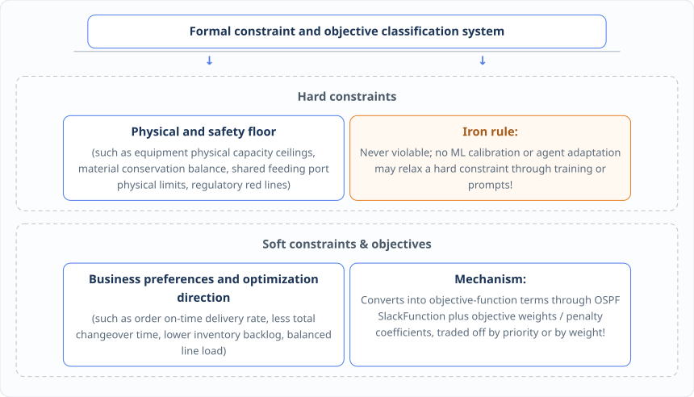

<!-- i18n-status: translated -->
<!-- i18n-source: docs/zh/chapter-08.md -->
# Chapter 8: Business as Building Blocks — Structured Functions, Logic Operators, Solver Decoupling

Once the single-source evaluation of an individual arithmetic expression is solved, the moment we actually set out to describe a complex industrial site with a formal domain model — scheduling, load allocation and inventory transfer in DOP, say — we run straight into the second roadblock: **real-world business rules are full of nonlinear segments, absolute-value deviations, conditional branches (`if-then-else`) and multi-objective trade-offs, while the underlying operations research solvers (linear programming LP / mixed-integer linear programming MILP) recognize nothing but the extremely dull matrices of linear equalities and inequalities ($A x \le b$)**.

If business developers or an agent were left to write the low-level linearized inequalities directly, dragging in masses of auxiliary 0-1 variables and huge constants (Big-M), the code would not only be obscure and easy to get wrong; the moment the solver changed — from one that does not support some function to one that supports native indicator constraints or quadratic programming, for instance — the entire model would have to be torn down and rebuilt.

This chapter shows how `ospf` (`ospf-kotlin-core`) uses **canonicalization and algebraic classification**, **built-in structured function and logic-operator building blocks**, **a compiler-style solver-decoupling architecture (`LinearMetaModel` → `LinearMechanismModel` → `LinearSolver`)** and **an explicit error contract (`Ret`)** to let developers and agents build models from intuitive business semantics the way one stacks building blocks, while keeping the low-level mathematical transformation and solver adaptation entirely outside the domain layer.

---

## 8.1 Turning the nonlinear into the linear: canonicalization and algebraic classification of absolute values, slack variables, piecewise linear and step rules

In real production and logistics scheduling, many seemingly nonlinear business requirements can in fact be converted, mathematically and equivalently, into linear or quadratic programming models by introducing controlled intermediate variables and additional constraint fragments.

In the `ospf-kotlin` framework, developers do not have to derive these tedious auxiliary variables by hand. They express business intent directly with the **higher-order functional symbols (Functional Symbols)** built into the `fuookami.ospf.kotlin.core.frontend.expression.symbol.linear_function` (and `quadratic_function`) package, and the framework then performs **canonicalization, algebraic classification and structured constraint-fragment expansion** automatically during construction and compilation:

### 1. Canonicalization and automatic algebraic-degree classification (Canonicalization & Algebraic Classification)
When several monomials or subexpressions combine through addition, subtraction, multiplication and division into a new, complex expression, the `ospf` polynomial system (such as `LinearPolynomial` and `QuadraticPolynomial`) automatically performs **like-term collapsing**, converts it into canonical monomial and canonical polynomial form, and distinguishes its algebraic degree precisely in both type and structure:
* Is it a **pure constant (Constant)**, a **first-degree linear polynomial (`LinearPolynomial`)**, a **second-degree quadratic polynomial (`QuadraticPolynomial`)**, or a **general nonlinear expression of still higher degree**?
* Before an expression is injected into a specific target meta-model (such as a `LinearMetaModel`, which demands first-degree linearity) or a specific solver plugin, a strict **target-degree and capability conversion check** must run.

### 2. OSPF's built-in continuous and piecewise business operator blocks
For the high-frequency scenarios of industrial scheduling and supply chain optimization, `ospf-kotlin` ships a rich set of built-in function symbols. When each symbol is registered into a `LinearMetaModel` and compiled into a `LinearMechanismModel`, it automatically generates the necessary intermediate auxiliary variables and linear constraint fragments while fully preserving the business name, unit and symbol identity:

| Function symbol category | `ospf-kotlin` built-in function symbol class used directly | Corresponding industrial and supply chain business scenario | What the `ospf` compiler does automatically underneath |
| :--- | :--- | :--- | :--- |
| **Deviation and elastic slack** | • `AbsFunction` (absolute value)<br>• `SlackFunction` (slack function)<br>• `SlackRangeFunction` (range slack) | • Measuring the positive and negative absolute deviation between actual output and the target plan;<br>• Setting a measurable elastic buffer range for delivery time windows or safety stock. | Automatically introduces non-negative positive and negative deviation auxiliary variables and their binding constraints; after solving, the concrete slack and violation can be queried directly through the symbol object. |
| **Piecewise linear and step rules** | • `ULPFunction` (univariate piecewise linear)<br>• `BLPFunction` (bivariate piecewise linear)<br>• `InStepRangeFunction` (step interval) | • Energy optimization under peak-flat-valley tiered electricity pricing;<br>• Processing loss rates that vary nonlinearly with equipment load factor;<br>• Tiered freight rates and discount-rate calculation in a logistics TMS. | From the breakpoint coordinates, automatically introduces convex-combination weights or SOS2 / binary piecewise activation variables and generates an equivalent mixed-integer linear constraint fragment. |
| **Lot sizing, rounding and semi-continuity** | • `CeilingFunction` / `FloorFunction`<br>• `RoundingFunction` / `ModFunction`<br>• `SemiFunction` (semi-continuous flag) | • Converting shipment volumes to WMS minimum whole-pallet / whole-case packaging;<br>• Line feeding where "either the line does not start (0), or, once started, the feeding quantity must not fall below the minimum lot threshold `lb`". | Automatically introduces integer quotient / remainder variables or semi-continuous activation binary variables, ensuring the generated plan naturally respects shop-floor physical packaging and minimum-lot rules. |

---

## 8.2 Putting business branches into the mathematical model: Boolean logic, conditional branches, one-of constraints and multi-objective soft-constraint trade-offs

If piecewise rules and rounding solve the problem of "numeric shape", the thing that most torments algorithm engineers on an industrial site is the ubiquitous **conditional branching and combinatorial logic** — for example: "if line A produces allergen-bearing material X today and is immediately followed by ordinary material Y, a 90-minute deep cleaning operation must be inserted; otherwise a routine 30-minute changeover is enough."

To write this kind of deductive logic naturally into the domain model, `ospf-kotlin` provides a complete **system of logic and conditional function symbols** together with a **governance mechanism for multi-objective soft constraints**:

### 1. OSPF's built-in Boolean logic and conditional branch operators
* **Binarization and logic-algebra operators**: `BinFunction` (binarization), `BTerFunction` (balanced ternarization), plus `AndFunction` (logical AND), `OrFunction` (logical OR), `NotFunction` (logical NOT) and `XorFunction` (logical XOR), so that several Boolean state conditions can be combined as freely as ordinary business code.
* **Implication and conditional branch operators**: `ImplyFunction` (logical implication), `InequalityFunction` (inequality indicator function), `IfFunction` (conditional IF), `IfInFunction` (conditional interval) and `IfThenFunction` (conditional If-Then). The developer only declares the business causality; the framework compiles it automatically into indicator constraints or linearized constraint fragments under strict bound control.
* **Combinatorial selection and extremum statistics**: `OneOfFunction` (one-of constraint), `SameAsFunction` (same-state constraint), `FirstFunction` (first nonzero index), `MaskingFunction` (masking function) and `MinFunction` / `MaxFunction` (minimum / maximum), which express complex scheduling rules such as "only one of several candidate production lines may be chosen" or "orders of the same batch must be assigned to the same truck" with ease.

### 2. Structured constraint metadata and multi-objective / soft-constraint trade-offs
In real production scheduling, not every rule is a blunt "one-vote veto". If the customer's expected delivery date, the ideal inventory level, fewer changeovers and no employee overtime were all set as absolutely non-negotiable **hard constraints (Hard Constraints)**, then the first rush order or equipment delay of the kind described in Chapter 1 would make the solver return a cold "infeasible (Infeasible)".

The formal domain model therefore defines constraints and objectives as structured metadata, drawing a strict line between **hard constraints** and **soft constraints (Soft Constraints) / multi-objective trade-offs**:



---

## 8.3 The compiler-style lowering architecture: how does the domain model shed every binding to a specific commercial or open-source solver API?

Once the domain layer and the algorithm layer have built a model from the general `ospf` symbols and structured constraints described above, how does it actually become low-level instructions that a concrete solver such as Gurobi, Cplex, SCIP, Cbc, MindOpt or Hexaly can execute?

This is where the most central engineering design of `ospf-kotlin` comes in — **a compiler-style lowering architecture (`LinearMetaModel` → `LinearMechanismModel` → `LinearSolver`) that decouples the model completely from the solver**.


This compiler-style layered architecture brings enterprise software three decisive engineering advantages:

1. **The domain model and algorithm logic shed solver lock-in entirely (Vendor Lock-in)**: every line written in the domain layer and the algorithm layer depends only on the solver-agnostic `ospf` frontend abstraction (`LinearMetaModel`). When an enterprise needs to switch from a commercial solver to an open-source one, or to a different solver plugin for a particular subproblem, **not a single line of the core business semantics and domain rules changes** — a different `LinearSolver` plugin instance is simply injected in the application-layer orchestration.
2. **Solver paths and degradation strategies can be split flexibly by scenario**: the application layer can orchestrate solvers freely according to the current business scenario — dispatching a lightweight solver for the frequent daily local propagation of the digital twin or the rapid multi-candidate comparison of an agent, to get second-level feedback; and dispatching a heavy MILP or a column generation / Benders decomposition pipeline for deep optimization in the nightly global master production schedule.
3. **A stable extension mechanism with no side effects**: every extension point stays stable and free of runtime business side effects, which both prevents special-case business rules from polluting the general mathematical foundation library in reverse and firmly blocks the native API of the underlying solver from seeping back into the domain layer.

---

## 8.4 The explicit error contract (`Result` / `Ret`) and capability checks: never silently truncate higher-order terms, and how to fail or degrade gracefully when the solver cannot keep up

In a traditional operations research script or LLM code generation, the most frightening outcome is not a program that errors out and exits, but **"running on while sick, caused by silent fault tolerance"**. When a business rule or dynamic constraint produces a quadratic product term (`QuadraticPolynomial`, maximum degree `degree = 2`) while the current pipeline uses a first-degree linear meta-model (`LinearMetaModel`) or a solver that only supports linear programming, some crude wrapper libraries silently drop the second-degree higher-order term; likewise, when a symbol is missing or units are incompatible, throwing an uncaught exception directly brings the entire scheduling service down.

This architecture therefore enforces an **explicit error contract (`Ret<T>`)** and a **strict mechanism of target-degree and solver-capability checks**:

1. **Fallible operations all return `ospf`'s `Ret<T>` (`Ok` / `Failed`)**: every unit conversion, expression evaluation, higher-degree conversion, constraint registration, model compilation (`LinearMechanismModel(metaModel)`) and solve execution (`solver(mechanismModel)`) passes a success value or a structured `Err` explicitly through `Ret<T>`, so an uncaught exception can never leak into the domain layer.
2. **Never silently truncate higher-order terms (Target Degree Check)**: before a general polynomial (such as a `QuadraticPolynomial` that may contain quadratic terms) is converted into a first-degree linear polynomial (`LinearPolynomial`) and injected into a linear model, it must be checked for second- or higher-degree terms; **the moment the degree exceeds the capability of the target modeler or solver, an explicit structured `Failed(Err(ErrorCode.ApplicationError, ...))` error must be returned at once. Silently truncating higher-order terms, or disguising a nonlinear rule as a linear expression, is absolutely forbidden**!

### Engineering implementation: complete modeling and solving code built on OSPF function operators, the degree guard, `LinearMetaModel` and `LinearSolver`
Below is the complete industrial-grade scheduling modeling and solving pipeline that ties together every `ospf-kotlin` native feature from Chapters 5 to 8:

```kotlin
package org.adaptive.dop.algorithm.scheduling

import fuookami.ospf.kotlin.utils.math.*
import fuookami.ospf.kotlin.utils.physics.unit.*
import fuookami.ospf.kotlin.utils.physics.quantity.*
import fuookami.ospf.kotlin.utils.error.*
import fuookami.ospf.kotlin.utils.functional.*
import fuookami.ospf.kotlin.core.frontend.variable.*
import fuookami.ospf.kotlin.core.frontend.expression.monomial.*
import fuookami.ospf.kotlin.core.frontend.expression.polynomial.*
import fuookami.ospf.kotlin.core.frontend.expression.symbol.*
import fuookami.ospf.kotlin.core.frontend.expression.symbol.linear_function.*
import fuookami.ospf.kotlin.core.frontend.inequality.*
import fuookami.ospf.kotlin.core.frontend.model.mechanism.*
import fuookami.ospf.kotlin.core.backend.solver.*
import fuookami.ospf.kotlin.core.backend.solver.output.*
import org.adaptive.dop.domain.core.*
import org.adaptive.dop.domain.role.*
import org.adaptive.dop.infrastructure.ospf.OspfBoundaryAdapter

/**
 * 1. Safe guard for target-degree conversion (Target Degree Check Guard):
 * when a QuadraticPolynomial that may contain quadratic terms is lowered into a LinearPolynomial,
 * if any quadratic product term exists (monomial.variable2 != null), return an explicit error at once; never silently truncate higher-order terms!
 */
object OspfDegreeCheckGuard {
    fun requireLinearPolynomial(
        quadPoly: QuadraticPolynomial,
        targetBackendName: String
    ): Ret<LinearPolynomial> {
        val nonlinearTerms = quadPoly.monomials.filter { it.variable2 != null }
        if (nonlinearTerms.isNotEmpty()) {
            val termDesc = nonlinearTerms.joinToString(", ") { "${it.coefficient}*${it.variable1.name}*${it.variable2?.name}" }
            return Failed(
                Err(
                    ErrorCode.ApplicationError,
                    "Algebraic degree out of range [ERR_DEGREE_EXCEEDED]: target backend [$targetBackendName] only supports first-degree linear expressions, " +
                    "but the expression contains second-degree quadratic terms [$termDesc]. Never silently truncate higher-order terms; enable one of the declared approximate linearization operators (such as ULP/BLP) explicitly!"
                )
            )
        }
        val linearPoly = MutableLinearPolynomial()
        for (m in quadPoly.monomials) {
            linearPoly += m.coefficient * m.variable1
        }
        linearPoly += quadPoly.constant
        return Ok(LinearPolynomial(linearPoly))
    }
}

/**
 * 2. Scheduling modeling pipeline built on the OSPF LinearMetaModel:
 * uses OSPF native units (Kilogram / Ton), FeedingSharedCore dual-entry symbols, SemiFunction and SlackFunction directly
 */
data class BuiltScheduleMetaModel(
    val metaModel: LinearMetaModel,
    val plannedFeedingSymA: Quantity<LinearExpressionSymbol>,
    val plannedFeedingSymB: Quantity<LinearExpressionSymbol>,
    val shortageSlackSym: SlackFunction
)

class SharedFeedingScheduleModelPipeline {

    fun buildScheduleMetaModel(
        specLineA: FeedingRuleSpec,
        specLineB: FeedingRuleSpec,
        actualFeedingInWindow: RoleScopedQuantity<ActualFactRole, Flt64>, // actual feeding facts already incurred today (e.g., 450 kg)
        sharedFeedingLimit: Quantity<Flt64>, // shared feeding port limit for the day (e.g., 1000 kg or 1.0 t)
        minLotSize: Quantity<Flt64> // line minimum lot size threshold (e.g., 100 kg)
    ): Ret<BuiltScheduleMetaModel> {
        // 1) create the OSPF linear meta-model container (LinearMetaModel)
        val metaModel = LinearMetaModel("DOP_APS_SharedFeeding_Schedule")

        // 2) define the planned-output decision variables (URealVar) of the tasks to solve and register them with metaModel
        val outputVarTask2A = URealVar("output_T2_lineA")
        val outputVarTask3B = URealVar("output_T3_lineB")
        metaModel.add(outputVarTask2A)
        metaModel.add(outputVarTask3B)

        // 3) call the [OR symbolic entry point] of the shared business core from Chapter 7 to produce a named intermediate symbol Quantity<LinearExpressionSymbol>
        val plannedFeedingSymA = when (val r = FeedingSharedCore.buildSymbolicFeedingIntermediate(specLineA, outputVarTask2A)) {
            is Ok -> r.value
            is Failed -> return r
        }
        val plannedFeedingSymB = when (val r = FeedingSharedCore.buildSymbolicFeedingIntermediate(specLineB, outputVarTask3B)) {
            is Ok -> r.value
            is Failed -> return r
        }
        // register the named intermediate symbols into the OSPF LinearMetaModel so their values can be queried transparently by name after solving!
        metaModel.add(plannedFeedingSymA.value)
        metaModel.add(plannedFeedingSymB.value)

        // 4) use OSPF's built-in SemiFunction (semi-continuous function symbol) directly to express the "minimum lot size constraint"
        val alignedMinLotB = when (val r = OspfBoundaryAdapter.convertQuantitySafely(minLotSize, plannedFeedingSymB.unit)) {
            is Ok -> r.value.value
            is Failed -> return r
        }
        val semiFeedingB = SemiFunction(
            x = LinearPolynomial(plannedFeedingSymB.value),
            lb = alignedMinLotB,
            name = "semi_minLot_lineB_T3"
        )
        metaModel.add(semiFeedingB)

        // 5) build the core dynamic hard constraint that runs through the use case:
        // actualFeedingInWindow + plannedFeedingRemaining[A] + plannedFeedingRemaining[B] <= feedingLimit
        // align every mass term with the OSPF native unit Kilogram
        val actualKg = when (val r = OspfBoundaryAdapter.convertQuantitySafely(actualFeedingInWindow.quantity, Kilogram)) {
            is Ok -> r.value.value
            is Failed -> return r
        }
        val limitKg = when (val r = OspfBoundaryAdapter.convertQuantitySafely(sharedFeedingLimit, Kilogram)) {
            is Ok -> r.value.value
            is Failed -> return r
        }

        val totalFeedingInWindowPoly: LinearPolynomial =
            actualKg + plannedFeedingSymA.value + plannedFeedingSymB.value

        when (
            val addConstraintRes = metaModel.addConstraint(
                constraint = totalFeedingInWindowPoly leq limitKg,
                name = "c_shared_feeding_limit_lineAB_day1",
                displayName = "hard constraint on the shared feeding port capacity limit of lines A and B for the day (${Kilogram.symbol})"
            )
        ) {
            is Ok -> {}
            is Failed -> return Failed(addConstraintRes.error)
        }

        // 6) use OSPF's built-in SlackFunction directly to express the "soft constraint of meeting the target output and the shortage penalty"
        val targetTotalFeedingKg = Flt64(650.0)
        val feedingShortageSlack = SlackFunction.neg(
            x = plannedFeedingSymA.value + plannedFeedingSymB.value,
            y = LinearPolynomial(targetTotalFeedingKg),
            name = "slack_feeding_target_shortage"
        )
        metaModel.add(feedingShortageSlack)

        // 7) register the minimizing penalty objective function
        val penaltyWeight = Flt64(100.0)
        metaModel.minimize(
            expr = penaltyWeight * feedingShortageSlack,
            name = "obj_minimize_target_shortage"
        )

        return Ok(
            BuiltScheduleMetaModel(
                metaModel = metaModel,
                plannedFeedingSymA = plannedFeedingSymA,
                plannedFeedingSymB = plannedFeedingSymB,
                shortageSlackSym = feedingShortageSlack
            )
        )
    }
}

/**
 * 3. Solve and intermediate-value resolution service built on the OSPF LinearMechanismModel and the LinearSolver interface:
 * fully decouples the concrete solver implementation, and backfills and extracts named intermediate values Quantity<Flt64> automatically after solving!
 */
data class SolvedScheduleDomainResult(
    val solverName: String,
    val status: SolverStatus,
    val objectiveValue: Flt64,
    val plannedFeedingLineA: Quantity<Flt64>,
    val plannedFeedingLineB: Quantity<Flt64>,
    val targetShortageSlackKg: Quantity<Flt64>
)

class OspfScheduleSolveService(
    private val solver: LinearSolver // inject any OSPF solver plugin (such as ScipLinearSolver / GurobiLinearSolver / CbcLinearSolver)
) {
    suspend fun compileAndSolve(built: BuiltScheduleMetaModel): Ret<SolvedScheduleDomainResult> {
        val metaModel = built.metaModel

        // 1) call the OSPF LinearMechanismModel lowering compiler: it expands SemiFunction and SlackFunction automatically
        val mechanismModel = when (val compileRes = LinearMechanismModel(metaModel)) {
            is Ok -> compileRes.value
            is Failed -> return Failed(compileRes.error)
        }

        // 2) call the OSPF LinearSolver plugin to execute the solve
        val solverOutput: FeasibleSolverOutput = when (val solveRes = solver(mechanismModel)) {
            is Ok -> solveRes.value
            is Failed -> return Failed(solveRes.error)
        }

        // 3) write the solution vector returned by the solver back into metaModel.tokens
        metaModel.tokens.setSolution(solverOutput.solution)

        // 4) evaluate through the named intermediate symbols to obtain transparent business intermediate values carrying OSPF native units!
        val feedingValA = built.plannedFeedingSymA.value.polynomial.evaluate(
            results = solverOutput.solution,
            tokenList = metaModel.tokens
        ) ?: return Failed(Err(ErrorCode.ApplicationError, "cannot resolve the solution value of intermediate symbol [${built.plannedFeedingSymA.value.name}]"))

        val feedingValB = built.plannedFeedingSymB.value.polynomial.evaluate(
            results = solverOutput.solution,
            tokenList = metaModel.tokens
        ) ?: return Failed(Err(ErrorCode.ApplicationError, "cannot resolve the solution value of intermediate symbol [${built.plannedFeedingSymB.value.name}]"))

        val slackVal = built.shortageSlackSym.polynomial.evaluate(
            results = solverOutput.solution,
            tokenList = metaModel.tokens
        ) ?: Flt64.zero

        return Ok(
            SolvedScheduleDomainResult(
                solverName = solver.name,
                status = solverOutput.status,
                objectiveValue = solverOutput.obj,
                plannedFeedingLineA = Quantity(feedingValA, built.plannedFeedingSymA.unit),
                plannedFeedingLineB = Quantity(feedingValB, built.plannedFeedingSymB.unit),
                targetShortageSlackKg = Quantity(slackVal, Kilogram)
            )
        )
    }
}
```
