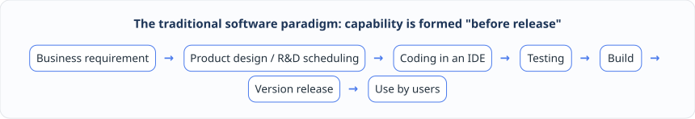

# Chapter 2: From Records to Intent — How Much Cognitive Responsibility Has Software Taken Over?

In the production-scheduling storm of Chapter 1 we saw how badly traditional industrial software copes with change on the floor: business concepts speak different languages in different systems and algorithms, and even a tiny adjustment of a temporary rule has to be scheduled into a long R\&D cycle. To see the historical causes of that predicament and to find a real way out, we have to step outside the argument about individual technologies and ask, from the standpoint of the broad history of software evolution, one fundamental question: **over the past few decades, what exactly has changed in what software does on humanity's behalf?**

***

## 2.1 The four stages of software evolution: informatization (recording), automation (acting by rules), pre-LLM intelligence (specific judgments) and LLM intelligence (understanding goals)

If we stretch out the history of enterprise software, it passes in turn through four stages: **informatization**, **automation**, **algorithmic intelligence before large language models** and **intelligence in the age of large language models**.

The essential difference between these four stages lies not in whether the substrate is a relational database, a workflow engine, deep learning or a large language model, but in **how much "cognitive and execution responsibility" the software system takes off humanity's hands**.

### Stage one: informatization — recording things into the system

At the informatization stage the core job of software is to serve as the enterprise's "electronic ledger". Orders, equipment, inventory, BOM and production schedules are entered into the system and turned into structured business data. The main capabilities the system offers are recording, querying and cross-department sharing; the typical outputs are ledgers of every kind, business documents and statistical reports. At this stage almost all business cognition, logical judgment and operational execution remain with people, whose role is to "operate the system" directly.

### Stage two: automation — making the system act by rules

As the business grew, people were no longer satisfied with clicking buttons by hand to move documents along, and software entered the automation stage. Engineers wrote explicit business rules, approval routings and state triggers into code or configuration tables, so that the system would automatically route, trigger, compute and execute according to the predefined logic, emitting standardized process actions or scheduling tasks. The system now takes over "the responsibility for repeated execution under deterministic rules", but the rules themselves must be exhaustively enumerated and clearly defined in advance by people, whose role moves up to "designing rules".

### Stage three: intelligence before the LLM era (algorithmic intelligence) — making models render specific judgments

When an enterprise faces fluctuation in equipment capacity, prediction of processing time, forecasting of material demand or complex scheduling optimization, many regularities cannot be exhausted by hand-coded rules, and software moves into the stage of algorithmic intelligence before large language models. Taking business data plus a specific mathematical or machine-learning model as input, the system takes on recognition, prediction, recommendation and operations-research optimization, and outputs classification results, risk scores or optimized plan options.

At this stage the system begins to share part of "the cognitive responsibility for pattern recognition and local optimization", but the mathematical boundary of the problem, the definition of features and the structure of constraints must still be fully specified in advance by algorithm engineers during development or training; the human role is to "define the problem".

### Stage four: intelligence in the LLM era — understanding goals and completing tasks

The arrival of large language models and agents opens the fourth stage. What the system receives is no longer only rigid form fields or algorithm parameters in a fixed format, but the human's **natural-language intent + runtime context + available tool set**. The system begins to understand vague expressions, reason with context, plan steps on its own, generate structured plans and call existing systems and algorithmic tools, ultimately outputting task results or checkable candidate capabilities. Correspondingly the human role evolves further into **"expressing business goals + reviewing safety boundaries"**.

To present these four leaps intuitively, we can compare them across four dimensions — core input, system capability, typical output and the role of people:

| Stage of evolution       | Core input                        | Capability the system takes on                             | Typical output                                 | Core role of people                     |
| ------------------------ | --------------------------------- | ---------------------------------------------------------- | ---------------------------------------------- | --------------------------------------- |
| **Informatization**      | Structured business data          | Recording, querying, sharing                               | Ledgers / documents / reports                  | Operating the system                    |
| **Automation**           | Rules, processes, triggers        | Automatic routing and execution by predefined logic        | Process actions / scheduling tasks             | Designing rules                         |
| **Pre-LLM intelligence** | Historical data + specific models | Recognition, prediction, recommendation, optimization      | Classification / scores / plan options         | Defining problem boundaries             |
| **LLM-era intelligence** | Intent + context + tools          | Understanding, reasoning, planning, generation, tool calls | Task results / candidate software capabilities | Expressing goals + reviewing boundaries |

***

## 2.2 The real historical break: where software capability is formed extends from "before release" into "while in use"

Looking at those four stages, why was the evolution of the first three mainly incremental improvement, while the arrival of the fourth convulses software-engineering paradigms? Because here a real historical break appears: **the place where software capability is formed has migrated fundamentally**.

In informatization, automation and even the algorithmic intelligence of the pre-LLM era, however much cleverer the systems became, the basic chain of "how software capability is manufactured" never changed:

In that traditional chain — whether one hard-codes a database validation rule, configures an automated approval flow, trains a capacity-forecasting model or writes a mixed-integer linear programming (MILP) scheduling script — **the formation of software capability happens mainly "before release", in the development or training period**. Once the software is released into production, its capability boundary is frozen; on the live floor users can only use the functions the R\&D team imagined in advance.

In the era of large language models, however, part of "semantic production" and "capability shaping" crosses for the first time from the development period onto the runtime site where users actually work:

As the figure shows, when a user on the production floor raises a long-tail request for which the system has no ready button — say, "today lines A and B share a feeding port, and total feeding must not exceed 1000 kg" — the system no longer fails outright or sends you off to raise an R\&D ticket. The large language model first understands the intent on the live runtime, assembles the context and generates a structured candidate plan, which after safety verification completes that instance of the work. Immediately afterwards the runtime keeps watching whether requests of this kind recur in later production cycles; as soon as it finds a pattern that is frequent, stable and clearly beneficial, the system extracts its semantic structure, compiles and verifies it into a low-cost, reusable specialized deterministic capability, and later requests of the same kind go straight down the specialized, efficient path.

In short, the traditional paradigm is **"develop first, then use"**; the new paradigm opens a second channel on top of it: **"first discover and verify a requirement while in use, then sediment the proven practice into the product"**.

***

## 2.3 The dead end of project-based delivery: why can "raise a requirement — write the code — test the interface — ship a release" never catch up with long-tail change?

Once we grasp that historical break — the migration of where capability is formed — it becomes easy to see why traditional industrial software (especially a digital operations platform spanning ERP, APS, MES, WMS and TMS) is always mired in "project-based delivery".

Manufacturing and supply-chain operations are by nature a world full of long-tail variation and dynamic disturbance:

* **Temporary floor anomalies**: a key machine suddenly slows down, two production lines share a feeding port for the day, a batch of in-transit material is delayed by traffic controls, a VIP customer order is inserted ahead of schedule;
* **Rules specific to a customer or a plant**: across industries, across plants and even across production stages within one plant, there are numerous fine differences in scheduling precedence, alternative-material allocation policy, the criteria for material availability (kitting) checks, vehicle loading limits and approval routing.

Under the traditional architecture, where "all capability is defined before release", a software vendor facing these wildly differing floor requirements has only two roads, and both end in a dead end:

1. **The first road: try to enumerate every configuration switch in the standard product in advance.** Product managers try to design a super configuration table with hundreds or thousands of parameter switches; the result is a configuration UI so complex that nobody understands it, and the moment the 1001st on-site combination appears (a dynamic feeding constraint across lines and time windows, for instance), the pre-wired switches still cannot express it.
2. **The second road: degenerate into "one project branch with custom code per customer".** After the floor raises a problem, the full cycle must run its course: "implementation consultant understands → product manager confirms → R\&D writes the interface and branch code → algorithm engineer changes the model → joint debugging and testing → release into production".

Cramming every long-tail floor variation into the R\&D process carries three unbearable costs:

* **Response speed is badly mismatched with business timeliness**: a temporary equipment anomaly or a rush-order adjustment on the floor often demands a feasible plan within minutes to hours, while one pass through code changes and an algorithm release takes days or even weeks;
* **Project customization cost grows linearly, even exponentially, with the number of customers**: for every new customer delivered, the code repository gains another pile of non-reusable hard-coded special cases and dedicated interfaces, and the R\&D team is gradually dragged down by maintaining a sea of project branches;
* **Even with a bolted-on Q\&A large language model, the way capability is formed does not change**: if a large language model is used only as a chat plug-in that helps write requirement documents or answers questions about an operations manual, then new rules still require someone to change code and ship a release by hand, and the cost structure of software delivery has not changed in any substantive way.

To break that dead end there is only one way out: offload the "exploration and preliminary verification" of long-tail requirements from the expensive human R\&D period onto the low-cost software runtime — let general intelligence catch the change on the floor first, and only when runtime evidence proves that a change genuinely deserves to be kept for the long term, solidify it into a system capability under control.

***

## 2.4 Redefining the relationship between people and software: users once only used programs; in the future, while using a program they keep shaping it

When the formation of software capability extends from "before release" into "while in use", the relationship between people and software is redefined in a profound way:

> **In the past, users only used a program that had already been written; in the future, while using a program, users also keep "compiling" and shaping it — through everyday business interaction they keep telling the software "how this enterprise should actually work".**

One clarification matters: "users taking part in programming at runtime" or "continuously compiling the program" **by no means asks a shop-floor manager, a planner or a logistics dispatcher to hand-write Java, Kotlin or Python code in a chat window**. Business people need no knowledge of any programming language or mathematical modeling syntax at all.

Under the new paradigm, the complete loop of human-machine collaboration consists of five steps:

1. **Users express intent naturally, in business language**: business people simply state business goals, temporary rules, exceptions or decision preferences in natural language or through everyday operations, just as they would in ordinary conversation (for example: "today lines A and B share a feeding port, total feeding must not exceed 1000 kg, T1 is already late, help me see how to adjust");
2. **The system turns the vague expression into a checkable structured plan**: acting as the semantic frontend, the large language model uses the current domain context to identify the production lines, tasks, resources, time ranges and capacity limits involved, and generates a structured candidate plan that machines can check rigorously (rather than changing the production database directly);
3. **Safe experimentation on historical data and in a digital-twin environment**: the system first tries the candidate plan in a projectable mirror of the production world (the digital twin), assesses its real impact on order delivery dates, material availability (kitting), changeover time and resource conflicts, and hands it to the optimization solver to confirm mathematical feasibility;
4. **Controlled execution after passing permission, rule and result checks**: only when fields, physical units, operation permissions, business invariants and simulation results have all passed deterministic screening (and, where necessary, human approval has been obtained) does the plan formally enter scheduling or the execution flow, with the actual runtime effect recorded throughout;
5. **Repeatedly effective experience gradually sediments into formal product capability**: for a transient situation that happens once, the system keeps it as a one-off candidate configuration; for a practice that recurs at the same customer site and whose runtime results prove it effective over the long term, the system no longer calls the large language model to reason from scratch every time, but upgrades it step by step into a customer-specific capability, a product-configurable capability, and eventually a standard platform core capability.

So the enterprise software of the future is no longer a concrete building topped out on delivery day; it is more like an organism endowed with "understanding, memory, projection and a mechanism for sedimenting itself". The large language model is responsible for understanding human intent and exploring unknown long-tail requirements at low cost; deterministic software engineering, the formal domain model and operations-research optimization are responsible for holding the safety line and solidifying the insight discovered into highly reliable product assets.

In this new paradigm of "growing while in use", then, how exactly do traditional software code (Software 1.0), machine-learning models (Software 2.0) and large-language-model-driven intent computing (Software 3.0) relate to one another? And how do they work together with underlying computing paradigms such as deterministic computation and operations-research optimization? In the next chapter we introduce two orthogonal axes of evolution and reveal the answer.
