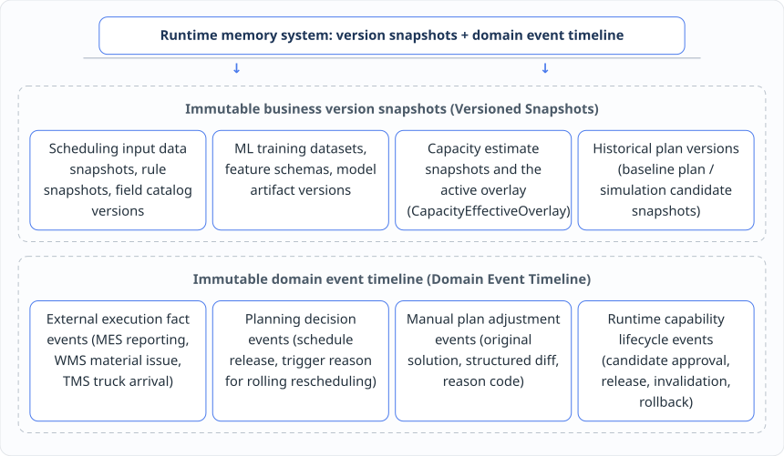

# Chapter 10: The Runtime World Model — Event Sourcing and the Computable Digital Twin

When comparing Software 2.0 and Software 3.0, we noted a difference that is very easy to overlook: **Software 2.0 usually only needs to learn statistical regularities offline from static historical datasets, whereas the agents and runtime of Software 3.0 must deeply understand "the business world that is running right now" at every real-time decision.**

A genuinely "living" runtime business world can never be a single flat cross-section of the current database. It must connect three time dimensions at once — **past, present and future**:


This chapter explains in detail how to build the system's "memory system" with **event sourcing** and its "safe proving ground" with the **computable digital twin**, so that the semantic reasoning of Software 3.0 stays firmly anchored in the real industrial physical world.

***

## 10.1 Why can a system with only the "current state" neither support retrospective accountability, nor sustain machine learning and capability accumulation?

In traditional anemic CRUD systems, database design follows the "state overwrite pattern" by default: when an order quantity changes, a work order slips, or a schedule is recomputed, a single `UPDATE` statement overwrites the original record, and the system only ever keeps the "current state (`What is?`)" of the last moment.

This "present only, no past" architecture causes three fatal disabilities in daily operations and in the journey toward intelligence:

### 1. Facing plan anomalies and changes, the system cannot answer "why did it turn out this way"

When the shop-floor board shows "task `T2` on line A is 45 minutes behind the baseline plan", or "this afternoon's scheduling sequence is completely different from what was released on the morning shift", what the business and management really care about is never just that result number, but the causal chain behind it:

* Did the predecessor task `T1` actually report late, or did WMS delay material kitting?
* Did a sudden equipment failure trigger a dynamic constraint, or did a planner drag a work order by hand at 09:40 and overwrite the optimization solution?
* Which version of the BOM rules and which version of the capacity forecast snapshot did the system use for scheduling at that moment?

If the system keeps no stable domain events, decision basis and version timeline, every planning fluctuation turns into a Rashomon of "no evidence, no case".

### 2. Machine learning training falls into "time travel (data leakage)" and sample distortion

When building ML-Native capabilities — say, estimating effective equipment capacity, predicting actual operation duration, or calibrating optimization objective weights — training samples must faithfully restore **"the real world as it looked at the moment the decision was made"**. If the system normally stores only the repeatedly overwritten, latest master data and the final manual plan, and keeps no precise event time of the historical observation, no point at which labels matured, no original optimization solution of that moment and no structured reason codes for planner adjustments, then the trained model will either suffer severe data leakage by mixing in future information, or wrongly learn a planner's temporary compromise for patching dirty data as an "optimal business preference" into its weights.

### 3. Runtime capability accumulation loses the support of an evidence chain

Under the `LLM as Runtime` architecture, the reason the system dares to promote a dynamic rule or query pattern to a formal capability is not a product manager's guess, but **real operating evidence** accumulated across cycles. If the system records neither past user requirement expressions, candidate generation, simulation comparisons and human approval conclusions, nor the business effect after actual execution (KPI improvement or regression), the adaptive runtime becomes "a blind man without memory", quite unable to judge which patterns recur and which solutions actually work.

***

## 10.2 Event sourcing and version snapshots: an immutable timeline that preserves facts, decisions, reasons for manual adjustment and rule versions

To fill the "memory gap", we introduce **event sourcing and a versioned historical audit mechanism** into the architecture as the "memory system" of the semantic runtime.

It must be stressed that, in engineering practice, we stay pragmatic and restrained: **unified historical memory by no means requires every ordinary configuration table or business object in the system to adopt full pure event sourcing**. What we adopt is a dual-track combination of **"immutable business version snapshots + a timeline of key domain events"**:



This memory mechanism rigorously guarantees the following four core capabilities:

1. **Exact state reconstruction at any historical point (time-travel reconstruction)**: scheduling, MRP, simulation trials and digital-twin retrospectives must all explicitly bind and freeze the input snapshot, rule snapshot, data version, forecast snapshot and plan version used in that round of computation. When reviewing a historical problem or replaying a model, the system can precisely restore the domain state of that moment; **it is absolutely forbidden to read the current latest master data or the current model version by default when explaining a historical scheduling result**.
2. **Structured recording of the full context of a "manual plan adjustment"**: when a planner modifies on the workbench the original solution produced by optimization, the system must never overwrite that solution; it must freeze and record at the same time: **the domain inputs and model parameter versions of that moment → the original optimization solution → the manually adjusted solution → the structured diff between the two → the structured reason code the planner selected (correcting a master data error, adding an unmodeled hard constraint, handling a one-off customer exception, or expressing a long-term scheduling preference) → the approval chain → the subsequent real execution result**.
3. **Carrying external execution facts with point-in-time semantics**: when execution feedback from MES, WMS and TMS enters the platform, the system records it as an immutable event together with its business event time, arrival time of synchronization, source system version and data-quality semantics, providing tamper-proof raw observations for digital-twin projection and machine learning feature construction.
4. **Tracking the provenance of dynamic capability end to end**: every dynamic constraint, forecast overlay or dedicated query plan generated by an agent or the runtime records through its event chain the origin of the original intent, content hash, verification evidence, approver, effective interval, and invalidation and rollback record.

***

## 10.3 Beyond the "static display dashboard": dynamic digital-twin projection based on the three-layer model of planned, estimated and actual time

If event sourcing resolves "what happened in the past (`What happened?`)" and the current domain state presents "what is (`What is?`)", then the **production planning digital twin** is responsible for answering the most critical question about the future: **"if we do this, what happens next (`What if?`)"**.

In many traditional digitalization projects, "digital twin" has degenerated into an expensive 3D visualization wall — merely displaying the current green running light or red fault light of shop-floor equipment statically on a screen. But in this book's architecture, **the digital twin is by no means a mere display dashboard; it maps orders, inventory, capacity, equipment, processes, BOM, people, energy, constraints and planned tasks into a computable, simulable, replayable mirror of the production system**.

The core business value of the digital twin lies in **continuously and dynamically updating the projection of future estimated states from actual execution data on the floor**. To achieve this, a work order and its operation tasks must never carry just one pair of start and end times in the domain model; they must establish a rigorous **three-layer time model of "planned, estimated and actual"**:

| Time model layer                                                                    | Domain semantic definition                                                                                              | Generation and update mechanism                                                                                                               | Role in the digital twin and the scheduling loop                                                                                                     |
| ----------------------------------------------------------------------------------- | ----------------------------------------------------------------------------------------------------------------------- | --------------------------------------------------------------------------------------------------------------------------------------------- | ---------------------------------------------------------------------------------------------------------------------------------------------------- |
| <p><strong>1. Planned start/end time</strong><br>(Planned Time)</p>                 | Baseline plan time generated when a scheduling solution is formally confirmed and released                              | Frozen as a baseline snapshot at every scheduling release, and never silently altered afterward by floor reporting.                           | Serves as the golden baseline reference for measuring on-time delivery and floor execution deviation.                                                |
| <p><strong>2. Estimated start/end time</strong><br>(Estimated / Projected Time)</p> | The latest forecast of the future dynamically derived from the current latest execution progress and effective capacity | Recomputed by forward propagation in the domain computation model whenever a preceding task produces actual time or a resource state changes. | Avoids explaining floor status with an already expired original plan, and exposes upcoming delivery delays and resource conflict risks in real time. |
| <p><strong>3. Actual start/end time</strong><br>(Actual Time)</p>                   | The real physical execution time fed back by MES or the shop floor                                                      | Written by floor reporting and IoT fact entry points; an immutable physical execution fact.                                                   | Anchors the "true current progress starting point" of the digital twin and drives cascading updates of subsequent estimated states.                  |

Let us take the running example from Chapters 4 and 5 and a set of recomputable real time data (assuming display in the factory's local time zone while underlying persistence uniformly uses UTC `Instant`) to see how the three-layer time model works dynamically inside the digital twin:

* **Baseline plan setup**: line A carries predecessor task `T1` (planned to start at `08:00` and end at `09:30`) and successor task `T2` (planned to start at `10:00`, where `09:30` to `10:00` is 30 minutes of changeover time); line B carries task `T3` (planned to start at `11:00`, and under the initial assumption `T3` does not compete with `T1` for the same critical resource in the same period).
* **A floor delay occurs**: at `10:00`, MES reports that `T1` actually started only at `08:10` and has just actually finished at `10:00` (30 minutes later than its planned end).

At this point the digital twin does not wait for the nightly batch reschedule. It immediately takes `T1`'s actual end time (`10:00`) plus the changeover time from `T1` to `T2` (30 minutes) and automatically projects `T2`'s estimated start time to `10:30`:

| Work order task | Production line | Planned start | Planned end       | Actual start | Actual end | Estimated start (after dynamic digital-twin recomputation)                                                                                                |
| --------------- | --------------- | ------------- | ----------------- | ------------ | ---------- | --------------------------------------------------------------------------------------------------------------------------------------------------------- |
| **Task T1**     | Line A          | `08:00`       | `09:30`           | `08:10`      | `10:00`    | `08:00` (completed; taken over by actual time)                                                                                                            |
| **Task T2**     | Line A          | `10:00`       | (set by duration) | `-`          | `-`        | **`10:30`** (automatically shifted by T1's actual delay and the 30-minute changeover)                                                                     |
| **Task T3**     | Line B          | `11:00`       | (set by duration) | `-`          | `-`        | **`11:00`** (unaffected under the no-shared-resource-conflict assumption; if the shared feeding port time windows overlap, it enters conflict validation) |

Pay particular attention to the rigorous boundary regarding task `T3` in the table: **judged only by line ownership, `T3` sits on line B and seems unaffected by the delay on line A; but once the dynamic constraint "lines A and B share a feeding port today and that port has a capacity limit" is superimposed, then when `T2` is pushed past `10:30`, its feeding time window may overlap with `T3`, which starts at `11:00`! At that point `T3` must also be pulled into the digital twin's resource conflict validation scope; it is never acceptable to hastily conclude that it is unaffected merely because it sits on a different line**.

***

## 10.4 Domain accumulation of changeover time, production duration and calendar availability: how to achieve "predecessor delayed → successor estimated state updated in seconds"

Looking closely at the dynamic update of `T2`'s estimated time above, the general mathematical projection behind it is as follows:

```
Estimated start time of the successor task
= Actual end time of the predecessor task
+ Changeover time from predecessor to successor (Changeover Time)
+ Calendar availability adjustment (Calendar Availability Adjustment)

Estimated end time of the successor task
= Estimated start time of the successor task
+ Production duration of the successor task (Production Duration)
+ Shift / break / planned downtime adjustment
```

Here, changeover time and production duration are by no means fixed dead constants; they are domain computation functions that depend on multidimensional business attributes and the approved effective capacity overlay (`CapacityEffectiveOverlay`):

```
Changeover time = f(previous material attributes, next material attributes, equipment characteristics, process changeover matrix rules)
Production duration = f(planned production quantity, frozen effective equipment capacity, process takt, shift calendar)
```

This set of formulas reveals a profoundly architectural forcing logic (what we detail in Chapter 11 as "point 12, the digital twin, reinforces points 1 and 8 in reverse"): **In past architectures, if changeover time calculation, production duration conversion and shift-calendar cross-break adjustment were written only inside the scheduling algorithm service, then when MES reports that `T1` is 30 minutes late, the business system itself cannot compute how late `T2` will be; it can only either keep displaying the already expired `10:00` planned time on the board and mislead the floor, or be forced to re-invoke the heavy full scheduling algorithm on every production report**!

In our architecture, by precipitating changeover time, production duration, calendar availability and expected material consumption entirely into **formal domain computation models carried by the dual `ospf` entry points**, the business system can, at the instant it receives `T1`'s actual completion event, call the domain layer's **deterministic numeric entry point** and independently complete the cascading recomputation of successor tasks' estimated times and the projection of resource occupancy in milliseconds!

Going further, this real-time evolving digital-twin mirror directly becomes **the authoritative context source for agent reasoning and rolling scheduling decisions**. When a planner asks about impact, the agent no longer guesses in a vacuum; it reads the digital-twin state and completes closed-loop collaboration along a rigorous engineering chain:

![Closed-loop collaboration between the agent and the digital twin: 1. actual floor feedback (MES reporting / WMS inventory sync) → 2. digital twin updates the estimated state (domain model recomputes the estimated time window) → 3. agent reasons about deviation impact (identifies affected tasks and new conflicts) → 4. generate candidates and compare by simulation (trial local delay vs. global rescheduling) → 5. local adjustment or rolling rescheduling (application layer validates by policy and executes).](../.gitbook/assets/chapter-10-3.svg)

Along this continuous chain, the digital twin simultaneously serves as **the intersection of the three natives**:

* **ML-Native** supplies the digital twin with effective capacity and duration predictions that carry provenance and uncertainty;
* **System-side domain computation model** drives estimated states to update within seconds as actual feedback arrives;
* **Agent-Native** combines the digital twin to judge whether a deviation exceeds the delivery window or triggers new conflicts such as a shared feeding port, and generates candidate adjustment plans;
* **OR-Native** performs lightweight solving and simulation comparison (`What-if`) on candidate plans inside the digital-twin sandbox, and the application layer finally decides by deterministic policy whether to update only local times or formally trigger a new round of rolling rescheduling.

In one sentence: **event sourcing provides experience (memory), the digital twin provides imagination (a proving ground); without memory, software cannot learn from history; without a proving ground, software cannot try safely before production**.
