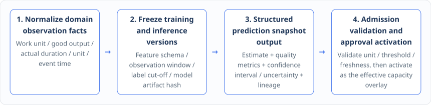

# Chapter 13: The Symphony of Three Natives — Three Bidirectional OR × ML Enhancements

In the digital transformation programs of many enterprises, the operations research team and the machine learning team work in separate silos: ML engineers train prediction models on an external data platform and emit an isolated predicted number through an API to the business system, while OR algorithm engineers take that number as a deterministic constant and stuff it straight into a linear programming model. Once the schedule underperforms on the floor, the two sides sink into endless recrimination — OR blames the inaccurate forecast, ML blames the brittle scheduling model.

Under the architecture of "the three natives unified in a formal domain model", the intersection of OR optimization and machine learning **is by no means letting a statistical model replace the OR solver, and by no means crudely rewriting rigorous hard business constraints as the reward function of a neural network. It is letting the "statistical / probabilistic interpretation" and the "symbolic / optimization interpretation" empower each other in both directions under a formal domain contract**.

***

## 13.1 ML-Native: freezing feature schemas and data versions, so that capacity and duration forecasts enter the approval flow carrying quality metrics, uncertainty and lineage

For machine learning and OR optimization to collaborate safely, the first step must turn the external black-box prediction into a first-class citizen the platform can govern — that is, to realize **ML-Native**.

"ML-Native" does not mean "the business system can call a model service over an HTTP API". It means that **the formal domain model uniformly defines stable features, labels, prediction targets, decision feedback, calibratable parameters, physical units, time semantics and result semantics, and makes the training dataset, the feature schema definition (Feature Schema), the model artifact (Model Artifact) and the inputs and outputs of online inference all immutably versioned, verifiable and replayable from history**.

Let us return to the running example that spans Chapters 4 and 5 — **the factory calendar (Calendar) and the effective capacity estimation for production lines A and B** — and look at how a prediction loop that meets the ML-Native standard operates:

1. **Domain normalization of production execution observations**: when MES reports execution records for completed tasks, the system first normalizes them into standard production observation facts under domain-layer rules, explicitly fixing the work unit (Work Unit), the good output quantity, the actual production duration, the target physical unit, the business event time (Event Time) and the historical observation window. A machine learning script is never allowed to guess or improvise business semantics on its own.
2. **Immutable freezing of inputs and model artifacts**: when training or online inference starts, the application layer forcibly freezes the feature schema definition (Schema), the observation-window range, the label maturity cut-off (which prevents future data from leaking into features and causing data leakage), the model artifact version, the runtime configuration and the content hash of the inputs used by this computation; the machine learning runtime may consume only frozen, deterministic inputs.
3. **Structured output carrying uncertainty and lineage**: what model inference produces is **by no means the "true capacity fact"**. It is a structured capacity estimation result (such as `estimatedProductivity[A]`) that must fully carry the model version number, evaluation quality metrics, the confidence interval or probability distribution (uncertainty), the applicable business scope, provenance tracking information (Provenance) and structured error codes on failure.
4. **Application-layer admission validation, human approval and overlay activation**: the capacity estimation result is first stored as sample evidence in the form of an immutable snapshot; the application layer then performs strict physical unit checks, finite-value checks (rejecting `NaN` or infinity), data freshness checks, quality threshold checks and scope validation. Only after passing validation and receiving business approval and activation may the estimate formally become the **effective capacity overlay (`CapacityEffectiveOverlay`)**, frozen into the input snapshot of master production scheduling (MPS) and detailed scheduling; it may never bypass approval to pose as a manually configured value or as an actual capacity fact.

In engineering terms this mechanism evolves very smoothly. Early in platform construction, calendar capacity estimation can ship with deterministic statistical estimators such as the arithmetic mean (Arithmetic Mean) and the exponentially weighted moving average (EWMA), getting the governance loop of "observation normalization → sample evidence → immutable snapshot → approval and activation → frozen MPS input" working end to end. When deep learning or tree models are added later, swapping the model artifact inside the controlled runtime reuses that whole domain semantics and admission chain without change, and historical inferences always replay exactly against the model version frozen at the time, never falling back to the current latest model.

***

## 13.2 Enhancement one (ML assists OR): from point prediction to robust optimization, stochastic programming, chance constraints, CVaR and distributionally robust optimization (DRO)

Once ML-Native has secured trusted admission and uncertainty quantification for prediction results, the first collaboration mode with OR-Native — **ML-Assisted OR** — follows naturally.

In traditional scheduling, even when a prediction model is introduced, people usually take only a "single-point expected value" (for example, a forecast that production line A will run at `100 kg/h` tomorrow) and substitute it into a deterministic OR model. Yet the industrial floor is full of random fluctuation: equipment may micro-stop, raw material batches differ in processing difficulty, and WMS kitting and TMS transit times fluctuate as well. If capacity is filled to the single-point average, the plan will in reality almost inevitably suffer cascading delay from local fluctuation.

Through "machine learning describing data-driven uncertainty + OR optimization generating constraint-satisfying risk-aware decisions", we can upgrade point scheduling into five advanced risk-aware optimization paradigms:

| Risk-aware optimization paradigm                                                  | Input structure provided by ML-Native                                                                                                                                                                                | Mathematical model compiled by OR-Native                                                                                                                                                                              | Core industrial and supply-chain pain point addressed                                                                                                                              |
| --------------------------------------------------------------------------------- | -------------------------------------------------------------------------------------------------------------------------------------------------------------------------------------------------------------------- | --------------------------------------------------------------------------------------------------------------------------------------------------------------------------------------------------------------------- | ---------------------------------------------------------------------------------------------------------------------------------------------------------------------------------- |
| 
<strong>1. Robust optimization</strong> (Robust Optimization, RO)
       | A bounded, interpretable, versionable **uncertainty set** and correlation bounds learned from historical residuals and features.                                                                                     | Compiles into robust dual equivalent constraints or a cutting-plane model, ensuring the plan stays strictly feasible in every worst case of the given perturbation set.                                               | Keeps core bottleneck lines or shared feeding ports from ever physically exceeding limits or breaching contracts within the range of processing-duration and capacity fluctuation. |
| 
<strong>2. Stochastic programming</strong> (Stochastic Programming, SP)
 | A **discrete scenario set with explicit probability weights (Scenario Tree / Set)** produced by sampling historical distributions or by a generative model (e.g. high / medium / low capacity and demand scenarios). | Builds a two-stage or multi-stage stochastic program (often solved with the Benders decomposition of Chapter 11), optimizing expected total cost and service level across scenarios.                                  | Finds a master plan that balances baseline cost and adjustment flexibility when demand, capacity or material arrival dates have several possible trajectories.                     |
| 
<strong>3. Chance-constrained programming</strong> (Chance Constraints)
 | Parametric probability distributions or quantile functions predicted for key random variables (e.g. operation completion duration, in-transit transportation time).                                                  | Converts "the hard constraint holds 100% of the time" into a deterministic equivalent constraint that "the constraint holds with probability no lower than the confidence level $1 - \alpha$ (e.g. 95%)".             | Explicitly caps the probability of risk events such as order delay, line material shortage or capacity overrun.                                                                    |
| 
<strong>4. Conditional Value-at-Risk</strong> (CVaR optimization)
       | Predicts the tail characteristics of the loss distribution and extreme-scenario samples.                                                                                                                             | Introduces CVaR auxiliary variables and linearization pieces into the objective or the constraints, directly bounding the average loss in the worst $\alpha%$ extreme cases.                                          | Looks beyond the average on-time rate to guard against "black swan" tail risks such as extreme delay or large penalty payments.                                                    |
| 
<strong>5. Distributionally robust optimization</strong> (DRO)
          | When historical samples are limited or the distribution drifts slightly, provides an **ambiguity set** centered on the empirical distribution with the Wasserstein distance or moment information as its radius.     | Compiles into a distributionally robust optimization model that stays robustly optimal over an entire family of possible probability distributions in the ambiguity set (not just the single empirical distribution). | Addresses the risk of overfitting a single-point distribution when historical samples are scarce, as when a new line ramps up or a new product is introduced.                      |

In engineering governance, every round of risk-aware scheduling must **simultaneously freeze the prediction model version, the feature schema definition, the training / inference input snapshot, the scenario-set or uncertainty-set generation rule, the risk-aversion parameters and the OR optimization model version**. As soon as machine learning output quality metrics miss the bar, the data is stale, or current operating conditions fall outside the model's declared scope, the application layer must intercept and reject immediately, automatically **falling back to a business-approved static baseline uncertainty set** or handing the case to manual confirmation. It is absolutely forbidden to silently rebuild historical scenarios in the background with an unaccepted current model.

***

## 13.3 Enhancement two (ML/RL under OR constraints): constrained reinforcement learning accelerates column-generation pricing and Benders subproblems, while the operations research master problem guards feasibility and provides an exact fallback

Many popular AI papers try to use end-to-end reinforcement learning (RL) to replace the OR solver outright and emit scheduling actions. On a serious industrial floor, though, "letting RL issue scheduling instructions directly" is extremely hard to land: a neural network policy cannot guarantee 100% satisfaction of the thousands of complex physical hard constraints (shared feeding port caps, material conservation, operation precedence), nor can it provide a mathematical bound proving how far the current solution is from the theoretical optimum.

This book's architecture therefore establishes a second collaboration paradigm — **Constrained ML/RL under the OR Master Problem**.

Our core architectural principle is this: **never let reinforcement learning issue production actions directly against business state; instead, treat reinforcement learning as a strictly constrained "learned subproblem accelerator" inside the large-scale decomposition algorithms of Chapter 11 (column generation and Benders decomposition)**. OR optimization always keeps firm control of the master problem, the hard-constraint boundary, candidate validation, bound computation and the final convergence decision.

![Collaboration chain of OR in control, RL acceleration and exact fallback: the formal domain model plus a frozen scheduling solve snapshot; OR optimization first builds the restricted master problem or the Benders master problem, then issues the subproblem contract to the ML / RL accelerator, whose submitted internal candidates go to the OR deterministic verification guard; if verification passes, they feed back into the master problem and fast iteration continues; if verification fails or candidate gain is insufficient, the path goes to an exact subproblem or deterministic heuristic mandatory fallback; both paths finally converge into the OR decision on final convergence.](../.gitbook/assets/chapter-13-2.svg)

As the figure shows, this collaboration chain of "OR in control + RL acceleration + exact fallback" holds five engineering boundaries strictly:

1. **The boundary in column generation / branch-and-price**: reinforcement learning can, from the dual prices and resource state of the current master problem, rapidly generate or rank high-value candidate columns, choose pricing heuristic strategies, or provide a high-quality warm start for the pricing subproblem. But **every candidate column produced by RL must pass independent verification by the OR layer for hard business-constraint feasibility and reduced cost before it enters the restricted master problem**. More importantly, as the algorithm approaches convergence or must supply an optimality proof, the system **must run the certifiable exact pricing subproblem**, strictly proving that no improving column satisfying the branching constraints remains.
2. **The boundary in Benders decomposition**: reinforcement learning can dynamically choose subproblem solving strategies, optimize the solving order across multiple stochastic scenarios, manage the priorities of the cut pool, or directly predict and propose candidate cuts. But **every feasibility cut and optimality cut must be validated for mathematical validity by the OR layer against certified primal / dual information**; the master problem's bounds and termination gap may never be replaced by the value-network estimate of RL.
3. **The boundary for policy artifacts and reward-function governance**: the state space, action space, reward function definition, training dataset, policy artifact (Policy Artifact) and scope of application of reinforcement learning must be strictly versioned like any ordinary ML model. The reward function only guides search efficiency or improves the quality of candidate generation; **it may never become the sole source of hard business constraints**.
4. **The boundary for 100% reproducibility and automatic fallback**: every scheduling solve that calls the RL accelerator must fully record the policy version used, the random seed, the generated candidate list, the reasons the OR guard rejected candidates, the moment the exact-subproblem fallback fired, and the basis on which convergence was finally certified. As soon as the RL policy is detected to drift in distribution, to time out in inference, or to produce only infeasible / non-improving columns, the solve pipeline must fall back within milliseconds to a deterministic heuristic or an exact subproblem solve, ensuring that the system can still complete solving and certification on its own when RL is entirely disabled.
5. **The boundary isolating writes to business state**: all RL output is merely transient candidates or solving hints (Hints) inside the OR solver, and only after the OR solver's structured solution parsing and application-layer validation can it become a formal domain plan; the reinforcement learning component has no permission whatsoever to modify domain aggregate state directly or to trigger production dispatch side effects.

***

## 13.4 Enhancement three (decision-feedback parameter calibration): learning objective weights and soft-constraint preferences from the deltas and reason codes of planners' manual adjustments

The third deep collaboration between OR-Native and ML-Native goes straight at the most pervasive pain point in industrial software delivery: **why does the "mathematically optimal plan" computed by the OR algorithm always need several manual edits from the planner before they are willing to release it?**

The reason is that real production operations contain a great many trade-off preferences that "can only be sensed tacitly and are hard for an implementation consultant to pin down as quantitative numbers in one pass" — for instance, in a particular peak season the shop floor actually cares more about not delaying a few core customers by even half an hour (the due-date weight) than about two extra changeovers (changeover cost); or on a certain old production line the planner would rather reserve a 10% safety capacity buffer (the soft-constraint penalty coefficient) than run the equipment to its limit.

After the original plan produced by OR optimization is manually adjusted by the planner, **the structured diff between the original plan and the manually modified plan actually carries valuable domain knowledge — it reveals stable business preferences that the objective-function weights or soft-constraint penalty coefficients of the current mathematical model do not yet fully express**!

To that end we build a third enhancement loop — **Decision-Feedback-Driven OR Parameter Calibration**. Using controlled parameter-learning methods such as inverse optimization (Inverse Optimization), preference learning (Preference Learning) or learning to rank (Learning to Rank), the system continuously calibrates, from historical decision feedback, those **OR parameters that the domain layer has explicitly declared "learnable"**:

To keep parameter learning from fossilizing a planner's temporary compromise or mistaken action into the system as truth, this loop enforces five iron governance rules:

1. **The learnable scope must be declared explicitly, and hard constraints may never be relaxed by training**: the formal domain model must explicitly mark which parameters may be calibrated (for example, the relative weights of objective terms such as order due-date delay, changeover duration, inventory buildup and overtime hours; the penalty coefficients of soft constraints; business-approved elasticity tolerances; and heuristic search parameters that do not affect mathematical correctness). **Hard constraints such as laws and regulations, safety red lines, physical equipment capacity limits, shared feeding port hard caps and material conservation balance are absolutely forbidden to be relaxed or deleted through parameter learning**!
2. **Manual adjustment is not a natural "optimal label"; reason-code classification is mandatory**: a planner's hand edit of the schedule may rest on four completely different motives:
   * _Motive A (data correction)_: they found that a work order's BOM or inventory master data was wrong and edited the plan to work around it temporarily;
   * _Motive B (missing hard constraint)_: a mold broke on the floor but had not yet been entered in the system, so the work order was moved by hand (this should become a dynamic hard constraint or a new domain rule from Chapter 14, not a weight change!);
   * _Motive C (one-off special approval exception)_: the boss called and asked for a non-urgent order to jump the queue;
   * _Motive D (stable business preference)_: a long-standing, stable multi-objective trade-off habit. When the planner saves an adjustment, the application layer must force recording of the structured diff and the **adjustment reason code (Reason Code)**; unclassified manual adjustments, or samples that are data corrections or one-off exceptions, must never be mixed directly into the parameter training set as "optimal supervision labels"!
3. **Training samples must contain the full decision context and be 100% replayable**: each feedback training sample must not save only the final manual schedule; it must simultaneously freeze the domain input snapshot, the OR model version, the old parameter version, the OR original plan, the manually modified plan, the approval chain and the workshop's final real execution results, so that the sample can fully replay the comparison context of that moment at any time.
4. **Strict offline holdout evaluation and counterfactual-simulation admission**: new weights or new penalty coefficients produced by training are never allowed to slip directly into production scheduling in the manner of "online learning"! They must first undergo **historical replay and counterfactual simulation** on a holdout set (Holdout Set) spanning time periods, organizations and scenarios, comprehensively comparing the feasibility rate, each objective component score, plan stability, improvement in manual acceptance rate and simulated execution effect under the old and new parameters; only after passing safety-boundary validation and receiving business approval may an immutable new parameter version be created and frozen into effect.
5. **Full-chain lineage recording and one-click rollback diagnosis**: every scheduling solve explicitly records the provenance of the parameter version used and the lineage of the training data. Once the external market shifts abruptly, manual preferences move, or a new parameter degrades some KPI, the system supports **one-click rollback to the approved baseline parameter version**, and diagnostic tools can clearly distinguish whether the cause is "objective weight parameter mismatch", "an input data quality problem" or "the domain model missing a new hard constraint".
