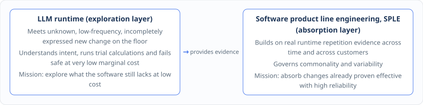

# Chapter 17: Taming Complexity — The Mythical Man-Month, SPLE and Four-Tier Capability Promotion

Through the Semantic JIT of Chapter 16, our software can already turn high-frequency intents into efficient specialized execution capability automatically at runtime.

Yet from the vantage point of the full enterprise-software lifecycle and product engineering, a deeper crisis is surfacing: **when large language models and generative compilation make it easier than ever to try out and generate a new capability, what happens if we let floor staff at hundreds or thousands of customer sites keep generating dynamic rules, specialized queries and private flows day after day? Five years on, will this system evolve into a precise and powerful standard product, or degenerate into a Frankenstein monster packed with a million dynamic special cases that nobody can make sense of?**

This chapter revisits the core insight of the classic software-engineering book _The Mythical Man-Month_, introduces **Software Product Line Engineering (SPLE)**, explains why runtime dynamism is never the endpoint, and builds the four-tier product-asset promotion funnel that leads from a temporary dynamic capability to a stable platform core.

***

## 17.1 Revisiting _The Mythical Man-Month_: when large models collapse the marginal cost of generating a new capability, how do we preserve the system's conceptual integrity?

Half a century ago, Turing Award winner Fred Brooks observed in _The Mythical Man-Month_ that the essential difficulty of software engineering lies in **essential complexity**, and that what keeps a large software system from collapsing under its own evolution is the system's **conceptual integrity**.

In the Software 3.0 era, large language models and agents bring a huge historical opportunity, and at the same time multiply the engineering risk of violating conceptual integrity:

| Dimension                              | New opportunity created by Software 3.0 and runtime generation                                                                                        | Complexity risk that is sharply amplified                                                                                                                                                                                           |
| -------------------------------------- | ----------------------------------------------------------------------------------------------------------------------------------------------------- | ----------------------------------------------------------------------------------------------------------------------------------------------------------------------------------------------------------------------------------- |
| **Speed of admitting requirements**    | A user's floor-level business intent can skip the long backlog and reach the system's response sooner.                                                | **Conceptual inconsistency**: the same business semantics (say rush-order priority or kitting rate) get defined a dozen conflicting ways across different workshops or different prompts.                                           |
| **Cost of long-tail adaptation**       | Temporary rules and customer long-tail needs can be adapted dynamically first, without having to build dedicated interface code right away each time. | **Product fragmentation**: large numbers of one-off special cases that barely run are kept in the system permanently, becoming a permanent technical-debt burden that cannot be upgraded or tested.                                 |
| **Efficiency of candidate generation** | Large models and generative tools can mass-produce candidate queries, constraints and flows at very low marginal cost.                                | **Coordination cost explosion**: multiple prediction models, agents, OR algorithms and subsystems each interpret the business through their own local understanding, and the structural entropy of the system grows out of control. |

Faced with that challenge, we have hung one conspicuous motto on the architecture:

> **The iron law of conceptual integrity: intelligence can be distributed, but semantics must never split!**

We must see clearly that **large language models lower only the marginal cost of producing one new change; software engineering must still bear the complexity cost of controlling how those changes persist and interact over time**. The formal domain model (which guards the uniqueness of concepts and physical dimensions), formal verification (which guards the admission boundary for execution) and software product line engineering, discussed next (which guards the evolutionary order of the product structure), are the three core weapons with which we tame complexity and defend conceptual integrity in the Software 3.0 era.

***

## 17.2 Why runtime dynamism is not the endpoint, but a probing mechanism for discovering the future stable product structure

Many people's intuition runs like this: now that we have a powerful dynamic runtime, shouldn't future software be dynamic in everything — drop the fixed product structure altogether and generate every feature on demand at runtime?

This book gives a clear no: **Software 3.0 must never become infinitely dynamic; runtime dynamism is not the endpoint of software evolution but a low-cost probing mechanism for discovering the future stable product structure**!

Why can't every capability stay dynamic at runtime forever?

1. **The economics of maintenance and cognition at scale**: for core business logic already proven highly common and long stable across the whole industry or the vast majority of customers, sinking it into the platform standard core (a deterministic Software 1.0 module or a standard domain component) yields far better long-run runtime performance, test determinism and maintenance return than letting every tenant regenerate it dynamically at runtime and govern it separately;
2. **Suppressing the growth of structural entropy**: as it serves more and more customers, a healthily evolving software product should gain an ever clearer grasp of industry commonality and of the dimensions of difference, and its product structure should converge and stabilize — instead of letting the set of dynamic rules expand without limit until it runs out of control.

So in our top-level architecture, **the large language model runtime (LLM Runtime)** and **software product line engineering (SPLE)** form a perfect two-wheel drive of exploration and absorption:

In short: **the LLM explores unknown change at low cost, and software product line engineering absorbs known change with high reliability**. Only a change that has accumulated real runtime evidence, passed formal verification and proved reusable across scenarios earns the right to be promoted step by step from dynamic candidate into the long-term product structure.

***

## 17.3 The four-tier capability promotion funnel of SPLE: temporary capability → customer-specific capability → product variability point → stable platform core

As we pointed out in Chapter 9, SPLE is not a seventh sequential step in the chain define — describe — remember — project — generate — verify. It sits above the whole closed loop of capability formation and is dedicated to governing the **commonality and variability** of the product.

When a new requirement is born on the operations floor — say the shared feeding-port capacity limit across multiple production lines that we have rehearsed several times, or a particular post-scheduling substitute-material recalculation flow — SPLE places it in a clear **four-tier capability promotion ladder** for full lifecycle management, according to its repetition evidence along the time dimension and the customer dimension:

The decision criteria and the product-engineering treatment of these four capability tiers are defined strictly as follows:

| Capability tier                                                                                                    | Deciding criteria from business and runtime evidence                                                                                                                                                                                                       | Product-engineering and architectural treatment (SPLE governance rules)                                                                                                                                                                                                                         | Evolutionary form, taking the shared feeding-port constraint as the example                                                                                                                                                          |
| ------------------------------------------------------------------------------------------------------------------ | ---------------------------------------------------------------------------------------------------------------------------------------------------------------------------------------------------------------------------------------------------------- | ----------------------------------------------------------------------------------------------------------------------------------------------------------------------------------------------------------------------------------------------------------------------------------------------- | ------------------------------------------------------------------------------------------------------------------------------------------------------------------------------------------------------------------------------------ |
| 
<strong>Tier 1: Temporary capability</strong> (Temporary / Ad-hoc Capability)
                            | 
• One-off and highly situation-specific; • repetition evidence across periods is not yet sufficient.
                                                                                                                                             | Stays in the runtime candidate layer or in a one-off temporary configuration, and is archived into the event history once used; **never rush it into the long-term product structure or pollute the standard branch**.                                                                          | A workshop's feeding pump needs emergency repair on a Tuesday, so the agent generates a one-off dynamic constraint valid for that day only.                                                                                          |
| 
<strong>Tier 2: Customer-specific capability</strong> (Customer-Specific Capability)
                     | 
• Recurs across multiple production periods within a single customer or a single organization or plant; • the business semantics and the benefit are already stable.
                                                                             | After shadow verification, **versioned as a controlled customer variant (Customer Variant) for that tenant**, written into the registry, with its scope of application, permissions, rollback path and expiry boundary made explicit.                                                           | Because of the plant's physical layout, the customer always shares a feeding port on Tuesdays and Thursdays, and the case settles into a parameterized constraint template dedicated to that tenant.                                 |
| 
<strong>Tier 3: Product variability point / configurable capability</strong> (Product Variability Point)
 | 
• <strong>Recurs across several different customers or plants in different industries</strong>; • the dimensions of difference between customers (say aggregation by day or by shift, by weight or by volume) can already be expressed formally.
 | **Formally promoted into the variability model (Variability Model) and the product capability catalog of the software product line**, offered to new customers as standardized configuration items, domain language (DSL) templates or process plugins for controlled out-of-the-box selection. | More than ten customers in the chemical and food industries show the same multi-line shared pretreatment feeding or buffer-tank capacity limit, which is distilled into a configurable constraint component of the standard product. |
| 
<strong>Tier 4: Stable core capability</strong> (Stable Platform Core)
                                   | 
• Becomes universal commonality for the vast majority of customers, stable over the long term; • the return from unified maintenance clearly exceeds the cost of dynamic runtime generation.
                                                     | **Sunk and promoted into the platform standard core (Platform Standard Core)**, built directly into the standard domain model and the base algorithm pipeline, reducing runtime dynamism and repeated generation overhead.                                                                      | Multi-level resource sharing and coupled capacity constraints become part of the DOP/APS platform standard domain model and built-in standard operators of `ospf`, available to every customer by default.                           |

Through this four-tier promotion mechanism, the software product acquires a virtuous **compounding of experience**: every special requirement at a new customer site stops being a custom-engineering swamp that drags the R\&D team down and becomes radar that helps the platform detect variability points in unknown territory. Once runtime evidence across periods and across customers proves an exploration to be commonality, it climbs the ladder `temporary capability → customer-specific capability → product variability point → stable core capability` and steadily internalizes into a standard platform asset, so that the product grows more standard and clearer the more it is used!

***

## 17.4 Five core platform assets: semantic IR, the semantic compiler, the capability registry, the adaptive runtime and the product line variability model

Once the way we produce software evolves from hard-coding everything before release to continuous specialization at runtime plus product line evolution, the **core platform assets** by which the core competitiveness of a software company or an engineering team is measured expand fundamentally as well.

Tomorrow's core assets are no longer just the business source code in a Git repository, but an organic asset library made up of the following **five classes of technical platform assets** and **five classes of business knowledge assets**:

| Core platform asset class                                                                                       | Core responsibility in the architecture                                                                                                                                                                              | Typical asset objects and engineering carriers                                                                                                                                                                  | Corresponding business-layer asset value (management view)                                                                                                                           |
| --------------------------------------------------------------------------------------------------------------- | -------------------------------------------------------------------------------------------------------------------------------------------------------------------------------------------------------------------- | --------------------------------------------------------------------------------------------------------------------------------------------------------------------------------------------------------------- | ------------------------------------------------------------------------------------------------------------------------------------------------------------------------------------ |
| 
<strong>1. Semantic IR assets</strong> (Semantic IR Assets)
                                           | Express formal business semantics precisely, fully isolating the ambiguity of natural language from implementation differences of the underlying execution engines.                                                  | Normalized query shape (Query Shape), query intermediate representation (Query IR), dynamic constraint definitions (Constraint IR), flow intermediate representation (Flow IR) and the domain metadata catalog. | **Unified business knowledge assets**: one authoritative definition across the whole domain for capacity, feeding, changeover and each state role.                                   |
| 
<strong>2. Semantic compiler assets</strong> (Semantic Compiler Assets)
                               | Enforce algebraic type, physical dimension, field catalog and tenant permission checks, and perform normalization, optimization and lowering to each backend.                                                        | Query plan generator, the `ospf`-based dynamic constraint compiler, the expression compiled evaluator, multi-solver adapter plugins and the explicit error contract set.                                        | **Reusable business capability assets**: a library of rules, constraints, calculations and optimization operators that is strictly verified and freely composable.                   |
| 
<strong>3. Capability and plan registry assets</strong> (Capability Registry Assets)
                  | Centrally govern the immutable version, lifecycle state, underlying dependency hash tree, canary release and one-click atomic rollback of every dynamic and specialized capability.                                  | Plan registry (Plan Registry), constraint and flow template library, model artifact and effective overlay snapshot library, and the full lineage definition history.                                            | **Traceable and auditable governance assets**: know exactly where each capability came from, who approved it, where it applies and when it expires.                                  |
| 
<strong>4. Adaptive runtime and world model assets</strong> (Adaptive Runtime &#x26; World Model)
     | Collect runtime profiles, preserve event memory, drive digital-twin projection, run shadow verification, decide capability promotion, and handle precise invalidation and rebuild when dependencies change.          | Runtime profile metric library, immutable domain event timeline, three-layer time digital-twin mirror, capability promotion policy engine, Schema/policy change listener.                                       | **Replayable operating experience and a safe proving ground**: historical facts and decision trails, plus a digital-twin mirror that can safely rehearse hypotheses at any time.     |
| 
<strong>5. Product line and variability model assets</strong> (Product Line &#x26; Variability Model)
 | Systematically manage the common core, formal variability points, customer variant rules and applicability boundaries of the product, plus the promotion state from dynamic capability to formal product capability. | Four-tier capability catalog, customer variant definition library, product variability point catalog (Variability Point Catalog), and audit records of capability promotion and retirement.                     | **A model of product commonality and difference**: clearly delimit the boundary between the industry-wide standard core, industry option packages and single-customer special cases. |
