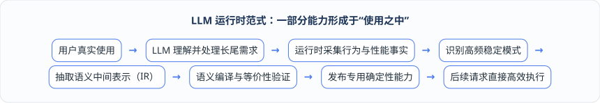

# 第 2 章：从信息化到意图驱动 —— 软件替人类承担了多少认知责任？

在第 1 章的生产调度风暴中，我们看到传统工业软件面对现场变化时的窘境：业务概念在多个系统和算法中各说各话，微小的临时规则调整也不得不排期走完漫长的研发流程。要看清这一困境的历史成因，并找到真正的破局方向，我们需要跳出单点技术的争论，从宏观软件演进史的视角追问一个根本问题：**过去几十年里，软件替人类做的事情究竟发生了什么变化？**

---

## 2.1 软件演进的四个阶段：信息化（记录）、自动化（按规则做事）、前 LLM 智能化（特定判断）与 LLM 智能化（理解目标）

如果我们把企业软件的发展历程拉长来看，它依次经历了**信息化**、**自动化**、**前大语言模型时代的算法智能化**以及**大语言模型时代的智能化**四个阶段。

这四个阶段的本质区别，并不在于底层用了关系型数据库、工作流引擎、深度学习还是大语言模型，而在于**软件系统替人类承担了多少“认知与执行责任”**。

### 第一阶段：信息化 —— 把事情记录进系统
在信息化阶段，软件的核心职责是充当企业的“电子账本”。订单、设备、库存、BOM 与排产计划被录入系统，转化为结构化的业务数据。系统提供的主要能力是记录、查询与跨部门共享，典型输出是各类台账、业务单据与统计报表。在这一阶段，几乎所有的业务认知、逻辑判断与操作执行责任都留在人类身上，人的角色是直接“操作系统”。

### 第二阶段：自动化 —— 让系统按规则做事
随着业务规模扩大，人们不再满足于手工点按钮流转单据，软件进入了自动化阶段。工程师将明确的业务规则、审批流转与状态触发器写进代码或配置表中，让系统按照既定逻辑自动流转、触发、计算和执行，输出标准化的流程动作或调度任务。此时，系统接管了“确定性规则下的重复执行责任”，但规则本身必须由人类事先穷举并定义清楚，人的角色上移为“设计规则”。

### 第三阶段：前 LLM 时代智能化（算法智能化）—— 让模型做特定判断
当企业面对设备产能波动、加工耗时预测、物料需求预测或复杂排产优化时，许多规律无法靠人工硬编码规则穷尽，软件随之迈入前大语言模型时代的算法智能化阶段。系统以业务数据加特定数学模型或机器学习模型为输入，承担起识别、预测、推荐与运筹优化的职责，输出分类结果、风险评分或优化计划方案。

在这一阶段，系统开始分担一部分“模式识别与局部寻优的认知责任”，但问题的数学边界、特征口径与约束结构依然必须由算法工程师在开发或训练阶段预先定义完备，人的角色是“定义问题”。

### 第四阶段：LLM 时代智能化 —— 理解目标并完成任务
大语言模型与智能体（Agent）的到来，开启了第四个阶段。系统接收的不再只是僵化的表单字段或固定格式的算法参数，而是人类的**自然语言意图 + 运行上下文 + 可用工具集**。系统开始具备理解模糊表达、结合上下文推理、自主规划步骤、生成结构化方案并调用既有系统与算法工具的能力，最终输出任务结果或可检验的候选能力。相应地，人类的角色进一步演进为**“表达业务目标 + 审核安全边界”**。

为了直观呈现这四次跃迁，我们可以从核心输入、系统能力、典型输出与人的角色四个维度进行全景对照：

| 演进阶段 | 核心输入 | 系统承担的能力 | 典型输出 | 人的核心角色 |
| :--- | :--- | :--- | :--- | :--- |
| **信息化** | 结构化业务数据 | 记录、查询、共享 | 台账 / 单据 / 报表 | 操作系统 |
| **自动化** | 规则、流程、触发器 | 按既定逻辑自动流转与执行 | 流程动作 / 调度任务 | 设计规则 |
| **前 LLM 时代智能化** | 历史数据 + 特定模型 | 识别、预测、推荐、优化 | 分类 / 评分 / 计划方案 | 定义问题边界 |
| **LLM 时代智能化** | 意图 + 上下文 + 工具 | 理解、推理、规划、生成、调用 | 任务结果 / 候选软件能力 | 表达目标 + 审核边界 |

---

## 2.2 真正的历史断点：软件能力形成的位置，从“发布之前”延伸到了“使用之中”

审视上述四个阶段，为什么前三个阶段的演进主要属于渐进式改良，而第四阶段的到来却引发了软件工程范式的剧震？因为这里出现了一个真正的历史断点：**软件能力形成的位置发生了根本性迁移**。

在信息化、自动化乃至前大语言模型时代的算法智能化中，尽管系统越来越聪明，但“软件能力是如何被制造出来的”这一基本链路从未改变：

在这条传统链路里，无论是写死一条数据库校验逻辑、配置一条自动化审批流，还是训练一个产能预测模型、编写一套混合整数线性规划（MILP）排产脚本，**软件能力的形成主要发生在“发布之前”的开发期或训练期**。一旦软件发布上线，它的能力边界就被冻结了；用户在运行现场只能使用研发团队预先设想好的功能。

而在大语言模型时代，一部分“语义生产”与“能力塑造”第一次从开发期跨入到了用户真实使用的运行现场（Runtime）：

如上图所示，当用户在生产现场提出一个过去系统里没有现成按钮的长尾诉求（如“今天 A 线和 B 线共用投料口，总投料量不超过 1000 公斤”）时，系统不再直接报错或让你去找研发提工单，而是先由大语言模型在运行现场理解意图、组织上下文并生成结构化候选方案，经安全验证后完成当次处理。紧接着，运行时持续观察这类需求是否在后续生产周期中被反复使用；一旦发现它是一个高频、稳定且收益明确的模式，系统便将其语义结构抽取出来，编译并验证为低成本、可复用的专用确定性能力，后续同类请求直接走专用高效路径执行。

简言之，传统范式是**“先开发，再使用”**；而新的范式在此基础上开辟了第二条通道：**“先在使用中发现和验证需求，再把被证明有效的做法沉淀进产品”**。

---

## 2.3 传统项目制交付的死结：为什么靠“提需求—写代码—测接口—发版本”永远追不上长尾变化？

理解了“能力形成位置迁移”这一历史断点，我们就很容易看懂为什么传统的工业软件（尤其是涵盖 ERP、APS、MES、WMS、TMS 的数字化运营平台）总是深陷“项目制交付”的泥潭。

制造业与供应链运营天然是一个充满长尾差异与动态扰动的世界：
* **临时性现场异常**：某台关键设备突然降速、某两条产线当天临时共用投料口、某批在途物料因交通管制延误、某张 VIP 客户订单临时插单提前；
* **客户与工厂级特有规则**：不同行业、不同工厂甚至同一工厂的不同生产阶段，在排产先后序、替代料分配策略、齐套检查口径、车辆配载限制与审批流转上都存在大量细微差异。

在传统“发布前定义一切能力”的架构下，软件厂商面对这些千差万别的现场需求，只有两条路可走，而这两条路最终都会走向死胡同：

1. **第一条路：试图在标准产品里预先穷举所有配置开关**。产品经理试图设计出一套包含成百上千个参数开关的超级配置表；结果不仅配置界面复杂到无人能懂，而且一旦遇到第 1001 种现场组合规则（例如跨产线、跨时间窗的动态投料约束），预先写死的开关依然无法表达。
2. **第二条路：退化为“每家客户拉一个项目分支写定制代码”**。现场人员提出问题后，必须依次经过“实施顾问理解 → 产品经理确认 → 研发写接口与分支代码 → 算法工程师改模型 → 联调测试 → 发布上线”的完整周期。

这种把所有现场长尾变化都塞进研发流程的做法，带来了三重不可承受的代价：
* **响应速度与业务时效严重错配**：现场的临时设备异常或急单调整往往要求在几分钟到几小时内给出可行方案，而走完一次代码修改与算法发版动辄需要数天乃至数周；
* **项目定制成本随客户数量线性甚至指数级膨胀**：每交付一家新客户，代码仓库里就多出一堆无法复用的硬编码特例与专用接口，研发团队逐渐被海量项目分支的维护工作拖垮；
* **即使外接了问答式大模型，也未改变能力形成方式**：如果仅仅把大语言模型当作一个帮忙写需求文档或回答操作手册问题的聊天插件，遇到新规则时依然要靠人工改代码、发版本，那么软件的交付成本结构就没有发生任何实质性改变。

要打破这一死结，唯一的出路就是把长尾需求的“探索与初步验证”从高昂的人工研发期卸载到低成本的软件运行时——让通用智能先在现场接住变化，等运行证据证明某项变化确实值得长期保留时，再将其受控地固化为系统能力。

---

## 2.4 重新定义人与软件的关系：过去用户只是使用程序，未来用户在使用程序的同时也在持续塑造程序

当软件能力的形成从“发布前”延伸到“使用中”，人与软件的关系便迎来了一次深刻的重新定义：

> **过去，用户只是被动地使用已经写好的程序；未来，用户在使用程序的同时，也在持续“编译”和塑造程序——通过日常业务交互，不断告诉软件“这家企业到底应该怎样工作”**。

需要特别澄清的是，这里的“用户在运行时参与编程”或“持续编译程序”，**绝不是指让车间主任、计划员或物流调度员在聊天窗口里手写 Java、Kotlin 或 Python 代码**。业务人员完全不需要懂任何编程语言或数学规划语法。

在新的范式下，人机协同的完整工作闭环由以下五个步骤组成：

1. **用户用业务语言自然表达意图**：业务人员只需像平时沟通一样，用自然语言或日常操作提出业务目标、临时规则、例外情况或决策偏好（例如：“今天 A 线和 B 线共用一个投料口，总投料量不要超过 1000 公斤，T1 已经晚了，帮我看看怎么调”）；
2. **系统将模糊表达转化为可检查的结构化方案**：大语言模型作为语义前端，结合当前领域上下文识别出涉及的产线、任务、资源、时间范围与容量限制，生成机器可严格检查的结构化候选方案（而非直接改动生产数据库）；
3. **在历史数据与数字孪生环境中安全试验**：系统在可推演的生产世界镜像（数字孪生）中先行试算该候选方案，评估其对订单交期、库存齐套、换产耗时与资源冲突的真实影响，并交由优化求解器确认数学可行性；
4. **通过权限、规则与结果校验后受控执行**：只有当字段、物理单位、操作权限、业务不变量和仿真结果全部通过确定性把关（且在必要时获得人工审批确认）后，方案才正式投入排产或执行流程，并全程记录实际运行效果；
5. **反复有效的经验逐步沉淀为正式产品能力**：对于只发生一次的临时状况，系统将其保留为一次性候选配置；对于在同一客户现场反复出现、被运行结果证明长期有效的做法，系统不再每次从头调用大模型重新推理，而是将其逐步升级为客户专用能力、产品可配置能力乃至平台标准核心能力。

由此可见，未来的企业软件不再是一座在交付日就已经封顶的水泥建筑，而更像一个拥有“理解力、记忆力、推演力与自我沉淀机制”的有机体。大语言模型负责低成本地理解人类意图、探索未知的长尾需求；而确定性的软件工程、形式化领域模型与运筹优化算法则负责守住安全底线，并将探索出的真知灼见固化为高可靠的产品资产。

那么，在这套“边使用、边生长”的新范式中，传统的软件代码（Software 1.0）、机器学习模型（Software 2.0）与大语言模型驱动的意图计算（Software 3.0）究竟是怎样的关系？它们又是如何与确定性计算、运筹优化等底层计算范式协同工作的？在接下来的第 3 章中，我们将引入两条正交的进化坐标轴，为您揭晓答案。
