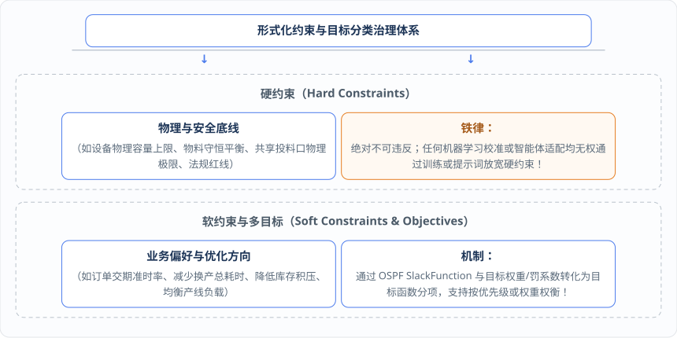
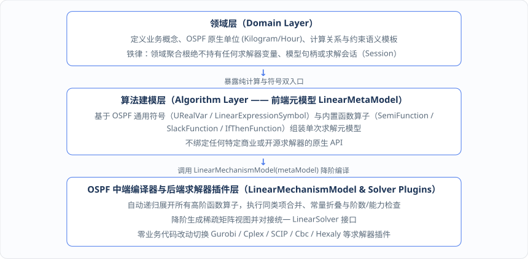

# 第 8 章：像搭积木一样表达复杂业务 —— 结构化函数、逻辑算子与求解器解耦

解决了单个算术表达式的同源求值问题后，当我们真正着手用形式化领域模型去刻画复杂的工业现场（如 DOP 中的排产、配载与库存调拨）时，马上会遇到第二道拦路虎：**现实世界的业务规则充满了非线性分段、绝对值偏差、条件分支（`if-then-else`）与多目标权衡，而底层的运筹优化求解器（如线性规划 LP / 混合整数线性规划 MILP）却只认识极其枯燥的线性等式与不等式矩阵（$A x \le b$）**。

如果让业务研发或智能体直接去写引入大量辅助 0-1 变量和极大常数（Big-M）的底层线性化不等式，不仅代码晦涩难懂、极易写错，而且一旦切换求解器（例如从不支持某函数的求解器切换到支持原生指示约束或二次规划的求解器），整套模型就得推倒重来。

本章将展示 `ospf`（`ospf-kotlin-core`）如何通过**规范化与代数分类**、**内置的结构化函数与逻辑算子积木**、**类编译器求解器解耦架构（`LinearMetaModel` → `LinearMechanismModel` → `LinearSolver`）**以及**显式错误契约（`Ret`）**，让开发者与智能体能够像搭积木一样用直观的业务语义构建模型，同时将底层数学转换与求解器适配彻底隔离在领域层之外。

---

## 8.1 化非线性为线性：绝对值、松弛变量、分段线性与阶梯规则的规范化与代数分类

在真实的生产与物流调度中，许多看似非线性的业务诉求，在数学上其实是可以通过引入受控的中间变量与附加约束片段，等价转换为线性或二次规划模型的。

在 `ospf-kotlin` 框架中，开发者无需手工推导这些繁琐的辅助变量，而是直接使用 `fuookami.ospf.kotlin.core.frontend.expression.symbol.linear_function`（及 `quadratic_function`）包内置的**高阶函数符号（Functional Symbols）**来表达业务意图；随后，框架在构建与编译阶段自动完成**规范化、代数分类与结构化约束片段展开**：

### 1. 规范化与代数阶数自动分类（Canonicalization & Algebraic Classification）
当多个单项式或子表达式经过加减乘除组合成一个新的复杂表达式时，`ospf` 的多项式系统（如 `LinearPolynomial`、`QuadraticPolynomial`）会自动执行**同类项合并**，将其转换为规范单项式与规范多项式表示，并在类型与结构上精确区分其代数阶数：
* 它是**纯常数（Constant）**、**一阶线性多项式（`LinearPolynomial`）**、**二阶二次多项式（`QuadraticPolynomial`）**，还是**更高阶的一般非线性表达式**？
* 在将表达式注入特定目标元模型（例如要求一阶线性的 `LinearMetaModel`）或特定求解器插件前，必须执行严格的**目标次数与能力转换检查**。

### 2. OSPF 内置连续与分段业务算子积木
围绕工业排程与供应链优化的高频场景，`ospf-kotlin` 提供了丰富的内置函数符号，每个符号在注册到 `LinearMetaModel` 并编译为 `LinearMechanismModel` 时，都会自动生成必要的中间辅助变量与线性约束片段，同时完整保留业务名称、单位与符号身份：

| 函数符号类别 | 直接使用的 `ospf-kotlin` 内置函数符号类 | 对应的工业与供应链业务场景 | `ospf` 编译器底层自动完成的工作 |
| :--- | :--- | :--- | :--- |
| **偏差与弹性松弛** | • `AbsFunction`（绝对值）<br>• `SlackFunction`（松弛函数）<br>• `SlackRangeFunction`（范围松弛） | • 衡量实际产出与目标计划的正负绝对偏差；<br>• 为交期时间窗或安全库存设置可度量的弹性缓冲区间。 | 自动引入非负正负偏差辅助变量与绑定约束，求解后可直接通过该符号对象查询具体松弛量与违反量。 |
| **分段线性与阶梯规则** | • `ULPFunction`（一元分段线性）<br>• `BLPFunction`（二元分段线性）<br>• `InStepRangeFunction`（步进区间） | • 电力峰谷平阶梯电价下的能耗优化；<br>• 随设备负载率非线性变化的加工损耗率；<br>• 物流 TMS 的阶梯运价与折扣率计算。 | 根据折点坐标自动引入凸组合权重或 SOS2 / 二元分段激活变量，生成等价的混合整数线性约束片段。 |
| **批量、取整与半连续** | • `CeilingFunction` / `FloorFunction`<br>• `RoundingFunction` / `ModFunction`<br>• `SemiFunction`（半连续标记） | • WMS 最小整托盘/整箱包装发运量折算；<br>• 产线投料“要么不开启（为 0），一旦开启则投料量不得低于最小起批门槛 `lb`”。 | 自动引入整数商/余数变量或半连续激活二元变量，确保生成的计划天然符合车间物理包装与起批规范。 |

---

## 8.2 把业务分支装进数学模型：布尔逻辑、条件分支、选一约束与多目标软约束权衡

如果说分段与取整解决的是“数值形态”问题，那么工业现场最令算法工程师头疼的则是无处不在的**条件分支与组合逻辑**——例如：“如果产线 A 今天生产了含过敏原的物料 X，且紧接着生产普通物料 Y，则必须插入一次长达 90 分钟的深度清洗工序；否则只需常规换产 30 分钟”。

为了把这类演绎逻辑自然地写进领域模型，`ospf-kotlin` 提供了完备的**逻辑与条件函数符号体系**以及**多目标软约束治理机制**：

### 1. OSPF 内置布尔逻辑与条件分支算子
* **二值化与逻辑代数算子**：提供 `BinFunction`（二值化）、`BTerFunction`（平衡三值化）以及 `AndFunction`（逻辑与）、`OrFunction`（逻辑或）、`NotFunction`（逻辑非）、`XorFunction`（逻辑异或）算子，让多个布尔状态条件可以像写普通业务代码一样自由组合。
* **蕴含与条件分支算子**：提供 `ImplyFunction`（逻辑蕴含）、`InequalityFunction`（不等式指示函数）、`IfFunction`（条件 IF）、`IfInFunction`（条件区间）与 `IfThenFunction`（条件 If-Then）算子。开发者只需声明业务上的因果关系，框架便会自动将其编译为指示约束或受严格边界控制的线性化约束片段。
* **组合选择与极值统计**：提供 `OneOfFunction`（选一约束）、`SameAsFunction`（同状态约束）、`FirstFunction`（首个非零索引）、`MaskingFunction`（掩码函数）、`MinFunction` / `MaxFunction`（最小/最大值）等算子，轻松表达“多条备选产线只能选一条”、“同批次订单必须分配给同一辆货车”等复杂调度规则。

### 2. 结构化约束元数据与多目标/软约束权衡
在真实的生产排程中，并不是所有规则都是生硬的“一票否决”。如果把客户期望交期、理想库存水位、减少换产次数和员工不加班全部设成绝对不可妥协的**硬约束（Hard Constraints）**，那么一旦遇到第 1 章那样的急单或设备延误，求解器只会冷冰冰地返回“无解（Infeasible）”。

因此，形式化领域模型将约束与目标定义为结构化的元数据，并严格区分**硬约束**与**软约束（Soft Constraints）/ 多目标权衡**：



---

## 8.3 类编译器降阶架构：如何让领域模型彻底摆脱对特定商业或开源求解器 API 的绑定？

当领域层与算法层用上述 `ospf` 通用符号与结构化约束搭好模型后，它究竟是如何变成 Gurobi、Cplex、SCIP、Cbc、MindOpt 或 Hexaly 等具体求解器能够执行的底层指令的？

这里体现了 `ospf-kotlin` 最核心的工程设计——**类编译器降阶架构（`LinearMetaModel` → `LinearMechanismModel` → `LinearSolver`）与求解器彻底解耦**。



这一类编译器分层架构为企业软件带来了三大决定性的工程优势：

1. **领域模型与算法逻辑彻底摆脱求解器锁定（Vendor Lock-in）**：领域层与算法层编写的每一行代码都只依赖求解器无关的 `ospf` 前端抽象（`LinearMetaModel`）。当企业需要从商业求解器切换至开源求解器、或者针对特定子问题切换不同的求解器插件时，**核心业务语义与领域规则代码一行都不用改**，只需在应用层编排中注入不同的 `LinearSolver` 插件实例。
2. **支持按场景灵活拆分求解路径与降级策略**：应用层可以根据当前业务场景自由编排求解器——例如在日常高频的数字孪生局部推演或智能体多方案快速比选中，调度轻量级求解器以获得秒级反馈；而在夜间全局主计划排产中，则调度重型 MILP 或列生成/Benders 分解管线进行深度寻优。
3. **无副作用的稳定扩展机制**：所有扩展点均保持稳定且无运行时业务副作用，既防止业务特例规则反向污染通用数学基础库，也坚决杜绝底层求解器的原生 API 反向渗透到领域层。

---

## 8.4 显式错误契约（`Result` / `Ret`）与能力检查：严禁静默截断高阶项，当求解器能力不支持时如何优雅报错或降级

在传统的运筹脚本或大模型代码生成中，最可怕的不是程序直接报错退出，而是**“静默容错导致的带病运行”**。例如，当一个业务规则或动态约束生成了二次乘积项（`QuadraticPolynomial`，最高次数 `degree = 2`），而当前管线使用的是一阶线性元模型（`LinearMetaModel`）或仅支持线性规划的求解器时，某些简陋的封装库会静默丢弃二次高阶项；同样，当缺失符号或单位不兼容时，直接抛出未捕获的异常会导致整个排产服务崩溃。

为此，本书架构强制推行**显式错误契约（`Ret<T>`）**与**严格的目标阶数及求解器能力检查机制**：

1. **可失败运算统一返回 `ospf` 的 `Ret<T>`（`Ok` / `Failed`）**：所有单位转换、表达式求值、高阶阶数转换、约束注册、模型编译（`LinearMechanismModel(metaModel)`）与求解执行（`solver(mechanismModel)`），均通过 `Ret<T>` 显式传递成功结果或结构化 `Err`，彻底杜绝未捕获异常泄漏到领域层。
2. **严禁静默截断高阶项（Target Degree Check）**：在将通用多项式（如可能包含二次项的 `QuadraticPolynomial`）转换为一阶线性多项式（`LinearPolynomial`）注入线性模型前，必须检查其是否含有二次或更高阶项；**一旦发现阶数超出目标建模器或求解器能力，必须立即返回显式的 `Failed(Err(ErrorCode.ApplicationError, ...))` 结构化错误，绝对禁止静默截断高阶项或把非线性规则伪装成线性表达式**！

### 工程实现：基于 OSPF 函数算子、阶数守卫、`LinearMetaModel` 与 `LinearSolver` 的完整建模与求解代码
下面给出完整串联第 5～8 章所有 `ospf-kotlin` 原生特性的工业级排产建模与求解管线代码：

```kotlin
package org.adaptive.dop.algorithm.scheduling

import fuookami.ospf.kotlin.utils.math.*
import fuookami.ospf.kotlin.utils.physics.unit.*
import fuookami.ospf.kotlin.utils.physics.quantity.*
import fuookami.ospf.kotlin.utils.error.*
import fuookami.ospf.kotlin.utils.functional.*
import fuookami.ospf.kotlin.core.frontend.variable.*
import fuookami.ospf.kotlin.core.frontend.expression.monomial.*
import fuookami.ospf.kotlin.core.frontend.expression.polynomial.*
import fuookami.ospf.kotlin.core.frontend.expression.symbol.*
import fuookami.ospf.kotlin.core.frontend.expression.symbol.linear_function.*
import fuookami.ospf.kotlin.core.frontend.inequality.*
import fuookami.ospf.kotlin.core.frontend.model.mechanism.*
import fuookami.ospf.kotlin.core.backend.solver.*
import fuookami.ospf.kotlin.core.backend.solver.output.*
import org.adaptive.dop.domain.core.*
import org.adaptive.dop.domain.role.*
import org.adaptive.dop.infrastructure.ospf.OspfBoundaryAdapter

/**
 * 1. 目标阶数转换安全守卫 (Target Degree Check Guard)：
 * 当把可能包含二次项的 QuadraticPolynomial 降阶为 LinearPolynomial 时，
 * 若存在任何二次乘积项 (monomial.variable2 != null)，立即显式返回错误，严禁静默截断高阶项！
 */
object OspfDegreeCheckGuard {
    fun requireLinearPolynomial(
        quadPoly: QuadraticPolynomial,
        targetBackendName: String
    ): Ret<LinearPolynomial> {
        val nonlinearTerms = quadPoly.monomials.filter { it.variable2 != null }
        if (nonlinearTerms.isNotEmpty()) {
            val termDesc = nonlinearTerms.joinToString(", ") { "${it.coefficient}*${it.variable1.name}*${it.variable2?.name}" }
            return Failed(
                Err(
                    ErrorCode.ApplicationError,
                    "代数阶数越界错误 [ERR_DEGREE_EXCEEDED]: 目标后端 [$targetBackendName] 仅支持 1 阶线性表达式，" +
                    "但表达式包含 2 阶二次项 [$termDesc]。严禁静默截断高阶项，请显式启用已声明的近似线性化算子（如 ULP/BLP）！"
                )
            )
        }
        val linearPoly = MutableLinearPolynomial()
        for (m in quadPoly.monomials) {
            linearPoly += m.coefficient * m.variable1
        }
        linearPoly += quadPoly.constant
        return Ok(LinearPolynomial(linearPoly))
    }
}

/**
 * 2. 基于 OSPF LinearMetaModel 的排产建模管线：
 * 直接使用 OSPF 原生单位 (Kilogram / Ton)、FeedingSharedCore 双入口符号、SemiFunction 与 SlackFunction
 */
data class BuiltScheduleMetaModel(
    val metaModel: LinearMetaModel,
    val plannedFeedingSymA: Quantity<LinearExpressionSymbol>,
    val plannedFeedingSymB: Quantity<LinearExpressionSymbol>,
    val shortageSlackSym: SlackFunction
)

class SharedFeedingScheduleModelPipeline {

    fun buildScheduleMetaModel(
        specLineA: FeedingRuleSpec,
        specLineB: FeedingRuleSpec,
        actualFeedingInWindow: RoleScopedQuantity<ActualFactRole, Flt64>, // 当日已发生实际投料事实 (如 450 kg)
        sharedFeedingLimit: Quantity<Flt64>,                              // 共享投料口当日上限 (如 1000 kg 或 1.0 t)
        minLotSize: Quantity<Flt64>                                       // 产线最小起批量门槛 (如 100 kg)
    ): Ret<BuiltScheduleMetaModel> {
        // 1) 创建 OSPF 线性元模型容器 (LinearMetaModel)
        val metaModel = LinearMetaModel("DOP_APS_SharedFeeding_Schedule")

        // 2) 定义待求解任务的计划产出决策变量 (URealVar)，并注册到 metaModel
        val outputVarTask2A = URealVar("output_T2_lineA")
        val outputVarTask3B = URealVar("output_T3_lineB")
        metaModel.add(outputVarTask2A)
        metaModel.add(outputVarTask3B)

        // 3) 调用第 7 章共享业务核心的【运筹符号入口】，生成具名中间符号 Quantity<LinearExpressionSymbol>
        val plannedFeedingSymA = when (val r = FeedingSharedCore.buildSymbolicFeedingIntermediate(specLineA, outputVarTask2A)) {
            is Ok -> r.value
            is Failed -> return r
        }
        val plannedFeedingSymB = when (val r = FeedingSharedCore.buildSymbolicFeedingIntermediate(specLineB, outputVarTask3B)) {
            is Ok -> r.value
            is Failed -> return r
        }
        // 将具名中间符号注册进 OSPF LinearMetaModel，确保求解后可按名透明查询中间值取值！
        metaModel.add(plannedFeedingSymA.value)
        metaModel.add(plannedFeedingSymB.value)

        // 4) 直接使用 OSPF 内置的 SemiFunction (半连续函数符号) 表达“最小起批量约束”
        val alignedMinLotB = when (val r = OspfBoundaryAdapter.convertQuantitySafely(minLotSize, plannedFeedingSymB.unit)) {
            is Ok -> r.value.value
            is Failed -> return r
        }
        val semiFeedingB = SemiFunction(
            x = LinearPolynomial(plannedFeedingSymB.value),
            lb = alignedMinLotB,
            name = "semi_minLot_lineB_T3"
        )
        metaModel.add(semiFeedingB)

        // 5) 构建贯穿用例的核心动态硬约束：
        // actualFeedingInWindow + plannedFeedingRemaining[A] + plannedFeedingRemaining[B] <= feedingLimit
        // 使用 OSPF 原生单位 Kilogram 统一对齐所有质量项
        val actualKg = when (val r = OspfBoundaryAdapter.convertQuantitySafely(actualFeedingInWindow.quantity, Kilogram)) {
            is Ok -> r.value.value
            is Failed -> return r
        }
        val limitKg = when (val r = OspfBoundaryAdapter.convertQuantitySafely(sharedFeedingLimit, Kilogram)) {
            is Ok -> r.value.value
            is Failed -> return r
        }

        val totalFeedingInWindowPoly: LinearPolynomial =
            actualKg + plannedFeedingSymA.value + plannedFeedingSymB.value

        when (
            val addConstraintRes = metaModel.addConstraint(
                constraint = totalFeedingInWindowPoly leq limitKg,
                name = "c_shared_feeding_limit_lineAB_day1",
                displayName = "产线A与B当日共享投料口容量上限硬约束(${Kilogram.symbol})"
            )
        ) {
            is Ok -> {}
            is Failed -> return Failed(addConstraintRes.error)
        }

        // 6) 直接使用 OSPF 内置的 SlackFunction 表达“目标产量达成软约束与缺口惩罚”
        val targetTotalFeedingKg = Flt64(650.0)
        val feedingShortageSlack = SlackFunction.neg(
            x = plannedFeedingSymA.value + plannedFeedingSymB.value,
            y = LinearPolynomial(targetTotalFeedingKg),
            name = "slack_feeding_target_shortage"
        )
        metaModel.add(feedingShortageSlack)

        // 7) 注册最小化惩罚目标函数
        val penaltyWeight = Flt64(100.0)
        metaModel.minimize(
            expr = penaltyWeight * feedingShortageSlack,
            name = "obj_minimize_target_shortage"
        )

        return Ok(
            BuiltScheduleMetaModel(
                metaModel = metaModel,
                plannedFeedingSymA = plannedFeedingSymA,
                plannedFeedingSymB = plannedFeedingSymB,
                shortageSlackSym = feedingShortageSlack
            )
        )
    }
}

/**
 * 3. 基于 OSPF LinearMechanismModel 与 LinearSolver 接口的求解与中间值解析服务：
 * 彻底解耦具体求解器实现，并在求解后自动回填提取具名中间值 Quantity<Flt64>！
 */
data class SolvedScheduleDomainResult(
    val solverName: String,
    val status: SolverStatus,
    val objectiveValue: Flt64,
    val plannedFeedingLineA: Quantity<Flt64>,
    val plannedFeedingLineB: Quantity<Flt64>,
    val targetShortageSlackKg: Quantity<Flt64>
)

class OspfScheduleSolveService(
    private val solver: LinearSolver // 注入任意 OSPF 求解器插件（如 ScipLinearSolver / GurobiLinearSolver / CbcLinearSolver）
) {
    suspend fun compileAndSolve(built: BuiltScheduleMetaModel): Ret<SolvedScheduleDomainResult> {
        val metaModel = built.metaModel

        // 1) 调用 OSPF LinearMechanismModel 降阶编译器：自动展开 SemiFunction 与 SlackFunction
        val mechanismModel = when (val compileRes = LinearMechanismModel(metaModel)) {
            is Ok -> compileRes.value
            is Failed -> return Failed(compileRes.error)
        }

        // 2) 调用 OSPF LinearSolver 插件执行求解
        val solverOutput: FeasibleSolverOutput = when (val solveRes = solver(mechanismModel)) {
            is Ok -> solveRes.value
            is Failed -> return Failed(solveRes.error)
        }

        // 3) 将求解器返回的解向量回填至 metaModel.tokens
        metaModel.tokens.setSolution(solverOutput.solution)

        // 4) 直接通过具名中间符号求值，获得带 OSPF 原生单位的透明业务中间值结果！
        val feedingValA = built.plannedFeedingSymA.value.polynomial.evaluate(
            results = solverOutput.solution,
            tokenList = metaModel.tokens
        ) ?: return Failed(Err(ErrorCode.ApplicationError, "无法解析中间符号 [${built.plannedFeedingSymA.value.name}] 的解值"))

        val feedingValB = built.plannedFeedingSymB.value.polynomial.evaluate(
            results = solverOutput.solution,
            tokenList = metaModel.tokens
        ) ?: return Failed(Err(ErrorCode.ApplicationError, "无法解析中间符号 [${built.plannedFeedingSymB.value.name}] 的解值"))

        val slackVal = built.shortageSlackSym.polynomial.evaluate(
            results = solverOutput.solution,
            tokenList = metaModel.tokens
        ) ?: Flt64.zero

        return Ok(
            SolvedScheduleDomainResult(
                solverName = solver.name,
                status = solverOutput.status,
                objectiveValue = solverOutput.obj,
                plannedFeedingLineA = Quantity(feedingValA, built.plannedFeedingSymA.unit),
                plannedFeedingLineB = Quantity(feedingValB, built.plannedFeedingSymB.unit),
                targetShortageSlackKg = Quantity(slackVal, Kilogram)
            )
        )
    }
}
```
