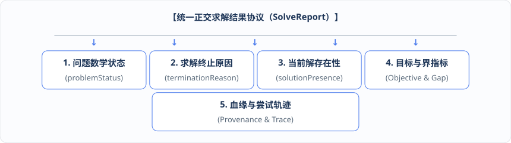
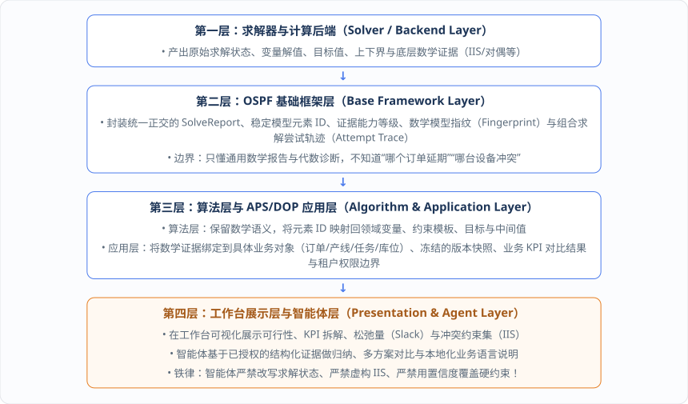

# 第 12 章：告别“无解报错” —— 正交求解结果协议（SolveReport）与分层自解释

当运筹优化模型（无论是单次 MILP 求解，还是第 11 章的列生成与 Benders 分解）运行结束后，软件工程链路上最容易被敷衍了事、却又对用户体验影响最大的环节出现了：**如何向业务系统和人类计划员汇报求解结果？**

在传统的工业软件中，这一步往往是一场灾难。本章将深入剖析为什么粗暴的“成功/失败”返回值会让排产系统在复杂现场寸步难行，并展示如何依托 `ospf` 基础框架建立**正交求解结果协议（`SolveReport`）**、**有解/无解数学诊断证据**以及**四层自解释架构**，让每一次求解结论都经得起数学检验、业务复盘与智能体归因。

---

## 12.1 为什么只返回“成功/失败”或一段求解器日志会让计划员寸步难行？

让我们回到真实的排产工作台。假设今天上午 `10:00`，计划员加入了“产线 A、B 共用投料口，总投料量不超过 1000 公斤”的约束，并点击了“仿真重排”按钮。等待了 30 秒后，传统外挂算法接口只会在屏幕上弹出以下两种结果之一：

* **情况一：弹窗提示“排产成功！”并刷新了一张甘特图**。
  计划员看着新甘特图满腹狐疑：这个方案到底是已经证明全局最优了，还是因为到了 30 秒时间上限、求解器随便吐出来的一个差距还很大的初始可行解（最优差距 Optimality Gap 高达 25%）？为什么在这个新方案里，订单 M 的交期被推迟了？到底是因为共享投料口满载卡住了，还是因为设备产能不够？
* **情况二：弹窗提示“求解失败：模型无解（Infeasible）”或者直接打印出几百行英文求解器控制台日志（Solver Log）**。
  计划员彻底懵了：到底是真的在物理上不存在任何可行排产方案（已证明不可行），还是仅仅因为问题太复杂、30 秒超时还没来得及搜到第一个可行解（超时未找到当前可行解）？又或者是求解器许可证过期、内存溢出或网络断了？如果真的是规则冲突导致无解，全厂几千条排产约束里，**究竟是哪几条约束撞在一起导致了冲突**？我需要把投料口上限放宽多少公斤，或者把哪个订单的交期推迟几小时，才能让计划重新跑通？

如果算法接口只返回 `"SUCCESS" / "FAILED"` 状态字符串，或者在业务 Service 里用正则表达式去扒求解器的英文文本日志，不仅机器无法做可靠的自动化分支判断，如果再让大语言模型去根据这种模糊状态“自由发挥写解释”，大模型就会把毫无根据的猜测包装成看似笃定的结论，严重误导生产决策！

---

## 12.2 正交求解结果协议（`SolveReport`）：解耦问题状态、终止原因与解存在性，严禁把“超时未得解”谎报为“不可行”

为了彻底根除上述混乱，基础框架（如 `ospf-kotlin` 及其规划的 `OSPF-SOL-*` 求解协议体系）确立了一条核心设计原则：**运行是否完成、数学问题本身的状态、以及当前手里是否握有可用解，是三个完全正交的维度，必须通过统一的 `SolveReport`（求解报告协议）进行正交表达**！

无论是本地内存求解、分解组合求解还是远端算力求解，都必须统一返回包含以下核心正交维度的 `SolveReport`：



1. **`problemStatus`（问题数学状态）**：描述数学模型本身的客观性质——是已证明最优（`Optimal`）、已证明不可行（`Infeasible`）、已证明无界（`Unbounded`），还是尚未完成最终证明（`Indeterminate` / `Feasible`）；
2. **`terminationReason`（求解终止原因）**：描述求解器为什么停下来——是因为完成了数学收敛证明，还是触达了时间限制（`TimeLimit`）、节点数限制（`NodeLimit`）、迭代次数限制、用户主动取消（`Cancelled`），抑或是遭遇了数值病态、许可证失败或基础设施错误；
3. **`solutionPresence`（解存在性）**：明确声明当前报告中是否包含至少一个可执行的**当前可行解（Incumbent Solution）**；
4. **目标值、上下界与最优差距（Objective, Best Bound & Optimality Gap）**：在存在可行解时，同时报告当前目标函数值、已证明的最佳理论界（Best Bound）以及二者之间的最优差距百分比（Gap），严禁只给一个目标值而隐瞒其距离最优界还有多远；
5. **模型/配置指纹、求解器血缘与组合求解尝试轨迹（Attempt Trace）**：完整记录当次求解的数学模型哈希指纹、实际生效的求解器配置参数、求解器名称与版本血缘；若采用了“先启发式、再受控 RL 定价、最后精确求解兜底”的组合求解策略，还需完整保留每一步尝试的 `attempt trace`。

依托这三个正交维度的组合，基础框架强制将所有求解输出严格划分为**五类标准结果类别**，并在架构上立下死规矩：

| 标准结果类别 | `problemStatus` | `solutionPresence` | `terminationReason` 典型值 | 架构与前端展示治理铁律 |
| :--- | :--- | :--- | :--- | :--- |
| **1. 有解且已证明最优** | `Optimal` | **有当前可行解**<br>（Has Incumbent） | 收敛证明完成（达到容差内 Gap ≈ 0） | 完整报告当前可行解、目标值、最佳界、最优差距、关键紧绑定约束及可用的敏感性证据。 |
| **2. 有解但未证明最优** | `Feasible` /<br>`Suboptimal` | **有当前可行解**<br>（Has Incumbent） | 触达时间限制（`TimeLimit`）或节点限制（`NodeLimit`） | 报告当前可行解、当前上下界与最优差距（Gap）；**严禁将此类“限时有解”在前端展示或汇报为“已最优”**！ |
| **3. 已证明不可行** | `Infeasible` | **无可行解**<br>（No Solution） | 完成不可行数学证明 | 报告不可行证明级别，并提供可用的最小不可行子系统（IIS）、冲突集合、Farkas 证书或等价数学证据，通过稳定元素 ID 关联原始约束。 |
| **4. 无界或不可判定** | `Unbounded` /<br>`Indeterminate` | 无解（或含无界射线） | 完成无界证明 / 模型能力不支持 / 数值病态问题 | 严格区分已证明数学无界、底层求解器能力不支持与数值稳定性故障；后端支持时保留无界射线（Unbounded Ray）诊断。 |
| **5. 未返回解但未证明不可行** | `Unknown` /<br>`Indeterminate` | **无当前可行解**<br>（No Incumbent） | **超时未搜到首个可行解** / 用户取消 / 许可证或解析错误 | **最高优先级防错铁律：绝对禁止将“超时未找到当前可行解”、取消或系统错误归并映射为 `Infeasible`（不可行）**，必须保留真实终止原因！ |

---

## 12.3 有解与无解的数学证据：最优差距（Gap）、松弛量/违反量、关键紧绑定约束与最小不可行子系统（IIS/冲突集合）

仅仅分清上面五类状态还不够。为了支撑方案比较（What-if）、瓶颈分析与冲突排雷，`SolveReport` 还必须为“有解”和“无解”两种情况分别提供结构化的**数学诊断证据（Diagnostic Evidence）**：

### 1. 当求解“有解（类 1 与类 2）”时的诊断证据
当求解器找到了可行方案时，计划员需要知道“方案好在哪里、瓶颈卡在哪里”。此时报告提供：
* **决策变量与具名中间值取值**：所有决策变量及领域中间值（如 `plannedFeeding[lineA]`、各任务预计开始/结束时间）的精确取值与物理单位；
* **目标函数分项拆解（Objective Breakdown）**：将总目标值拆解为交期延误惩罚、换产耗时成本、库存持有成本、加班成本等各业务子项的贡献明细，一眼看清方案是在哪里付出了代价；
* **约束左右端求值（LHS / RHS）、松弛量（Slack）与违反量（Violation）**：对每一条结构化约束，给出其在当前解下的左端实际计算值（LHS）、右端界限值（RHS）、剩余裕度（松弛量 Slack）以及软约束的违反量；
* **紧绑定状态（Binding Status）与对偶/约化成本**：自动识别出松弛量为零（即已经顶到天花板、限制了目标进一步优化）的**关键紧绑定约束（Critical Binding Constraints）**，并在求解器支持时提供对偶价格（影子价格）与约化成本。例如，直接用数学证据指出：“当前共享投料口约束 `LHS = 1000 kg, RHS = 1000 kg, Slack = 0`，处于紧绑定状态，是导致任务 T2/T3 无法进一步提前的瓶颈约束”。

### 2. 当求解“已证明不可行或无界（类 3 与类 4）”时的诊断证据
当模型被证明确实不存在可行解时，计划员最需要的是“精准排雷”。此时报告提供：
* **稳定模型元素 ID（Stable Model Element IDs）**：在构建模型时，每一条约束和变量都被赋予了跨求解器一致的稳定元素 ID，确保诊断结果能精准反查回原始表达式；
* **最小不可行子系统（IIS, Irreducible Inconsistent Subsystem）或冲突约束集合（Conflict Set）**：从成千上万条排产约束中，精准抽取出最小的一组互相矛盾的约束集合（在这组集合里，只要拿掉任意一条约束，该子系统就能恢复可行），或者提供 Farkas 不可行证明证书、无界射线及受控的约束松弛建议（Relaxation Suggestions）。

在提供上述诊断证据时，基础框架强制执行一条**“证据诚实性守卫”原则**：

> **每一项诊断证据都必须显式声明其来源、底层求解器能力支持情况、证据精度等级（是严格的数学精确证明 Exact，还是启发式冲突排查 Heuristic）以及缺失时的真实原因。当底层求解器不支持计算 IIS 时，必须显式返回“能力不支持（Capability Missing）”，绝对禁止伪造 IIS，也绝对禁止把启发式搜索猜出来的冲突列表冒充为严格的数学不可行证明**！

### 工程实现：基于 OSPF 的正交求解报告（`OspfSolveReport`）与约束松弛量/紧绑定诊断器代码
下面给出直接基于 `ospf-kotlin`（`Flt64`、`SolverStatus`、`FeasibleSolverOutput`、`LinearMetaModel`、`LinearInequality`、`InequalitySign`）实现的正交求解报告协议与诊断证据提取器代码：

```kotlin
package org.adaptive.dop.foundation.report

import fuookami.ospf.kotlin.utils.math.*
import fuookami.ospf.kotlin.utils.error.*
import fuookami.ospf.kotlin.utils.functional.*
import fuookami.ospf.kotlin.core.frontend.inequality.*
import fuookami.ospf.kotlin.core.frontend.model.mechanism.*
import fuookami.ospf.kotlin.core.backend.solver.output.*

// 1. 三个严格正交的状态维度枚举（OSPF-SOL-* 规范承载）
enum class OrthogonalProblemStatus {
    PROVEN_OPTIMAL,         // 类 1：已证明全局最优
    FEASIBLE_SUBOPTIMAL,    // 类 2：已找到可行解，但因限时等原因未证明最优
    PROVEN_INFEASIBLE,      // 类 3：经数学证明绝对不可行
    PROVEN_UNBOUNDED,       // 类 4：经数学证明无界
    INDETERMINATE           // 类 4/5：未完成判定（如超时未找到首个可行解、用户取消、数值或设施错误）
}

enum class OrthogonalTerminationReason {
    CONVERGED_TO_OPTIMALITY,
    PROVEN_INFEASIBLE_OR_UNBOUNDED,
    TIME_LIMIT_REACHED,
    NODE_OR_ITERATION_LIMIT,
    USER_CANCELLED,
    NUMERICAL_INSTABILITY,
    LICENSE_OR_INFRA_ERROR
}

enum class OrthogonalSolutionPresence {
    HAS_INCUMBENT_SOLUTION, // 存在至少一个可用当前可行解
    NO_SOLUTION             // 未返回任何可行解
}

// 2. 诊断证据精度等级与不可行冲突证据契约（证据诚实性守卫：不支持 IIS 时必须显式声明 Missing！）
enum class EvidencePrecisionGrade { EXACT_MATHEMATICAL_PROOF, HEURISTIC_CONFLICT_FILTER }

sealed interface InfeasibilityDiagnosticEvidence {
    /** 后端支持并成功提取冲突证据（如 IIS、冲突集合或 Farkas 证书） */
    data class Provided(
        val precisionGrade: EvidencePrecisionGrade,
        val conflictingConstraintElementIds: List<String>, // 稳定模型元素 ID 列表
        val farkasDualCertificate: Map<String, Flt64> = emptyMap(),
        val providerSolverName: String
    ) : InfeasibilityDiagnosticEvidence

    /** 后端不支持 IIS 或因超时未能完成提取：严禁伪造 IIS，必须显式返回缺失原因！ */
    data class CapabilityMissing(
        val missingReason: String,
        val solverName: String,
        val solverSupportsExactIIS: Boolean = false
    ) : InfeasibilityDiagnosticEvidence
}

// 3. 单条约束在当前可行解下的求值、松弛量 (Slack)、违反量 (Violation) 与紧绑定诊断
data class EvaluatedConstraintEvidence(
    val elementId: String,          // 稳定模型元素 ID，如 "c_shared_feeding_limit_lineAB_day1"
    val displayName: String,
    val lhsEvaluated: Flt64,        // 左端多项式在当前解下的实际计算值
    val sign: Sign,                 // OSPF 不等号方向 (LessEqual / Equal / GreaterEqual)
    val rhsConstant: Flt64,         // 右端界限值
    val slack: Flt64,               // 剩余裕度（>= 0）
    val violation: Flt64,           // 违反量（若通过软约束松弛或容差越界则 > 0）
    val isCriticalBinding: Boolean  // Slack 在容差范围内为 0 时标记为关键紧绑定约束！
)

// 4. 组合求解尝试轨迹 (Attempt Trace)：记录“启发式 -> RL 定价 -> 精确 MILP”每一步尝试
data class SolveAttemptStep(
    val stepIndex: Int,
    val strategyName: String,
    val solverBackend: String,
    val elapsedMs: Long,
    val resultingStatus: OrthogonalProblemStatus,
    val foundIncumbent: Boolean,
    val gapAfterStep: Flt64?
)

// 5. 统一正交求解报告 (OspfSolveReport) —— 含构造函数防错铁律守卫
data class OspfSolveReport(
    val modelFingerprintHash: String,
    val solverName: String,
    val solverVersion: String,
    val problemStatus: OrthogonalProblemStatus,
    val terminationReason: OrthogonalTerminationReason,
    val solutionPresence: OrthogonalSolutionPresence,
    val objectiveValue: Flt64?,
    val bestBound: Flt64?,
    val optimalityGap: Flt64?,
    val variableSolutionMap: Map<String, Flt64>,
    val intermediateSymbolValues: Map<String, Flt64>,
    val objectiveBreakdown: Map<String, Flt64>,
    val constraintEvidences: List<EvaluatedConstraintEvidence>,
    val infeasibilityEvidence: InfeasibilityDiagnosticEvidence?,
    val attemptTrace: List<SolveAttemptStep>
) {
    init {
        // 防错铁律 1：超时未找到当前可行解、取消或基础设施错误，绝对禁止归并映射为 PROVEN_INFEASIBLE！
        if (solutionPresence == OrthogonalSolutionPresence.NO_SOLUTION &&
            terminationReason in setOf(
                OrthogonalTerminationReason.TIME_LIMIT_REACHED,
                OrthogonalTerminationReason.USER_CANCELLED,
                OrthogonalTerminationReason.LICENSE_OR_INFRA_ERROR
            )
        ) {
            require(problemStatus == OrthogonalProblemStatus.INDETERMINATE) {
                "协议防错拦截：终止原因为 [$terminationReason] 且无解时，problemStatus 必须为 INDETERMINATE，绝对禁止谎报为 PROVEN_INFEASIBLE！"
            }
        }
        // 防错铁律 2：限时终止且最优差距 (Gap) 大于容差时，绝对禁止展示为 PROVEN_OPTIMAL！
        if (problemStatus == OrthogonalProblemStatus.PROVEN_OPTIMAL) {
            require(solutionPresence == OrthogonalSolutionPresence.HAS_INCUMBENT_SOLUTION) {
                "协议防错拦截：PROVEN_OPTIMAL 状态必须包含当前可行解！"
            }
            if (optimalityGap != null) {
                require(optimalityGap leq Flt64(1e-4)) {
                    "协议防错拦截：当前最优差距 Gap ($optimalityGap) 未收敛至零，必须标记为 FEASIBLE_SUBOPTIMAL 而非 PROVEN_OPTIMAL！"
                }
            }
        }
    }

    /** 获取所有限制了当前方案进一步优化的关键紧绑定约束 (Slack == 0) */
    val criticalBindingConstraints: List<EvaluatedConstraintEvidence>
        get() = constraintEvidences.filter { it.isCriticalBinding }
}

// 6. 基于 OSPF LinearMetaModel 与求解输出的自动诊断构建器
object OspfSolveReportBuilder {

    /**
     * 将 OSPF 底层 SolverStatus 与 FeasibleSolverOutput 安全转换为正交 OspfSolveReport，
     * 并自动遍历 metaModel.constraints 计算每条约束的 LHS、RHS、Slack 与紧绑定状态！
     */
    fun buildFromFeasibleOutput(
        metaModel: LinearMetaModel,
        solverName: String,
        solverVersion: String,
        output: FeasibleSolverOutput,
        intermediateValues: Map<String, Flt64>,
        attemptTrace: List<SolveAttemptStep> = emptyList()
    ): OspfSolveReport {
        metaModel.tokens.setSolution(output.solution)

        // 1) 正交映射 OSPF SolverStatus -> (ProblemStatus, TerminationReason, SolutionPresence)
        val (probStatus, termReason) = when (output.status) {
            SolverStatus.Optimal -> OrthogonalProblemStatus.PROVEN_OPTIMAL to OrthogonalTerminationReason.CONVERGED_TO_OPTIMALITY
            SolverStatus.Feasible -> OrthogonalProblemStatus.FEASIBLE_SUBOPTIMAL to OrthogonalTerminationReason.TIME_LIMIT_REACHED
            else -> OrthogonalProblemStatus.FEASIBLE_SUBOPTIMAL to OrthogonalTerminationReason.NODE_OR_ITERATION_LIMIT
        }

        // 2) 遍历 OSPF LinearMetaModel 中的结构化约束，自动求值 LHS、RHS、Slack 与紧绑定状态
        val constraintEvidences = metaModel.constraints.map { constraint: LinearInequality ->
            val lhsVal = constraint.lhs.evaluate(results = output.solution, tokenList = metaModel.tokens) ?: Flt64.zero
            val rhsVal = constraint.rhs.evaluate(results = output.solution, tokenList = metaModel.tokens) ?: Flt64.zero
            val diff = rhsVal - lhsVal // 对于 lhs <= rhs，剩余裕度为 rhs - lhs

            val (slack, violation) = when (constraint.sign) {
                Sign.LessEqual -> if (diff geq Flt64.zero) diff to Flt64.zero else Flt64.zero to (-diff)
                Sign.GreaterEqual -> if (diff leq Flt64.zero) (-diff) to Flt64.zero else Flt64.zero to diff
                Sign.Equal -> Flt64.zero to abs(diff)
            }
            // 使用 OSPF Flt64 的容差相等 eq Flt64.zero 判定是否为关键紧绑定约束
            val isBinding = (slack eq Flt64.zero) && (violation eq Flt64.zero)

            EvaluatedConstraintEvidence(
                elementId = constraint.name.ifBlank { "anon_c_${constraint.hashCode()}" },
                displayName = constraint.displayName ?: constraint.name,
                lhsEvaluated = lhsVal,
                sign = constraint.sign,
                rhsConstant = rhsVal,
                slack = slack,
                violation = violation,
                isCriticalBinding = isBinding
            )
        }

        val varMap = metaModel.tokens.tokens.associate { it.variable.name to (it.result ?: Flt64.zero) }

        return OspfSolveReport(
            modelFingerprintHash = "sha256:${metaModel.name}_${metaModel.constraints.size}_${metaModel.tokens.tokens.size}",
            solverName = solverName,
            solverVersion = solverVersion,
            problemStatus = probStatus,
            terminationReason = termReason,
            solutionPresence = OrthogonalSolutionPresence.HAS_INCUMBENT_SOLUTION,
            objectiveValue = output.obj,
            bestBound = output.possibleBestObj,
            optimalityGap = output.gap,
            variableSolutionMap = varMap,
            intermediateSymbolValues = intermediateValues,
            objectiveBreakdown = mapOf("total_objective" to output.obj),
            constraintEvidences = constraintEvidences,
            infeasibilityEvidence = null,
            attemptTrace = attemptTrace
        )
    }
}
```

---

## 12.4 求解结果自解释的四层架构：从底层数学证据、算法符号映射、业务对象绑定到智能体本地化归纳

有了正交的 `SolveReport` 与诚实的数学诊断证据，我们终于可以实现真正的**“求解结果自解释（Self-Explaining Solve Results）”**。

本书所定义的“自解释”，**绝不是让求解器吐出一堆日志，然后让大语言模型看着日志去编造一段看似通顺的借口**，而是建立一套权责分明的**四层自解释架构**——让每一层都严格基于上一层提供的结构化证据，完成本层职责范围内的解释转换：



让我们通过一个直观的例子，看一看当“共享投料口上限（1000 kg）”与“某紧急订单强制当日完工硬约束”发生冲突导致无解时，这四层架构是如何协同生成一份无懈可击的自解释报告的：

1. **第一层 & 第二层（`ospf` 基础框架）**：底层求解器完成不可行证明并提取冲突极小集；`ospf` 生成 `SolveReport`，记录 `problemStatus = PROVEN_INFEASIBLE`、`solutionPresence = NO_SOLUTION`，输出精确等级（`EXACT_MATHEMATICAL_PROOF`）的冲突约束元素 ID 列表 `["c_shared_feeding_limit_lineAB_day1", "c_order_urgent_deadline", "c_actual_feeding_frozen"]`，并附上当前数学模型指纹 `sha256:8f3a...`。
2. **第三层（算法层与应用层）**：应用层根据稳定元素 ID 反查当轮冻结的领域快照，将这三条数学约束精准绑定到具体业务对象：
   * `c_actual_feeding_frozen` → 产线 A 任务 `T1` 今日已实际发生投料 `450 kg`（来自 MES 事实快照 `#v102`）；
   * `c_order_urgent_deadline` → 产线 A 任务 `T2` 与产线 B 任务 `T3` 若今日必须完工，按 BOM 与替代料规则最低需计划投料 `400 kg + 300 kg = 700 kg`（来自订单与 BOM 快照 `#v88`）；
   * `c_shared_feeding_limit_lineAB_day1` → 产线 A、B 今日共享投料口上限动态约束为 `1000 kg`（来自车间主任 10:00 提交的临时规则 `#r09`），而 `450 + 700 = 1150 kg > 1000 kg`，存在 `150 kg` 的硬性容量缺口。
3. **第四层（工作台与智能体）**：智能体读取第三层授权的结构化冲突证据包，向计划员输出清晰、可审计的业务说明与候选调整建议：
   > “当前排产方案经数学证明不可行（引用报告指纹 `8f3a`）。冲突根源在于以下三条硬约束无法同时满足：今日已实际投料 `450 kg`，待执行的 `T2` 与 `T3` 最低还需投料 `700 kg`（合计 `1150 kg`），超出了动态规则 `#r09` 设定的共享投料口当日上限 `1000 kg` 达 `150 kg`。您可以选择以下两个候选方案进入数字孪生试算：**方案一**：将任务 `T3` 的后半部分（对应 `150 kg` 投料）顺延至明日早班执行；**方案二**：向车间申请将今日投料口检修上限从 `1000 kg` 临时放宽至 `1150 kg`。”

### 工程实现：从第 2 层 `OspfSolveReport` 到第 3 层业务绑定与第 4 层受控智能体自解释的代码实现

```kotlin
package org.adaptive.dop.application.explanation

import fuookami.ospf.kotlin.utils.math.*
import fuookami.ospf.kotlin.utils.physics.unit.*
import org.adaptive.dop.foundation.report.*

// 1. 第三层（应用层）领域约束注册元数据：将稳定模型元素 ID 绑定到业务对象与冻结快照版本
data class DomainConstraintBindingMeta(
    val elementId: String,
    val businessRuleName: String,
    val affectedObjectIds: List<String>, // 如 ["lineA", "lineB", "task_T2", "task_T3"]
    val unit: PhysicalUnit,              // OSPF 原生单位，如 Kilogram
    val sourceSnapshotVersion: String,   // 如 "snapshot_bom_#v88" 或 "dynamic_rule_#r09"
    val authorizedRoles: Set<String>
)

// 2. 第三层向第四层（工作台/智能体）输出的已授权结构化业务解释证据包
data class AuthorizedBusinessExplanationBundle(
    val modelFingerprintHash: String,
    val inputSnapshotVersion: String,
    val algorithmVersion: String,
    val solverProvenance: String,
    val problemStatus: OrthogonalProblemStatus,
    val terminationReason: OrthogonalTerminationReason,
    val solutionPresence: OrthogonalSolutionPresence,
    val objectiveSummary: String?,
    val bindingBottlenecks: List<String>,
    val verifiedConflictSetDescription: List<String>,
    val evidenceHonestyStatement: String // 显式声明证据等级，防止智能体把启发式或缺失证据吹成数学证明
)

/**
 * 求解结果四层自解释编排服务：
 * 严格将数学报告 (OspfSolveReport) 映射为绑定了领域对象与版本血缘的业务证据包；
 * 强制约束智能体只能归纳已授权证据，绝不允许改写 problemStatus 或虚构 IIS！
 */
class SolveResultSelfExplanationService(
    private val constraintBindings: Map<String, DomainConstraintBindingMeta>,
    private val inputSnapshotVersion: String,
    private val algorithmVersion: String
) {
    fun buildAuthorizedExplanation(
        report: OspfSolveReport,
        callerRoles: Set<String>
    ): AuthorizedBusinessExplanationBundle {
        // 1) 过滤并映射有解时的关键紧绑定瓶颈约束（权限裁剪：未授权字段不向智能体暴露明细）
        val bottlenecks = report.criticalBindingConstraints.mapNotNull { ev ->
            val meta = constraintBindings[ev.elementId] ?: return@mapNotNull null
            if (callerRoles.intersect(meta.authorizedRoles).isEmpty()) return@mapNotNull null
            "瓶颈约束 [${meta.businessRuleName}] (元素ID=${ev.elementId}, 来源=${meta.sourceSnapshotVersion}) 已达极限: " +
            "当前值=${ev.lhsEvaluated} ${meta.unit.symbol}, 上限/界限=${ev.rhsConstant} ${meta.unit.symbol}, 剩余裕度 Slack=${ev.slack} ${meta.unit.symbol}，受影响对象=${meta.affectedObjectIds}"
        }

        // 2) 映射不可行时的冲突证据（严格执行证据诚实性守卫）
        val (conflictDescriptions, honestyStatement) = when (val infEv = report.infeasibilityEvidence) {
            is InfeasibilityDiagnosticEvidence.Provided -> {
                val gradeText = when (infEv.precisionGrade) {
                    EvidencePrecisionGrade.EXACT_MATHEMATICAL_PROOF -> "精确数学不可行证明 (Exact IIS / Farkas)"
                    EvidencePrecisionGrade.HEURISTIC_CONFLICT_FILTER -> "启发式冲突排查列表 (非严格数学最小集，仅供参考)"
                }
                val items = infEv.conflictingConstraintElementIds.map { id ->
                    val meta = constraintBindings[id]
                    if (meta != null && callerRoles.intersect(meta.authorizedRoles).isNotEmpty()) {
                        "冲突约束 [${meta.businessRuleName}] (ID=$id, 绑定对象=${meta.affectedObjectIds}, 快照版本=${meta.sourceSnapshotVersion})"
                    } else {
                        "受限约束 (ID=$id)"
                    }
                }
                items to "当前不可行诊断基于后端 [${infEv.providerSolverName}] 提供的 [$gradeText]。"
            }
            is InfeasibilityDiagnosticEvidence.CapabilityMissing -> {
                emptyList<String>() to "注意：底层求解器 [${infEv.solverName}] 未提供 IIS 冲突集（原因：${infEv.missingReason}）。严禁智能体自行猜测或伪造冲突约束列表！"
            }
            null -> {
                emptyList<String>() to "当前求解未触发不可行冲突提取（问题状态：${report.problemStatus}，终止原因：${report.terminationReason}）。"
            }
        }

        val objSummary = if (report.solutionPresence == OrthogonalSolutionPresence.HAS_INCUMBENT_SOLUTION) {
            "当前目标值=${report.objectiveValue}, 理论最优界=${report.bestBound}, 最优差距 Gap=${report.optimalityGap}"
        } else null

        return AuthorizedBusinessExplanationBundle(
            modelFingerprintHash = report.modelFingerprintHash,
            inputSnapshotVersion = inputSnapshotVersion,
            algorithmVersion = algorithmVersion,
            solverProvenance = "${report.solverName} (${report.solverVersion})",
            problemStatus = report.problemStatus,
            terminationReason = report.terminationReason,
            solutionPresence = report.solutionPresence,
            objectiveSummary = objSummary,
            bindingBottlenecks = bottlenecks,
            verifiedConflictSetDescription = conflictDescriptions,
            evidenceHonestyStatement = honestyStatement
        )
    }
}
```
