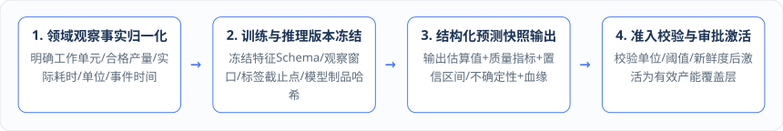
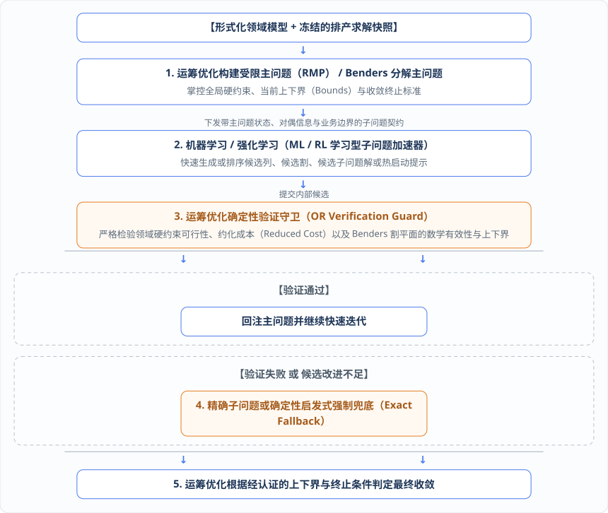
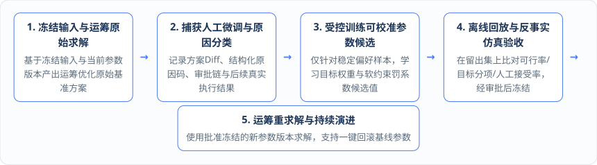

# 第 13 章：三原生交响曲 —— 运筹优化（OR）与机器学习（ML）的三大双向增强

在许多企业的数字化建设中，运筹优化团队与机器学习团队往往处于各自为战的割裂状态：机器学习工程师在外部数据平台上训练预测模型，通过接口向业务系统吐出一个孤立的预测数字；运筹算法工程师则将这个数字直接当作确定性常数塞进线性规划模型里求解。一旦排产结果在现场执行拉胯，两边就会陷入无休止的扯皮——运筹团队怪预测不准，机器学习团队怪排产模型太脆弱。

在“三原生统一于形式化领域模型”的架构下，运筹优化与机器学习的交叉**绝不是让统计模型去替代运筹求解器，也不是把严谨的业务硬约束粗暴地改写成神经网络的奖励函数（Reward Function），而是让“统计/概率解释”与“符号/优化解释”在形式化领域契约下实现双向赋能**。

---

## 13.1 机器学习原生（ML-Native）：冻结特征模式与数据版本，让产能与耗时预测携带质量指标、不确定性与血缘进入审批流

要让机器学习与运筹优化安全协同，第一步必须先将外部黑盒预测改造为平台可治理的一等公民——即实现**机器学习原生（ML-Native）**。

所谓“机器学习原生”，其核心含义不是“业务系统能够通过 HTTP 接口调用一个模型服务”，而是**由形式化领域模型统一定义稳定的特征、标签、预测目标、决策反馈、可校准参数、物理单位、时间口径与结果语义，并使训练数据集、特征模式定义（Feature Schema）、模型制品（Model Artifact）以及在线推理的输入输出全部实现不可变版本化、可校验与可历史回放**。

让我们回到第 4 章与第 5 章的贯穿用例——**工厂日历（Calendar）与产线 A、B 的有效产能估算场景**，看一看一个符合“机器学习原生”标准的预测闭环是如何运转的：

1. **生产执行观察的领域归一化**：当 MES 上报已完工任务的执行记录时，系统首先按照领域层规则将其归一化为标准生产观察事实，显式明确工作单元（Work Unit）、合格产量、实际生产耗时、目标物理单位、业务事件发生时间（Event Time）以及历史观察窗口，绝不允许机器学习脚本自行猜测或临时拼凑业务口径。
2. **输入与模型制品的不可变冻结**：在发起训练或在线推理时，应用层强制冻结本次计算所使用的特征模式定义（Schema）、观察窗口范围、标签成熟截止时点（防止将未来数据混入特征造成数据泄漏）、模型制品版本、运行配置以及输入内容哈希（Content Hash）；机器学习运行时只允许消费已冻结的确定性输入。
3. **带不确定性与血缘的结构化输出**：模型推理产出的**绝不是“真实产能事实”**，而是一份结构化的产能估算结果（如 `estimatedProductivity[A]`），其中必须完整携带模型版本号、评估质量指标、置信区间或概率分布（不确定性）、业务适用范围、血缘追踪信息（Provenance）以及失败时的结构化错误码。
4. **应用层准入校验、人工审批与覆盖层激活**：产能估算结果首先以不可变快照的形式保存样本证据；随后由应用层执行严格的物理单位检查、有限值检查（拒绝 `NaN` 或无穷大）、数据新鲜度检查、质量阈值检查与适用范围校验。只有通过校验并经业务审批与激活后，该估算结果才能正式转化为**有效产能覆盖层（`CapacityEffectiveOverlay`）**，冻结进入主生产计划（MPS）与详细排产的输入快照中，绝不能绕过审批直接冒充人工配置或实际产能事实。

在工程演进上，这套机制具有极佳的平滑演进性：例如在平台建设初期，日历产能估算可以先内置算术平均（Arithmetic Mean）与指数时间加权平均（EWMA）等确定性统计估算器，先把“观察归一化 → 样本证据 → 不可变快照 → 审批激活 → MPS 输入冻结”的业务治理闭环跑通；待后续接入复杂的深度学习或树模型时，只需在受控运行时中替换模型制品即可无缝复用整套领域语义与准入链路，历史推理也始终严格按当时冻结的模型版本精确回放，绝不回退到当前最新模型。

---

## 13.2 增强机制一（ML 辅助 OR）：从单点预测走向鲁棒优化、随机规划、机会约束、CVaR 与分布鲁棒优化（DRO）

当机器学习原生解决了预测结果的可信准入与不确定性量化后，它与运筹原生的第一种协同模式——**机器学习辅助运筹优化（ML-Assisted OR）**便水到渠成。

在传统排产中，即使引入了预测模型，往往也只是取一个“单点期望值”（例如预测产线 A 明天生产率为 `100 kg/h`）代入确定性运筹模型。然而工业现场充满了随机波动：设备可能出现微停机、不同批次原料的加工难度不同、WMS 备料与 TMS 在途时间也存在波动。如果只按单点平均值排满产能，计划在现实中几乎必然因为局部波动而发生连环延误。

通过“机器学习描述数据驱动的不确定性 + 运筹优化生成满足约束的风险感知决策”，我们可以将单点排产升级为五种高阶风险感知优化范式：

| 风险感知优化范式 | 机器学习原生（ML-Native）提供的输入结构 | 运筹原生（OR-Native）编译生成的数学模型 | 解决的工业与供应链核心痛点 |
| :--- | :--- | :--- | :--- |
| **1. 鲁棒优化** （Robust Optimization, RO） | 基于历史残差与特征学习出的可解释、可版本化的**有界不确定集（Uncertainty Set）**及相关性边界。 | 编译为鲁棒对偶等价约束或切平面模型，确保方案在给定扰动集合的所有最坏情况下依然严格可行。 | 保障核心瓶颈产线或共享投料口在加工时长与产能波动范围内绝不发生物理超限或违约。 |
| **2. 随机规划** （Stochastic Programming, SP） | 基于历史分布采样或生成模型产出的**带显式概率权重的离散场景集（Scenario Tree / Set）**（如高/中/低产能与需求场景）。 | 构建两阶段或多阶段随机规划（常配合第 11 章的 Benders 分解求解），优化跨场景的期望总成本与服务水平。 | 在需求、产能或到料交期存在多种可能走势时，找到兼顾基准成本与调整弹性的主计划。 |
| **3. 机会约束规划** （Chance Constraints） | 预测关键随机变量（如工序完工耗时、在途运输时长）的参数化概率分布或分位数函数。 | 将“硬约束 100% 成立”转化为“约束成立的概率不低于置信水平 $1 - \alpha$（如 95%）”的确定性等价约束。 | 显式控制订单延期、产线缺料或超产能等风险事件的发生概率上限。 |
| **4. 条件风险价值** （CVaR 优化） | 预测损失分布的尾部特征与极端场景样本。 | 在目标函数或约束中引入 CVaR 辅助变量与线性化片段，直接约束最差 $\alpha\%$ 极端情况下的平均损失。 | 不仅关注平均准时率，更重点防范极端延误或大额违约金等“黑天鹅”尾部风险。 |
| **5. 分布鲁棒优化** （DRO） | 在历史样本有限或存在轻微分布漂移时，提供以经验分布为中心、以 Wasserstein 距离或矩信息为半径的**模糊集（Ambiguity Set）**。 | 编译为分布鲁棒优化模型，对模糊集内的一整族可能概率分布（而非单一经验分布）保持稳健最优。 | 解决新产线投产初期、新产品导入期历史样本稀缺导致的单点分布过拟合风险。 |

在工程治理上，每一轮风险感知排产都必须**同时冻结预测模型版本、特征模式定义、训练/推理输入快照、场景集或不确定集生成规则、风险厌恶参数以及运筹优化模型版本**。一旦检测到机器学习输出的质量指标不达标、数据已过期或当前工况越出了模型的声明适用范围，应用层必须立即拦截拒绝，自动**降级为经业务批准的静态基准不确定集**或转交人工确认，绝对禁止在后台静默使用未经验收的当前模型去重建历史场景。

---

## 13.3 增强机制二（OR 约束下的 ML/RL）：用受约束强化学习加速列生成定价与 Benders 子问题，由运筹主问题守住可行性与精确兜底

在许多热门的 AI 论文中，常有人尝试用端到端的强化学习（Reinforcement Learning, RL）直接替代运筹求解器来输出排产动作。然而在严肃的工业现场，这种“让 RL 直接下发排产指令”的做法极难落地：因为神经网络策略无法保证 100% 满足成千上万条复杂的物理硬约束（如共享投料口上限、物料守恒、工序先后序），也无法提供当前解距离理论最优解还有多远的数学上下界证明。

因此，本书架构确立了第二种协同范式——**运筹优化约束下的机器学习/强化学习（Constrained ML/RL under OR Master Problem）**。

我们的核心架构原则是：**绝不让强化学习直接面向业务状态下发生产动作，而是将强化学习作为第 11 章大规模分解算法（列生成与 Benders 分解）内部受严格约束的“学习型子问题加速器”**！运筹优化始终牢牢掌控主问题、硬约束边界、候选验证、上下界计算与最终收敛判定。

如上图所示，这套“OR 主控 + RL 加速 + 精确兜底”的协同链路严格死守五条工程边界：

1. **在列生成 / 分支定价（Branch-and-Price）中的边界**：强化学习可以根据当前主问题的对偶价格与资源状态，快速生成或排序高价值候选列、选择定价启发式策略，或为定价子问题提供高质量的热启动（Warm Start）。但**每一个由 RL 产出的候选列在进入受限主问题前，必须通过运筹层的业务硬约束可行性校验与约化成本（Reduced Cost）独立核验**。更重要的是，当算法接近收敛或需要给出最优性证明时，系统**必须强制运行可认证的精确定价子问题**，严格证明已不存在满足分支约束的改进列。
2. **在 Benders 分解中的边界**：强化学习可以用来动态选择子问题的求解策略、优化多随机场景的求解顺序、管理割平面池（Cut Pool）的优先级，或者直接预测提出候选割（Candidate Cuts）。但**任何可行割（Feasibility Cut）与最优割（Optimality Cut）都必须由运筹优化层根据经过认证的原始/对偶信息验证其数学有效性**；主问题的上下界与终止间隙绝不能由 RL 的价值网络估计值替代。
3. **策略制品与奖励函数治理边界**：强化学习的状态空间、动作空间、奖励函数定义、训练数据集、策略模型制品（Policy Artifact）与适用范围必须像普通 ML 模型一样严格版本化。奖励函数只用于引导求解搜索效率或提升候选生成质量，**绝不能成为业务硬约束的唯一来源**。
4. **100% 可复现与自动降级兜底边界**：每一轮调用 RL 加速的排产求解，都必须完整记录所用的策略版本、随机数种子（Random Seed）、生成的候选列表、被运筹守卫拒绝的原因、触发精确子问题兜底的时机以及最终收敛认证依据。一旦检测到 RL 策略发生分布漂移、推理超时或产出的候选均为不可行/非改进列，求解管线必须能毫秒级无缝退回确定性启发式或精确子问题求解，确保系统在完全禁用 RL 时依然能独立完成求解与认证。
5. **业务状态写入隔离边界**：强化学习的全部输出仅仅是运筹优化求解器内部的瞬态候选或求解提示（Hints），最终仍须经由运筹优化的结构化解解析与应用层校验，才能转换为正式领域方案；强化学习组件绝无权限直接修改领域聚合状态或触发生产下发副作用。

---

## 13.4 增强机制三（决策反馈驱动的参数校准）：从计划员的人工调整差异与原因码中学习目标权重与软约束偏好

运筹原生与机器学习原生的第三种深度协同，直指工业软件落地中最普遍的一个痛点：**为什么运筹算法算出来的“数学最优计划”，计划员拿到手后总是要手工改上好几处才肯下发？**

原因在于，真实的生产运营中存在着大量“只可意会、难以一次性由实施顾问精准给出定量数字”的权衡偏好——比如在特定旺季，相比于多换产两次（换产成本），车间其实更看重不让某几家核心客户延期哪怕半小时（交期权重）；或者在某条老旧产线上，计划员宁可留出 10% 的安全产能缓冲（软约束罚系数），也不愿把设备排到极限。

当运筹优化给出的原始方案经过计划员手工调整后，**原始方案与人工修改方案之间的结构化差异（Diff），实际上蕴含着宝贵的领域知识——它揭示了当前数学模型的目标函数权重或软约束罚系数尚未完整表达的稳定业务偏好**！

为此，我们构建了第三条增强闭环——**决策反馈驱动的运筹优化参数校准（Decision-Feedback-Driven OR Parameter Calibration）**。系统利用逆向优化（Inverse Optimization）、偏好学习（Preference Learning）或排序学习（Learning to Rank）等受控参数学习方法，从历史决策反馈中持续校准那些**已被领域层显式声明为“允许学习（Learnable）”的运筹参数**：

为了防止参数学习把计划员的临时妥协或错误操作当成真理固化进系统，该闭环强制执行五条治理铁律：

1. **可学习范围必须显式声明，硬约束绝不可被训练放宽**：形式化领域模型必须显式标注哪些参数允许被校准（例如：订单交期延误、换产耗时、库存积压、加班时长等目标函数的相对权重，软约束的惩罚系数，经业务批准的弹性容差，以及不影响数学正确性的启发式搜索参数）。**法律法规、安全红线、设备物理容量极限、共享投料口硬上限、物料守恒平衡等硬约束（Hard Constraints），绝对禁止通过参数学习放宽或删除**！
2. **人工调整不是天然的“最优标签”，必须强制进行原因码分类**：计划员手工改动排产表，背后可能有四种完全不同的动机：
   * *动机 A（数据修正）*：发现某张工单的 BOM 或库存主数据错了，手工改计划临时绕开；
   * *动机 B（缺失硬约束）*：现场临时坏了一台模具但还没录入系统，手工把工单挪走（这应当转化为第 14 章的动态硬约束或新领域规则，而不是改权重！）；
   * *动机 C（一次性特批例外）*：老板临时打电话要求某张非紧急订单插队；
   * *动机 D（稳定业务偏好）*：长期稳定的多目标权衡习惯。
   应用层在计划员保存调整时，必须强制记录结构化差异与**调整原因码（Reason Code）**；未分类的人工调整或属于数据修正/一次性例外的样本，严禁作为“最优监督标签”直接混入参数训练集！
3. **训练样本必须包含完整决策上下文且 100% 可回放**：每一个反馈训练样本都不能只保存最终那张人工排产表，而必须同时冻结当时的领域输入快照、运筹模型版本、旧参数版本、运筹原始方案、人工修改方案、审批链以及车间最终的真实执行效果，确保样本在任何时候都能完整回放当时的对比情境。
4. **严格的离线留出集评估与反事实仿真准入**：训练产出的新权重或新罚系数候选值，绝不允许以“在线学习（Online Learning）”的方式直接溜进生产排产！它们必须先在跨时间周期、跨组织和跨场景的留出集（Holdout Set）上进行**历史回放与反事实仿真（Counterfactual Simulation）**，全面比对新旧参数下的方案可行率、各目标分项得分、计划稳定性、人工接受率提升度以及实际执行模拟效果；只有通过安全边界校验并获得业务审批后，才能生成不可变的新参数版本冻结生效。
5. **全链路血缘记录与一键回滚诊断**：每一次排产求解都显式记录所用参数版本的来源与训练数据血缘。一旦外部市场环境剧变、人工偏好转移或新参数导致某项 KPI 退化，系统支持**一键回滚至已批准的基线参数版本**，并能借助诊断工具清晰区分究竟是“目标权重参数失配”、“输入数据质量问题”还是“领域模型缺失了新的硬约束”。
