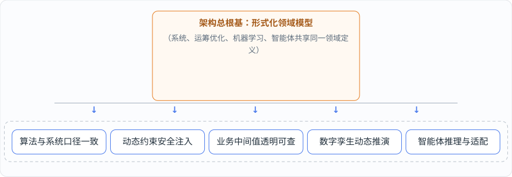
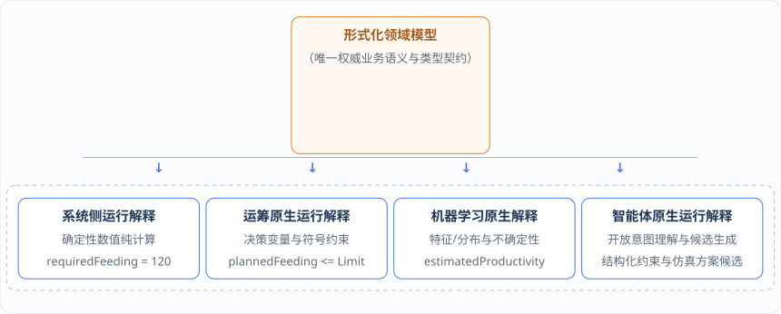
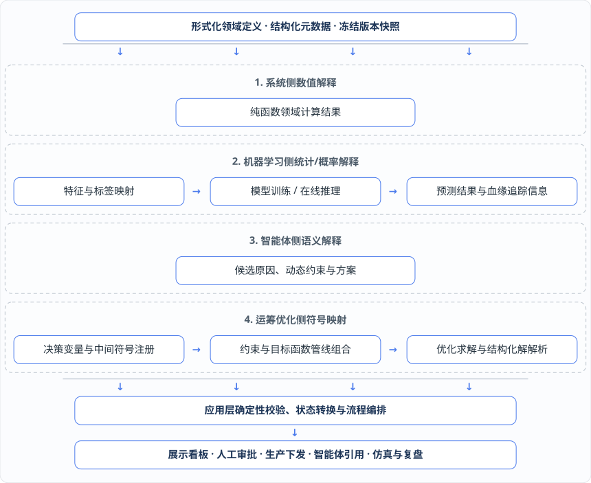

# 第 5 章 · 三原生统一于形式化领域模型：终结业务语义分裂

在引入运筹优化（OR）、机器学习（ML）与大语言模型智能体（Agent）的企业级软件（如数字化运营平台 DOP 与高级计划排程系统 APS）中，最危险的长期架构隐患并不是多种技术栈并存带来的运维负担，而是**业务语义的彻底分裂**。本章将从架构依赖的底层逻辑出发，阐明如何通过形式化领域模型将“运筹原生、机器学习原生、智能体原生”与确定性业务系统统一在同一份语义契约之下，并基于 `ospf-kotlin` 原生组件给出状态角色隔离与领域契约的工程实现。

***

## 5.1 为什么说“各运行侧共享同一形式化领域模型”是整座架构大厦的根基？

在第 1 章剖析传统架构痛点时，我们曾提到企业软件向智能化演进需要具备 15 项核心架构能力（包括业务逻辑内聚、算法可被应用层编排、算法与系统口径一致、动态约束注入、中间值透明、可测试性、可仿真性、版本快照、数字孪生推演、滚动排产与流程编排、智能体动态适配与业务推理等）。

当我们对这 15 项能力进行严格的拓扑依赖推演时，会得出一个极其关键的发现：**“各运行侧共享同一形式化领域模型”（第 8 点）是支撑所有高阶能力的总根基**。



为什么一旦失去“共享形式化领域模型”这块基石，上面所有的智能化能力都会沦为空中楼阁？我们可以顺着依赖链逐一验证：

1. **没有共享形式化领域模型，就不可能有“算法与系统业务口径一致”**。如果业务系统和运筹算法各自定义一遍“投料量”“生产时长”“换产时间”“产能占用”和“物料消耗”，系统就会同时存在两套代码、两套单位转换、两套边界条件和两套异常处理逻辑。在这种架构下，业务规则更新后的口径不一致根本不是偶发的编码失误，而是架构分裂的必然结果。
2. **没有共享形式化领域模型，就不可能实现安全的“动态约束注入”**。动态约束要求排产变量与业务中间值是运行时可精确引用的“一等公民”。如果“投料量”的物理单位、状态角色（计划值还是实际值）与时间聚合口径没有被形式化建模，系统与智能体就无法在运行时安全引用它来构造数学不等式。
3. **没有共享形式化领域模型，“中间值透明”就无从谈起**。中间值透明并不是靠在接口里多塞几个返回字段凑出来的，而是形式化领域模型的自然副产品。如果投料量、产能占用或换产耗时只是算法服务内部的临时数学表达式，求解结束后系统拿到的就只是一堆没有业务身份的原始数字，根本无法知道“这个值代表什么业务含义、从哪个规则来、由哪些变量计算得到”。
4. **没有共享形式化领域模型，“数字孪生动态推演”与“滚动排产流程编排”就会断裂**。数字孪生要求当前序任务报工延误后，系统能独立根据换产时间、生产时长与日历可用性重算后序任务的预计时间；流程编排则要求“排产 → 替代料分配 → 重算物料消耗 → MRP → 下发”各节点使用统一的数据结构与业务口径传递状态。若这些模型仍被锁在单一算法内部或各节点各执一词，推演与编排便寸步难行。
5. **没有共享形式化领域模型，“智能体业务推理与动态适配”只能停留在文字游戏**。智能体不是靠阅读散乱的业务代码去猜语义的；它必须依赖系统暴露的结构化领域元数据（可引用变量、中间值、约束模板、流程节点契约与适用边界），才能把车间现场的自然语言描述转化为可校验、可审计、可回滚的执行方案。

正因如此，平台架构升级的核心方向，是从过去“业务系统调用求解器黑盒 + 调用预测服务黑盒 + 调用大语言模型黑盒”的外挂拼凑模式，转向**业务系统、运筹优化、机器学习与智能体四种运行侧共享同一形式化领域模型的“三原生（运筹原生、机器学习原生、智能体原生）”架构**。

***

## 5.2 同一业务概念的四种正交解释：系统侧数值解释、运筹侧符号解释、机器学习侧统计解释与智能体侧语义解释

在 Software 1.0、2.0 与 3.0 并存的企业软件中，同一个业务概念（如“产能”“投料量”或“时间窗口”）会同时出现在系统代码字段、机器学习特征矩阵、运筹求解器变量以及大语言模型的提示词上下文中。

| 同一业务概念           | 确定性业务系统（数值计算）          | 统计 / 机器学习（概率计算）          | 运筹优化（符号与数学规划）        | 大语言模型 / 智能体（语义推理）     |
| ---------------- | ---------------------- | ------------------------ | -------------------- | --------------------- |
| **产能（Capacity）** | 数值计算 / 主数据配置字段         | 历史生产特征 / 训练标签 / 估算生产率分布  | 资源容量约束上限 / 模型参数      | 可理解、可引用的业务概念与来源说明     |
| **投料量（Feeding）** | 按 BOM 与损耗计算的确定性数值 / 状态 | 预测模型输入特征或监督信号            | 计划决策变量 / 线性或非线性约束表达式 | 临时规则推理与异常影响分析的引用对象    |
| **时间（Time）**     | 计划 / 预计 / 实际三层状态时间戳    | 事件发生时间 / 历史观察窗口 / 标签截止时点 | 交期时间窗 / 工序前后序与换产时间约束 | 推理偏差传播与设定规则生效范围的语义上下文 |

所谓“三原生统一于形式化领域模型”，绝不是把系统、运筹优化、机器学习和智能体做成四套彼此独立的业务语言，而是让它们**共享同一份权威领域定义，并根据各自的运行载体对同一概念执行四种正交的运行解释**：

### 1. 系统侧：确定性数值解释（Numerical Interpretation）

业务系统（涵盖应用层、领域计算模型与持久化状态管理）面向的是已经明确的输入数据。它对领域模型执行确定性的纯函数数值计算与状态流转治理。例如，在给定订单数量、BOM 展开关系、替代料配比与损耗系数后，系统侧直接计算出产线 A 的需求投料量 `requiredFeeding[A] = 120 kg`，或者根据前序任务的实际结束时间直接算出后序任务的预计开始时间。

### 2. 运筹原生（OR-Native）：符号与优化解释（Symbolic Interpretation）

运筹原生的本质，是让领域知识能够由算法层稳定、无歧义地映射为优化引擎可消费的符号模型。在运筹优化侧，产线 A 的计划投料量 `plannedFeeding[A]` 不再是一个已知的静态数字，而是被解释为一个待求解的\*\*计划决策变量（Decision Variable）\*\*或由决策变量构成的代数表达式（如 `ospf` 中的 `LinearExpressionSymbol`），受制于共享投料口容量上限（`feedingLimit`）与有效产能约束。更换底层求解器时，领域语义保持不变，仅由算法适配层重新编译符号约束。

### 3. 机器学习原生（ML-Native）：统计与概率解释（Statistical / Probabilistic Interpretation）

机器学习原生的本质，是让领域知识能够被训练与推理过程稳定地“统计化、概率化消费”。在机器学习侧，历史生产执行事实被严格按领域规则归一化为具名的特征（合格产量、实际耗时、工作单元、观察窗口）与预测目标，模型推理输出的是带有模型版本号、评估质量指标、置信区间（不确定性）与适用范围的估算生产率 `estimatedProductivity[A]`，而绝不是一个来历不明的黑盒裸数值。

### 4. 智能体原生（Agent-Native）：语义与编排解释（Semantic Interpretation）

智能体原生的本质，是让领域模型本身成为可被大语言模型直接读取、推理和组合的结构化语义契约。在智能体侧，模型无需猜测底层代码实现，而是直接通过结构化领域元数据识别出“投料口”“计划投料量”“实际投料事实”“产能估算快照”及其单位与边界，结合当前数字孪生上下文输出受影响对象集合、结构化候选约束与仿真比选方案。



通过这四种正交解释，形式化领域模型同时扮演了双重关键角色：在横向协同上，它是系统、运筹优化、机器学习与智能体的**共同语义契约**；在纵向演进上，它又是面向 `LLM as Runtime` 的**领域语言规范、类型系统与编译契约**。

***

## 5.3 状态角色隔离：为什么统一“投料量”定义，绝不等于把需求量、计划量、预测量、预计量和实际量混为一个字段？

在推进“统一领域模型”的过程中，工程团队最容易踩入的一个致命误区是：**误以为“统一业务概念定义”就是把所有的“投料量”或“产能”合并成数据库里的同一个字段**。

我们必须以最严厉的架构准则明确指出：**统一的是业务概念的语义、物理量纲、计算关系与时间聚合口径，而绝不是把需求量、计划量、预测量、预计量和实际执行事实混用为同一个字段！**

在真实的生产与供应链闭环（ERP / APS / MES / WMS / TMS）中，同一业务概念在不同生命周期阶段承担着截然不同的**状态角色（State Roles）**，它们的产生入口、可变性与治理规则有着严格的不可逾越边界：

| 状态角色                                    | 以“投料量 / 产能”为例的具名表达                                      | 产生机制与权威来源                                             | 核心治理铁律                                                                                       |
| --------------------------------------- | ------------------------------------------------------- | ----------------------------------------------------- | -------------------------------------------------------------------------------------------- |
| **1. 需求角色（Required）**                   | 需求投料量 `requiredFeeding`                                 | 由系统侧根据订单需求、BOM 展开、替代料规则与工艺损耗执行确定性数值计算得出。              | 反映理论需求基准，随订单或 BOM 版本变更而重算。                                                                   |
| **2. 预测角色（Predicted / Estimated Rate）** | 估算生产率 `estimatedProductivity`                           | 由机器学习或统计估算器基于冻结的历史观察窗口推理得出，携带质量指标、不确定性与模型血缘。          | **预测绝不能直接冒充人工配置或实际事实**；必须生成不可变快照，经校验、审批与激活后，才能作为有效产能覆盖层（`CapacityEffectiveOverlay`）冻结进入排产输入。 |
| **3. 计划角色（Planned）**                    | 计划投料量 `plannedFeeding`                                  | 在运筹优化求解中作为决策变量（或中间表达式），在求解完成后经结构化解解析并由应用层确认为正式计划方案版本。 | **优化求解结果只是建议或基准计划，绝不等于现场已经发生的物理事实**。                                                         |
| **4. 预计角色（Estimated / Projected）**      | <p>预计投料量 <code>estimatedFeeding</code><br>预计开始/结束时间</p> | 在数字孪生推演中，结合已发生的最新实际进度与领域计算模型动态重算出的未来状态预测。             | 用于实时反映偏差向后传播的影响，不可直接覆盖下发基准计划或伪造实际报工。                                                         |
| **5. 实际角色（Actual Fact）**                | <p>实际投料事实 <code>actualFeeding</code><br>实际生产耗时</p>      | 由 MES、WMS、TMS 等外部现场执行系统同步并经由事实入口记录的**不可变执行事实**。       | **至高无上的物理事实边界**：只能由执行事实入口追加记录，任何算法求解器、预测模型或大模型智能体均无权生成或篡改实际事实！                               |

让我们回到第 1 章和第 4 章反复提及的“产线 A、B 当天共用一个投料口，总投料量不超过上限 `feedingLimit`”这一贯穿案例，看看状态角色隔离在运行时是如何发挥关键作用的：

假设在周二上午 10:00 触发滚动重排时，产线 A 的前序任务 `T1` 已经执行完毕，并在当天时间窗口内产生了真实的投料消耗。此时，如果把投料上限 `feedingLimit` 解释为当日累计容量限制，那么智能体与编译器生成的结构化动态约束**绝不能**笼统地写成 `plannedFeeding[A] + plannedFeeding[B] <= feedingLimit`，而必须精准地区分“已发生的实际事实”与“待决策的剩余计划变量”：

```
actualFeedingInWindow + plannedFeedingRemaining[A] + plannedFeedingRemaining[B] <= feedingLimit
```

在这个表达式中：

* `actualFeedingInWindow` 是从 MES/WMS 事实入口读取并冻结的当日已执行任务实际投料总量（不可变常数事实）；
* `plannedFeedingRemaining[A]` 与 `plannedFeedingRemaining[B]` 则是产线 A、B 上待执行任务（如 `T2`、`T3`）在当日窗口内的计划投料决策变量；
* 倘若现场限制不是当日累计量，而是瞬时流量上限，则系统会根据领域目录定义，将其切换为按时间桶（Time Bucket）聚合的约束模板。

此外，在跨系统（MES、WMS、TMS 与 APS）协同中，统一领域语义与状态角色隔离还带来了一项重要的工程韧性：**解耦外部系统的单据到达时序与本地计算一致性**。在真实工厂里，MES 的报工单、WMS 的领料单与 TMS 的运单不可能总是毫秒不差地同时到达或完整配对，某些外部对象或可选追溯信息（如生产批次号）在特定时刻可能暂时缺失。依托清晰的状态角色边界，只要同步过来的执行事实满足当前领域计算必需的数据条件，可选追溯信息的缺失就绝不应阻断 APS 的业务计算；同时，计划值、预计值和预测值仍严格按各自口径产生和流转，永远不会因为外部单据延迟而去冒充实际执行结果。

### 工程实现：基于 OSPF 原生 `Quantity`、`PhysicalUnit` 与 `Ret` 的状态角色强类型隔离代码

在代码实现中，我们**直接使用 `ospf-kotlin-utils` 原生提供的 `Quantity<T>`、`PhysicalUnit`（如 `Kilogram`、`Ton`、`Hour`、`Kilogram / Hour`）、`RealNumber<T>` 与 `Ret<T>`（`Ok` / `Failed`）**，通过泛型状态角色标记（`StateRole`）从编译期锁死五类角色的边界，并实现预测准入激活机与容忍可选追溯信息缺失的外部事实接收守卫：

```kotlin
package org.adaptive.dop.domain.role

import java.time.Instant
import fuookami.ospf.kotlin.utils.math.*
import fuookami.ospf.kotlin.utils.physics.unit.*
import fuookami.ospf.kotlin.utils.physics.quantity.*
import fuookami.ospf.kotlin.utils.error.*
import fuookami.ospf.kotlin.utils.functional.*

// 1. 定义五类严格隔离的领域状态角色标记接口 (State Role Markers)
sealed interface StateRole {
    val roleCode: String
}

/** 需求角色：系统侧按 BOM、计划产出量和损耗计算的理论需求量 (如 requiredFeeding) */
data object RequiredRole : StateRole { override val roleCode = "REQUIRED" }

/** 预测角色：机器学习或统计估算器输出的预测值 (如 estimatedProductivity)，未审批激活前严禁直接作为计划输入 */
data object PredictedRole : StateRole { override val roleCode = "PREDICTED" }

/** 计划角色：运筹优化求解产出的建议计划值 (如 plannedFeeding)，绝不等于现场已发生的实际事实 */
data object PlannedRole : StateRole { override val roleCode = "PLANNED" }

/** 预计角色：数字孪生结合最新实际进度推算出的预计值 (如 estimatedFeeding / 预计开始结束时间) */
data object EstimatedRole : StateRole { override val roleCode = "ESTIMATED" }

/** 实际角色：MES/WMS/TMS 现场执行事实入口记录的不可变事实 (如 actualFeeding) */
data object ActualFactRole : StateRole { override val roleCode = "ACTUAL_FACT" }

// 2. 直接基于 OSPF 原生 Quantity<T> 构建带状态角色与版本血缘的领域量 (RoleScopedQuantity)
// 泛型 R 约束为状态角色 StateRole，泛型 T 约束为 OSPF 的 RealNumber<T>
data class RoleScopedQuantity<R : RealNumber<T StateRole, T>>(
    val conceptName: String,       // 统一领域概念名，如 "feeding_amount"
    val role: R,                   // 强类型状态角色标记
    val quantity: Quantity<T>,     // 直接复用 OSPF 原生的 Quantity<T> (内含数值与 PhysicalUnit)
    val businessObjectId: String,  // 绑定的业务对象标识，如 "lineA"
    val timeWindowId: String,      // 绑定的时间窗口标识
    val snapshotVersion: String,   // 来源快照版本或事件 ID
    val recordedAt: Instant
)

// 3. 机器学习产能估算快照与有效产能覆盖层 (CapacityEffectiveOverlay) 审批激活状态机
data class ProductivityPredictionSnapshot<T : RealNumber<T>>(
    val snapshotId: String,
    val workUnitId: String,
    val featureSchemaVersion: String,
    val modelArtifactVersion: String,
    val inputContentHash: String,
    val estimatedProductivity: RoleScopedQuantity<PredictedRole, T>,
    val confidenceInterval: Pair<Quantity<T>, Quantity<T>>,
    val qualityScore: Flt64
)

/**
 * 有效产能覆盖层 (CapacityEffectiveOverlay)：
 * 只有通过质量阈值、OSPF 物理单位校验并获得业务审批后，预测快照才能转化为此类型冻结进入 MPS/排产输入！
 */
class CapacityEffectiveOverlay<T : RealNumber<T>> private constructor(
    val overlayId: String,
    val sourceSnapshotId: String,
    val workUnitId: String,
    val effectiveProductivity: Quantity<T>,
    val approvedBy: String,
    val activatedAt: Instant
) {
    companion object {
        fun <T : RealNumber<T>> approveAndActivate(
            snapshot: ProductivityPredictionSnapshot<T>,
            minQualityThreshold: Flt64,
            expectedRateUnit: PhysicalUnit = Kilogram / Hour, // 直接使用 OSPF 原生单位除法组合复合单位 kg/h
            approver: String,
            now: Instant
        ): Ret<CapacityEffectiveOverlay<T>> {
            // 1) 使用 OSPF 容差比较算子 ls (<) 校验预测质量阈值
            if (snapshot.qualityScore ls minQualityThreshold) {
                return Failed(
                    Err(ErrorCode.ApplicationError, "预测质量得分 (${snapshot.qualityScore}) 低于准入阈值 ($minQualityThreshold)，拒绝激活！")
                )
            }
            // 2) 直接使用 OSPF Quantity.to(expectedRateUnit) 校验并对齐单位量纲
            val alignedQty = snapshot.estimatedProductivity.quantity.to(expectedRateUnit)
                ?: return Failed(
                    Err(
                        ErrorCode.DimensionMismatch,
                        "产能估算单位 [${snapshot.estimatedProductivity.quantity.unit}] 与目标有效产能单位 [$expectedRateUnit] 量纲不兼容"
                    )
                )

            return Ok(
                CapacityEffectiveOverlay(
                    overlayId = "ovl_${snapshot.snapshotId}",
                    sourceSnapshotId = snapshot.snapshotId,
                    workUnitId = snapshot.workUnitId,
                    effectiveProductivity = alignedQty,
                    approvedBy = approver,
                    activatedAt = now
                )
            )
        }
    }
}

// 4. 跨系统（MES / WMS / TMS）异步执行事实容错接收守卫
data class MesFeedingFactDto(
    val eventId: String,
    val lineId: String?,
    val taskId: String?,
    val rawFeedingValue: Double?,
    val unit: PhysicalUnit?, // 直接使用 OSPF 原生 PhysicalUnit（如 Kilogram、Ton、Gram）
    val eventTime: Instant?,
    // 可选追溯单据字段：当外部单据未同时到达或缺失批次号时，绝不阻断 APS 核心投料与进度计算
    val productionBatchNo: String? = null,
    val wmsPickOrderNo: String? = null
)

object MesFactIngestionGuard {
    fun ingestActualFeeding(
        dto: MesFeedingFactDto,
        targetMassUnit: PhysicalUnit = Kilogram, // 直接使用 OSPF 原生 Kilogram 单位
        timeWindowId: String
    ): Ret<RoleScopedQuantity<ActualFactRole, Flt64>> {
        val line = dto.lineId?.takeIf { it.isNotBlank() }
            ?: return Failed(Err(ErrorCode.IllegalArgument, "缺失核心计算必需字段: lineId"))
        val rawVal = dto.rawFeedingValue?.takeIf { it.isFinite() && it >= 0.0 }
            ?: return Failed(Err(ErrorCode.IllegalArgument, "缺失或非法的实际投料数值: rawFeedingValue"))
        val evtTime = dto.eventTime
            ?: return Failed(Err(ErrorCode.IllegalArgument, "缺失核心事件时间戳: eventTime"))
        val sourceUnit = dto.unit
            ?: return Failed(Err(ErrorCode.IllegalArgument, "缺失物理单位: unit"))

        // 使用 OSPF 原生 Flt64 与 Quantity(value, unit) 构造数量，并调用 .to(targetMassUnit) 完成同量纲换算
        val rawQuantity = Quantity(Flt64(rawVal), sourceUnit)
        val alignedQuantity = rawQuantity.to(targetMassUnit)
            ?: return Failed(Err(ErrorCode.DimensionMismatch, "上报投料单位 [$sourceUnit] 与目标质量单位 [$targetMassUnit] 量纲不兼容"))

        return Ok(
            RoleScopedQuantity(
                conceptName = "feeding_amount",
                role = ActualFactRole,
                quantity = alignedQuantity,
                businessObjectId = line,
                timeWindowId = timeWindowId,
                snapshotVersion = "evt_${dto.eventId}",
                recordedAt = evtTime
            )
        )
    }
}
```

***

## 5.4 形式化领域模型的八大最低构成要素与运行时实例边界

本文所称“形式化领域模型”，不是数据库实体集合、某个求解器的数学模型或某个机器学习模型的特征表，而是由稳定业务概念、纯计算关系、变量与中间值语义、特征/标签/预测语义、结构化约束元数据、决策反馈与可校准参数语义、模型制品治理、版本快照和结果契约共同组成的**可计算语义体系**。

在大语言模型即运行时（`LLM as Runtime`）的长期架构下，它还承担 **领域语言规范 / 类型系统 / 编译契约** 的职责：约束大语言模型与智能体“什么可以表达、如何组合、单位/状态/范围是什么、哪些能力可执行、哪些必须拒绝”，并为语义中间表示（Semantic IR）、编译器和运行时专门化提供稳定的语义与版本边界。它至少应包含以下八大构成要素：

| 构成要素                         | 最低形式化定义要求                                                                      | 架构分层与运行边界                                                     |
| ---------------------------- | ------------------------------------------------------------------------------ | ------------------------------------------------------------- |
| **1. 领域概念与计算模型**             | 稳定名称、数据类型、物理单位、维度、业务对象绑定、状态角色、时间范围、边界条件与显式错误语义                                 | **由领域层权威定义**；业务系统侧以无副作用的纯函数数值方式直接执行计算。                        |
| **2. 变量与中间值语义**              | 稳定标识符、索引维度、来源表达式或计算关系、依赖项、物理单位、适用业务场景与生命周期                                     | **领域层定义业务语义**；运筹算法层据此创建单次求解所需的运行时决策变量与中间符号。                   |
| **3. 特征、标签与预测语义**            | 对应领域概念、事件发生时间、历史观察窗口、标签成熟截止时点、单位、维度、业务对象绑定、适用范围与防数据泄漏（Data Leakage）约束          | **领域层定义稳定语义**；机器学习侧据此构造运行时特征张量、训练样本与预测输出。                     |
| **4. 约束与目标元数据**              | 约束/目标名称、代数表达式、比较关系、软硬优先级、物理单位、对象绑定、时间范围、启停条件、版本号与冲突诊断信息                        | **领域层提供约束语义或模板**；算法层将其编译为可组合、可独立测试的约束与目标管线（Pipeline）。         |
| **5. 决策反馈与可校准参数语义**          | 运筹原始输入/参数/原始方案、人工计划调整差异、结构化原因码、审批链与实际执行结果；可校准参数的名称、类型、合法范围、适用场景及“是否允许学习”标记     | **应用层记录并分类反馈**；机器学习侧仅训练被显式允许学习的参数候选；运筹侧使用经审批并冻结的参数版本重新求解。     |
| **6. 模型制品与质量治理**             | 模型唯一标识、不可变版本号、内容哈希（Content Hash）、训练数据集引用、特征模式定义（Schema）、运行时版本、离线评估指标、审批状态与适用范围 | **算法或受控机器学习运行时产生制品**；应用层编排制品验收、启停与回滚；基础设施层负责持久化存取。            |
| **7. 快照与适用版本**               | 输入数据快照、业务规则快照、字段目录版本、算法能力版本、特征/数据集/模型版本、适用组织与生效时间区间                            | **应用层选择并冻结本轮计算所用版本**；运筹优化、机器学习与智能体严禁隐式读取当前最新数据库值去替代历史快照输入。    |
| **8. 结果契约（Result Contract）** | 结果具名标识、业务含义、物理单位、来源变量/中间值/模型、质量指标、不确定性区间、适用范围、风险提示与结构化失败原因                     | **运筹/机器学习侧将内部输出解析为结构化结果**；应用层完成校验后，再将其转换为领域方案、计算结果、预测快照或风险指标。 |

在工程实现上，架构师必须死守一条核心边界：**严格区分“稳定领域语义定义”与“单次运行时实现实例”**。

* **稳定领域语义定义**：诸如 `plannedFeeding`（计划投料量）、产能特征、预测目标的名称、物理单位、状态角色、业务对象绑定与时间口径，属于跨运行侧共享的领域语义，驻留在领域层；
* **单次运行时实现实例**：诸如底层求解器中的具体二元变量（`BinVar` / `BinVariable1`）、运行时中间符号、具体求解器约束句柄、机器学习的特征张量（Tensor）、模型权重矩阵以及单次求解/推理会话（Session），全部属于**单次建模或单次推理的瞬态运行实现**——它们**绝不能侵入领域聚合根（Domain Aggregate），也绝不能作为业务事实直接持久化到核心业务表中**！

同时，具名的业务中间值与预测结果充当了**跨能力组合的稳定语义接口**。例如，一个模块对外公开“预计投料量”“资源占用量”“预计换产时间”或“估算生产率”等具名结果时，下游消费方（无论是数字孪生看板、后续排产节点还是智能体）只需依赖其业务含义、物理单位、适用范围与血缘追踪信息（Provenance），而完全无需关心它内部究竟是用算术表达式、逻辑分段函数、运筹决策变量还是机器学习模型算出来的。不同的底层实现可以支撑同一个结果语义，但每一种实现都必须显式声明其业务模式、算法/模型能力、规则或模型版本、质量指标与适用条件，严禁在运行时静默切换计算口径。

当这套形式化领域模型进入运行态后，四大运行侧便形成了一条高度内聚、可追溯的标准协作链路：


