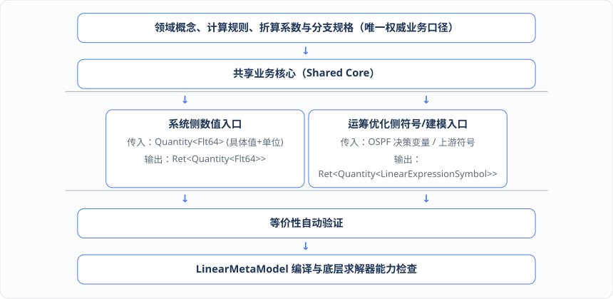

# 第 7 章 · 一鱼两吃：统一表达式中间表示（Expression IR）与同源双入口

在第 5 章和第 6 章中，我们看到形式化领域模型要求同一个业务规则（例如“投料量计算”“物料消耗预计”“换产时间计算”或“产能占用计算”）既能在业务系统侧进行确定性的**数值计算**，又能在运筹优化侧进行面向求解器的**符号建模**。

然而在传统的软件工程实践中，“数值计算”和“符号建模”仿佛生活在两个平行宇宙里。本章将深入剖析这两个宇宙分裂的根源，并展示如何直接利用 `ospf-kotlin` 的**统一表达式与多项式中间表示（`LinearMonomial` / `LinearPolynomial` / `LinearExpressionSymbol`）**、**共享业务核心双入口架构**以及**部分求值与编译求值技术**，真正实现“一份业务规则定义，同时驱动系统数值求值与运筹符号求解”的“一鱼两吃”架构。

***

## 7.1 传统研发的分裂之痛：后端程序员用业务代码算物料消耗，算法工程师用脚本重写一遍投料约束

让我们看一个在几乎所有制造企业都会发生的日常研发场景：定义\*\*“工单任务在指定时间窗口内的物料投料消耗”\*\*规则。

在传统开发模式下，这个规则会被拆成两份完全不同的代码，交给两个团队分别实现：

*   **第一份代码（系统后端团队编写）**：为了在排产工作台展示物料消耗预计，或者在替代料分配更新了任务投料后重新核算消耗，后端工程师会在 Service 层用 Java/Kotlin 编写一段直接操作具体数值（`Double`）的函数：

    ```kotlin
    // 系统侧：直接传入具体数值，算出一个具体的消耗结果数字
    fun calcFeedingAmount(outputQty: Double, bomRatio: Double, scrapRate: Double): Double {
        return outputQty * bomRatio / (1.0 - scrapRate)
    }
    ```
*   **第二份代码（运筹算法团队编写）**：为了在排产求解时保证“产线 A 和产线 B 的计划投料量之和不超过共享投料口上限 `feedingLimit`”，算法工程师会在算法服务里调用某个特定求解器（如 Cplex、Gurobi 或 OR-Tools）的 API，用决策变量构造一段线性表达式：

    ```python
    # 算法侧：操作求解器专属变量句柄，拼装出一个数学约束对象
    expr_a = solver.ScalProd([var_output_qty_a], [bom_ratio_a * (1.0 + scrap_rate_a)])
    expr_b = solver.ScalProd([var_output_qty_b], [bom_ratio_b * (1.0 + scrap_rate_b)])
    solver.Add(expr_a + expr_b <= feeding_limit)
    ```

请仔细观察上面这两段代码——**灾难已经悄然发生了**！ 在系统后端的代码里，损耗率采用的是**除法口径** `bomRatio / (1.0 - scrapRate)`；而在算法工程师写的脚本里，损耗率却被写成了**乘法近似口径** `bom_ratio * (1.0 + scrap_rate)`！

当损耗率 `scrapRate = 10%` 时，系统算出来的需求投料系数是 `1 / 0.9 = 1.1111...`，而算法求解时用的系数却是 `1.10`。结果就是：运筹算法满心欢喜地返回了一个“完全满足 1000 公斤投料口上限”的最优排产计划，但当这个计划传回业务系统、按系统口径一重算物料消耗预计时，总投料量赫然变成了 `1010 公斤`，直接在生产现场触发超限告警！

这就是**缺少统一的数值与符号计算基础，导致同一公式在系统代码、算法表达式和求解器适配中重复实现**的典型恶果。只要数值计算和符号建模是两套独立编写的代码，无论团队开多少次对齐会、写多少页接口文档，编译期都无法阻止单位错配或公式分叉。

***

## 7.2 OSPF 表达式中间表示（Expression IR）：常量、稳定符号身份、属性路径与不可变语法树

要从根源上消灭“两套公式代码”，核心思路其实非常清晰：**我们不应该让业务规则直接算出一个死数字，也不应该让它直接绑定某个求解器的变量句柄，而是应该让业务规则构建出一棵求解器无关、既能代入数字求值又能转化为数学约束的“统一表达式中间表示（Expression IR）”**。

在 `ospf-kotlin`（`fuookami.ospf.kotlin.core.frontend.expression`）中，已经原生提供了一套可扩展的标量表达式与布尔关系表达式中间表示体系：


在设计和使用这套 `Expression IR` 时，架构上必须严格遵循四项工程规范：

1. **不可变、可遍历、可解释（Immutable, Traversable, Explainable）**：每一个已定型的多项式（`LinearPolynomial` / `QuadraticPolynomial`）与中间符号（`LinearExpressionSymbol`）保持不可变。多个复杂约束可以安全地共享和复用同一个具名中间符号，而绝不会发生某处修改污染全局公式的副作用；同时，表达式内部的所有单项式（`monomials`）与常数项（`constant`）均可被编译器、验证器、诊断器与智能体完整遍历，清晰解释“这个结果是由哪些变量和符号通过什么系数运算得来的”。
2. **稳定符号身份与业务属性路径**：`ospf` 的 `LinearIntermediateSymbol` 通过稳定的符号名称（`name`）与业务展示名（`displayName`）标识业务身份（例如 `plannedFeeding_lineA_T2_MAT001`），而不持有任何特定商业求解器的底层内存指针。
3. **表达式泛型绝不能替代物理单位与业务语义校验**：尽管多项式在代数结构上是泛型的，但在领域建模层构造表达式时，仍必须用 `ospf` 原生的 `Quantity`（如 `Quantity(intermediateSymbol, Kilogram)`）结合第 5 章的状态角色进行严格检查——不允许因为都变成了多项式，就把不同物理量纲或非法状态的符号随意相加。
4. **运行时符号与表达式不是领域事实**：单次求解或单次计算所生成的运行时决策变量与多项式实例，仅仅是计算过程中的技术载体；它们**绝不进入领域聚合根（Aggregate）的持久化状态，也不作为业务历史事实写入事件库**。

***

## 7.3 共享业务核心的双入口架构：系统侧代入具体数值直接求值 vs. 运筹侧代入符号变量生成约束片段

依托 `ospf-kotlin` 的表达式与具名中间符号体系，我们可以在领域层构建\*\*“共享业务核心与数值/符号双入口”\*\*的标准架构模式。



如上图所示，这套架构明确划分了领域层、算法层与求解器适配层的职责边界：

* **领域层（唯一业务语义所有者）**：只维护一份权威的领域概念、计算规则、损耗系数与条件分支规格。它通过共享业务核心对外暴露两个入口——当系统侧（如 BOM 展开、替代料消耗重算、数字孪生预计时间推演）调用**数值入口**时，传入带原生 `PhysicalUnit` 的 `Quantity<Flt64>`，直接获得计算结果；当运筹优化侧调用**符号/建模入口**时，则生成引用同一套系数与分支逻辑的 `Quantity<LinearExpressionSymbol>`（带物理单位的具名中间符号）。
* **算法层（单次求解建模者）**：负责创建单次排产或优化求解所需的运行时决策变量（如 `URealVar`、`BinVar`）、调用领域层的符号入口组装中间符号与约束管线、将其注册进 `LinearMetaModel` 并编排求解流程。
* **求解器适配层（编译器后端）**：通过 `LinearMechanismModel` 将通用元模型编译映射到底层具体的求解器插件（如 Gurobi、Cplex、SCIP、Cbc 或 Hexaly 等），并执行底层求解器能力检查。

同时，我们在工程落地上必须保持清醒的克制：**建立双入口架构，绝不意味着要把系统里所有的简单代码都强行泛型化，或者去造一个包罗万象的通用计算机代数系统（CAS）**！

* 对于**仅仅被业务系统侧单独使用**的简单确定性计算（例如纯粹的订单金额汇总或静态单据状态转换），仍然应当优先实现为直观、简洁的值对象（Value Object）或纯函数；
* **只有当同一条业务规则确实需要被“系统侧数值执行”和“运筹侧符号建模”共同消费时**（例如投料量、物料消耗、换产时间、生产时长、产能占用与日历可用性），才为其建立共享业务核心与双入口。所有基础抽象都必须以“减少口径分叉、提升可验证性”为唯一准绳，坚决拒绝为了形式上的统一而制造毫无业务收益的类型复杂度。

### 工程实现：基于 OSPF 原生组件的“投料量与生产时长”双入口共享核心代码

下面给出直接基于 `ospf-kotlin` 原生类型（`Flt64`、`Kilogram`、`Ton`、`Hour`、`Minute`、`Quantity`、`AbstractVariableItem`、`LinearPolynomial`、`LinearExpressionSymbol`）实现的两个核心双入口模块代码：

```kotlin
package org.adaptive.dop.domain.core

import fuookami.ospf.kotlin.utils.math.*
import fuookami.ospf.kotlin.utils.physics.unit.*
import fuookami.ospf.kotlin.utils.physics.quantity.*
import fuookami.ospf.kotlin.utils.error.*
import fuookami.ospf.kotlin.utils.functional.*
import fuookami.ospf.kotlin.core.frontend.variable.*
import fuookami.ospf.kotlin.core.frontend.expression.monomial.*
import fuookami.ospf.kotlin.core.frontend.expression.polynomial.*
import fuookami.ospf.kotlin.core.frontend.expression.symbol.*
import org.adaptive.dop.infrastructure.ospf.OspfBoundaryAdapter
import org.adaptive.dop.infrastructure.ospf.OspfGenericMathOperations

/**
 * 1. 投料规则领域规格（纯领域值对象，100% 使用 OSPF 原生 PhysicalUnit 如 Kilogram / Ton）
 */
data class FeedingRuleSpec(
    val taskId: String,
    val lineId: String,
    val materialId: String,
    val bomRatio: Flt64,                      // 单位成品所需基准投料配比
    val scrapRate: Flt64,                     // 工序损耗率 [0, 1)
    val outputUnit: PhysicalUnit = Kilogram,  // 直接使用 OSPF 原生 Kilogram 单位
    val feedingUnit: PhysicalUnit = Kilogram  // 直接使用 OSPF 原生 Kilogram 单位
)

/**
 * 共享业务核心一：物料投料与消耗计算核心（FeedingSharedCore）
 * 彻底消除“系统侧写除法损耗、算法侧写乘法损耗”的口径分裂！
 */
object FeedingSharedCore {

    /** 唯一权威折算系数：bomRatio / (1 - scrapRate) * (outputUnit -> feedingUnit 换算比例) */
    fun computeAlignedFeedingCoefficient(spec: FeedingRuleSpec): Ret<Flt64> {
        val rawMultiplier = when (
            val r = OspfGenericMathOperations.computeEffectiveMultiplier(spec.bomRatio, spec.scrapRate, Flt64)
        ) {
            is Ok -> r.value
            is Failed -> return r
        }
        val oneOutputUnitQty = Quantity(Flt64.one, spec.outputUnit)
        val convertedUnitQty = when (
            val uRes = OspfBoundaryAdapter.convertQuantitySafely(oneOutputUnitQty, spec.feedingUnit)
        ) {
            is Ok -> uRes.value
            is Failed -> return uRes
        }
        return Ok(rawMultiplier * convertedUnitQty.value)
    }

    /** 【入口 A：系统侧确定性数值入口】—— 用于 BOM 拆解、替代料消耗预计重算与数字孪生局部推演 */
    fun evaluateNumericalFeeding(
        spec: FeedingRuleSpec,
        outputQuantity: Quantity<Flt64>
    ): Ret<Quantity<Flt64>> {
        val alignedOutput = when (
            val r = OspfBoundaryAdapter.convertQuantitySafely(outputQuantity, spec.outputUnit)
        ) {
            is Ok -> r.value
            is Failed -> return r
        }
        val coeff = when (val cRes = computeAlignedFeedingCoefficient(spec)) {
            is Ok -> cRes.value
            is Failed -> return cRes
        }
        return Ok(Quantity(alignedOutput.value * coeff, spec.feedingUnit))
    }

    /** 【入口 B：运筹优化侧 OSPF 符号建模入口】—— 产出带物理单位的 OSPF 具名中间符号 LinearExpressionSymbol */
    fun buildSymbolicFeedingIntermediate(
        spec: FeedingRuleSpec,
        plannedOutputVar: AbstractVariableItem<*, *> // OSPF 决策变量，如 URealVar / IntVar
    ): Ret<Quantity<LinearExpressionSymbol>> {
        val coeff = when (val cRes = computeAlignedFeedingCoefficient(spec)) {
            is Ok -> cRes.value
            is Failed -> return cRes
        }
        return OspfBoundaryAdapter.safeCall {
            val polynomial: LinearPolynomial = coeff * plannedOutputVar
            val symbolName = "plannedFeeding_${spec.lineId}_${spec.taskId}_${spec.materialId}"
            val intermediateSymbol = LinearExpressionSymbol(
                polynomial = polynomial,
                name = symbolName,
                displayName = "产线[${spec.lineId}]任务[${spec.taskId}]计划投料量(${spec.feedingUnit.symbol})"
            )
            Quantity(intermediateSymbol, spec.feedingUnit)
        }
    }
}

/**
 * 2. 共享业务核心二：工序换产与生产总耗时计算核心（TaskDurationSharedCore）
 * 支撑第 10 章数字孪生“前序任务延误 -> 后序预计时间重算”与运筹侧工序时间窗建模同源！
 */
data class TaskDurationSpec(
    val taskId: String,
    val lineId: String,
    val effectiveProductivity: Quantity<Flt64>, // 如 Quantity(Flt64(400.0), Kilogram / Hour)
    val changeoverDuration: Quantity<Flt64>,    // 如 Quantity(Flt64(30.0), Minute)
    val calendarBreakDuration: Quantity<Flt64> = Quantity(Flt64.zero, Hour),
    val outputUnit: PhysicalUnit = Kilogram,
    val targetTimeUnit: PhysicalUnit = Hour
)

object TaskDurationSharedCore {

    /** 唯一权威时间系数与固定偏移计算（统一对齐到 targetTimeUnit，如 Hour） */
    fun computeTimeParameters(spec: TaskDurationSpec): Ret<Pair<Flt64, Flt64>> {
        // 1) 计算生产 1 个 outputUnit 所需的时间 (如 1 kg / (400 kg/h) = 0.0025 h)
        val oneUnitOutput = Quantity(Flt64.one, spec.outputUnit)
        val timePerUnit = when (
            val r = OspfBoundaryAdapter.divideQuantitiesSafely(oneUnitOutput, spec.effectiveProductivity, spec.targetTimeUnit)
        ) {
            is Ok -> r.value.value
            is Failed -> return r
        }
        // 2) 计算换产时间 + 班次休息调整的固定时间偏移 (如 30 min + 0 h = 0.5 h)
        val totalFixedOffset = when (
            val r = OspfBoundaryAdapter.addQuantitiesSafely(spec.changeoverDuration, spec.calendarBreakDuration, spec.targetTimeUnit)
        ) {
            is Ok -> r.value.value
            is Failed -> return r
        }
        return Ok(timePerUnit to totalFixedOffset)
    }

    /** 【入口 A：系统侧数值入口】—— 数字孪生收到 T1 实际完工时间后，秒级重算 T2 预计占用时长 */
    fun evaluateNumericalTotalDuration(
        spec: TaskDurationSpec,
        outputQuantity: Quantity<Flt64>
    ): Ret<Quantity<Flt64>> {
        val alignedOutput = when (val r = OspfBoundaryAdapter.convertQuantitySafely(outputQuantity, spec.outputUnit)) {
            is Ok -> r.value
            is Failed -> return r
        }
        val (timePerUnit, fixedOffset) = when (val pRes = computeTimeParameters(spec)) {
            is Ok -> pRes.value
            is Failed -> return pRes
        }
        return Ok(Quantity(alignedOutput.value * timePerUnit + fixedOffset, spec.targetTimeUnit))
    }

    /** 【入口 B：运筹侧 OSPF 符号入口】—— 产出任务占用时长中间符号：timePerUnit * plannedOutputVar + fixedOffset */
    fun buildSymbolicTotalDurationIntermediate(
        spec: TaskDurationSpec,
        plannedOutputVar: AbstractVariableItem<*, *>
    ): Ret<Quantity<LinearExpressionSymbol>> {
        val (timePerUnit, fixedOffset) = when (val pRes = computeTimeParameters(spec)) {
            is Ok -> pRes.value
            is Failed -> return pRes
        }
        return OspfBoundaryAdapter.safeCall {
            val poly: LinearPolynomial = timePerUnit * plannedOutputVar + fixedOffset
            val sym = LinearExpressionSymbol(
                polynomial = poly,
                name = "taskTotalDuration_${spec.lineId}_${spec.taskId}",
                displayName = "任务[${spec.taskId}]含换产总占用时长(${spec.targetTimeUnit.symbol})"
            )
            Quantity(sym, spec.targetTimeUnit)
        }
    }
}
```

***

## 7.4 部分求值、编译求值缓存与等价性性质测试：用自动化测试证明系统计算与算法模型 100% 口径一致

当同一套业务规则既能走数值入口、又能走符号表达式入口时，基础框架还必须解决两个关键的工程问题：**第一，如何在不同上下文下高效、安全地对表达式进行求值？第二，如何用自动化手段 100% 证明两个入口算出来的东西绝对等价？**

`ospf` 基础框架与我们的领域边界适配层通过以下三项核心能力给出了完备的解决方案：

### 1. 完整求值、部分求值（Partial Evaluation）与三值逻辑

在复杂的业务推演与模型化简中，表达式里的符号并不总是同时全部已知的。例如，在排产前预处理阶段，BOM 比例、设备额定功率和今日已发生的实际投料量（`actualFeedingInWindow`）是已知的常数，而待排产任务的计划产量则是未知的决策变量。

* **完整代入与部分代入**：框架支持按上下文绑定业务属性与符号。当所有变量符号都绑定了具体数值时，直接执行**完整求值**产出最终数值；当只有一部分符号绑定了已知常数时，则执行**部分求值（Partial Evaluation）**，将已知常数项提前折叠化简为新的 `LinearPolynomial`，生成更精简的剩余符号表达式。
* **缺失符号诊断与三值逻辑（Three-Valued Logic）**：在求值过程中，如果遇到缺失的符号绑定或处于“未知（Unknown）”状态的业务属性，严格遵循三值逻辑（`TRUE` / `FALSE` / `UNKNOWN`），并以显式的结构化结果（`Ret`）向上传播失败或未知状态。**严禁将“未知（Unknown）”静默当成布尔 `false` 处理，也严禁将“缺失值（Missing）”静默当成零值（`0`）代入运算**——因为一旦把缺失的库存或缺失的换产耗时当成 `0`，就会在排产中制造出致命的虚假可行解！

### 2. 编译求值（Compiled Evaluation）与稀疏大表达式性能治理

在工业级排产与数字孪生仿真中，一个大规模表达式可能包含数以万计的符号项（例如跨数百个时间桶、上千道工序的产能与物料平衡表达式），并且需要在局部推演、启发式搜索或求解后结果检验中被高频重复求值成千上万次。如果每次求值都去遍历复杂对象图并做哈希表查找，CPU 与内存开销将难以承受。

为此，系统实现了\*\*“构建期校验与运行期编译求值分离”\*\*的机制：

* **冻结符号顺序与预计算索引**：在可诊断的模型构建阶段完成类型、单位与结构校验后，支持冻结当前的变量符号顺序（如 `LinearMetaModel.tokens` 中的冻结 Token 索引），预计算稀疏非零项索引数组，生成可缓存的高性能求值器，并对稀疏大表达式提供可观测的时间与内存边界控制。
* **带版本指纹的缓存键治理**：为了防止历史回放或并发仿真时发生状态串扰，编译求值器的缓存键（Cache Key）必须完整包含**表达式结构哈希、冻结的符号顺序以及底层数值能力版本**，绝不允许默认用当前的全局可变状态去解释历史模型。

### 3. 双入口等价性与代数律验证（Equivalence & Property-Based Testing）

这是保障“系统与算法永不分叉”的终极武器。每当工程师新增或修改一个共享业务核心规则时，自动化测试套件都会强制执行多维度的**等价性测试与代数性质测试**：

| 验证维度                | 自动化测试验证内容                                                                         | 拦截的典型工程缺陷                            |
| ------------------- | --------------------------------------------------------------------------------- | ------------------------------------ |
| **数值入口 vs. 符号入口等价** | 随机生成大批量合法业务输入，比对“直接调用系统侧数值入口的结果”与“先生成运筹侧 `ospf` 符号表达式、再将同一批数值作为变量解代入求值的结果”是否严格相等。 | 拦截数值分支与符号建模分支中的系数漏乘、损耗公式不一致或边界条件分叉。  |
| **解释求值 vs. 编译求值等价** | 对同一棵复杂稀疏多项式，比对“映射表代入求值”与“基于冻结 Token 顺序的编译数组求值”在完整代入和部分代入下的输出是否完全一致。               | 拦截符号索引错位、稀疏项漏算或缓存键冲突导致的计算失真。         |
| **规范化与化简前后等价**      | 比对原始业务表达式与经过同类项合并、代数化简、规范单项式/多项式转换后的表达式，在全定义域内的求值结果是否恒等。                          | 拦截表达式化简器或降阶编译器在重写多项式时引入的符号正负号错误或项丢失。 |
| **异常与边界拒绝一致性**      | 覆盖常数符号代入、真实决策变量代入、物理单位不兼容失败、非仿射拒绝以及求解器能力不足等负面边界。                                  | 确保非法输入在各入口均以一致的结构化错误显式失败，绝不静默放行。     |

### 工程实现：基于 OSPF `LinearPolynomial` 的三值逻辑部分求值、编译求值器与双入口等价性测试代码

```kotlin
package org.adaptive.dop.domain.core

import fuookami.ospf.kotlin.utils.math.*
import fuookami.ospf.kotlin.utils.physics.unit.*
import fuookami.ospf.kotlin.utils.physics.quantity.*
import fuookami.ospf.kotlin.utils.error.*
import fuookami.ospf.kotlin.utils.functional.*
import fuookami.ospf.kotlin.core.frontend.variable.*
import fuookami.ospf.kotlin.core.frontend.expression.monomial.*
import fuookami.ospf.kotlin.core.frontend.expression.polynomial.*
import org.adaptive.dop.infrastructure.ospf.OspfBoundaryAdapter

// 1. 严格的三值逻辑枚举：用于处理含未决变量的条件与不等式求值（严禁把 UNKNOWN 当成 FALSE！）
enum class ThreeValuedTruth { TRUE, FALSE, UNKNOWN }

// 2. 基于 OSPF LinearPolynomial 的安全完整求值与部分求值器（严禁把缺失变量绑定静默当成 0！）
object OspfSafePolynomialEvaluator {

    /**
     * 安全完整求值：
     * 检查多项式中的所有决策变量是否均已在 bindings 中提供（且不在 explicitUnknownVars 中）；
     * 若有任何变量缺失绑定，立即显式返回 Failed(ErrorCode.SymbolNotFound)，绝不静默按 0 求值！
     */
    fun evaluateCompleteSafely(
        polynomial: LinearPolynomial,
        bindings: Map<AbstractVariableItem<*, *>, Flt64>,
        explicitUnknownVars: Set<AbstractVariableItem<*, *>> = emptySet()
    ): Ret<Flt64> {
        for (monomial in polynomial.monomials) {
            val variable = monomial.variable
            if (variable in explicitUnknownVars) {
                return Failed(Err(ErrorCode.ApplicationError, "求值拦截：变量 [${variable.name}] 处于显式未知状态 (UNKNOWN)，拒绝强行转为数值！"))
            }
            if (!bindings.containsKey(variable)) {
                return Failed(Err(ErrorCode.SymbolNotFound, "求值失败：变量 [${variable.name}] 缺失绑定值（严禁将缺失值当作 0 处理！）"))
            }
        }
        return OspfBoundaryAdapter.safeCall(ErrorCode.ApplicationError, "OSPF 多项式代入求值返回 null") {
            polynomial.evaluate(bindings)
        }
    }

    /**
     * 安全部分求值 (Partial Evaluation)：
     * 将已知绑定变量的单项式折叠并入常数项，保留未绑定变量的单项式，返回化简后的新 OSPF LinearPolynomial。
     */
    fun evaluatePartialPolynomial(
        polynomial: LinearPolynomial,
        knownBindings: Map<AbstractVariableItem<*, *>, Flt64>
    ): LinearPolynomial {
        val residualPoly = MutableLinearPolynomial()
        var foldedConstant = polynomial.constant
        for (monomial in polynomial.monomials) {
            val boundVal = knownBindings[monomial.variable]
            if (boundVal != null) {
                foldedConstant += monomial.coefficient * boundVal
            } else {
                residualPoly += monomial
            }
        }
        residualPoly += foldedConstant
        return LinearPolynomial(residualPoly)
    }

    /** 三值逻辑不等式求值 (poly <= rhsLimit)：若仍有未绑定变量则返回 UNKNOWN，绝不伪造 FALSE */
    fun evaluateLeqThreeValued(
        polynomial: LinearPolynomial,
        rhsLimit: Flt64,
        bindings: Map<AbstractVariableItem<*, *>, Flt64>
    ): ThreeValuedTruth {
        val partial = evaluatePartialPolynomial(polynomial, bindings)
        if (partial.monomials.isNotEmpty()) {
            return ThreeValuedTruth.UNKNOWN
        }
        return if (partial.constant leq rhsLimit) ThreeValuedTruth.TRUE else ThreeValuedTruth.FALSE
    }
}

// 3. 冻结符号顺序的高性能编译求值器 (Compiled Evaluator) 与带版本指纹的缓存键
data class CompiledEvaluatorCacheKey(
    val polynomialStructureHash: Int,
    val frozenVariableNamesOrder: List<String>, // 冻结的 OSPF 变量名顺序列表
    val numericalPrecisionVersion: String       // 如 "Flt64_ep_1e-9"
)

class OspfCompiledLinearEvaluator private constructor(
    val cacheKey: CompiledEvaluatorCacheKey,
    val unit: PhysicalUnit,
    private val constant: Double,
    private val nonZeroIndices: IntArray,
    private val coefficients: DoubleArray,
    private val expectedVectorLength: Int
) {
    /** 高频运行阶段：直接基于连续 Double 解向量做稀疏内积，无任何哈希查找或对象分配开销 */
    fun evaluateFast(solutionVector: DoubleArray): Ret<Quantity<Flt64>> {
        if (solutionVector.size < expectedVectorLength) {
            return Failed(
                Err(ErrorCode.IllegalArgument, "解向量长度 (${solutionVector.size}) 小于冻结符号顺序长度 ($expectedVectorLength)")
            )
        }
        var acc = constant
        for (i in nonZeroIndices.indices) {
            acc += coefficients[i] * solutionVector[nonZeroIndices[i]]
        }
        return Ok(Quantity(Flt64(acc), unit))
    }

    companion object {
        /** 构建阶段：校验最大稀疏项数边界、冻结变量顺序并预计算索引 */
        fun compile(
            polynomial: LinearPolynomial,
            unit: PhysicalUnit,
            frozenVariables: List<AbstractVariableItem<*, *>>,
            maxAllowedNonZeroTerms: Int = 100_000
        ): Ret<OspfCompiledLinearEvaluator> {
            if (polynomial.monomials.size > maxAllowedNonZeroTerms) {
                return Failed(
                    Err(ErrorCode.ApplicationError, "稀疏多项式非零项数 (${polynomial.monomials.size}) 超过内存边界上限 ($maxAllowedNonZeroTerms)")
                )
            }
            val indexMap = frozenVariables.withIndex().associate { (idx, v) -> v.name to idx }
            val indices = IntArray(polynomial.monomials.size)
            val coeffs = DoubleArray(polynomial.monomials.size)

            for ((k, mono) in polynomial.monomials.withIndex()) {
                val idx = indexMap[mono.variable.name]
                    ?: return Failed(Err(ErrorCode.SymbolNotFound, "变量 [${mono.variable.name}] 不在冻结符号顺序列表中"))
                indices[k] = idx
                coeffs[k] = mono.coefficient.toDouble()
            }

            val cacheKey = CompiledEvaluatorCacheKey(
                polynomialStructureHash = polynomial.hashCode(),
                frozenVariableNamesOrder = frozenVariables.map { it.name },
                numericalPrecisionVersion = "Flt64_ep_${Flt64.decimalPrecision}"
            )
            return Ok(
                OspfCompiledLinearEvaluator(
                    cacheKey = cacheKey,
                    unit = unit,
                    constant = polynomial.constant.toDouble(),
                    nonZeroIndices = indices,
                    coefficients = coeffs,
                    expectedVectorLength = frozenVariables.size
                )
            )
        }
    }
}

// 4. 自动化双入口等价性与性质测试套件（同时验证数值入口、符号解释求值、编译求值与缺失符号拒绝）
object OspfDualEntryEquivalenceTestSuite {

    fun runEquivalenceAndPropertyTests() {
        val spec = FeedingRuleSpec(
            taskId = "T2",
            lineId = "lineA",
            materialId = "MAT_001",
            bomRatio = Flt64(0.85),
            scrapRate = Flt64(0.15), // 0.85 / (1 - 0.15) = 1.0
            outputUnit = Ton,        // 产出使用 OSPF 原生 Ton (吨)
            feedingUnit = Kilogram   // 投料使用 OSPF 原生 Kilogram (千克)
        )

        val plannedOutputVar = URealVar("qty_T2_ton")
        val symbolicFeedingQty = (FeedingSharedCore.buildSymbolicFeedingIntermediate(spec, plannedOutputVar) as Ok).value
        val compiledEvaluator = (OspfCompiledLinearEvaluator.compile(
            polynomial = symbolicFeedingQty.value.polynomial,
            unit = symbolicFeedingQty.unit,
            frozenVariables = listOf(plannedOutputVar)
        ) as Ok).value

        // 1. 验证数值入口、OSPF 符号解释求值、OSPF 编译求值三者在全样本域上 100% 恒等
        val testTons = listOf(0.25, 1.0, 1.85, 5.4)
        for (tonVal in testTons) {
            val fltVal = Flt64(tonVal)
            // (a) 系统侧数值入口
            val numRes = (FeedingSharedCore.evaluateNumericalFeeding(spec, Quantity(fltVal, Ton)) as Ok).value
            // (b) OSPF 符号安全完整求值
            val symResVal = (OspfSafePolynomialEvaluator.evaluateCompleteSafely(
                symbolicFeedingQty.value.polynomial,
                mapOf(plannedOutputVar to fltVal)
            ) as Ok).value
            // (c) 冻结符号顺序的编译求值器
            val compiledRes = (compiledEvaluator.evaluateFast(doubleArrayOf(tonVal)) as Ok).value

            check((numRes.value eq symResVal) && (numRes.value eq compiledRes.value)) {
                "双入口或编译求值不一致: num=${numRes.value}, sym=$symResVal, compiled=${compiledRes.value}"
            }
            check(numRes.unit == Kilogram && compiledRes.unit == Kilogram)
        }

        // 2. 验证缺失符号绑定时，必须显式返回 Failed，绝不静默当成 0！
        val missingEval = OspfSafePolynomialEvaluator.evaluateCompleteSafely(
            symbolicFeedingQty.value.polynomial,
            emptyMap()
        )
        check(missingEval is Failed) { "严重错误：缺失变量绑定未被拦截！" }

        // 3. 验证三值逻辑：当变量未绑定时，不等式求值必须返回 UNKNOWN 而非 FALSE
        val truth = OspfSafePolynomialEvaluator.evaluateLeqThreeValued(
            symbolicFeedingQty.value.polynomial,
            Flt64(1000.0),
            emptyMap()
        )
        check(truth == ThreeValuedTruth.UNKNOWN)
    }
}
```
