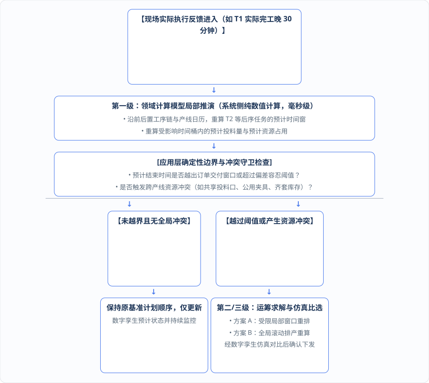
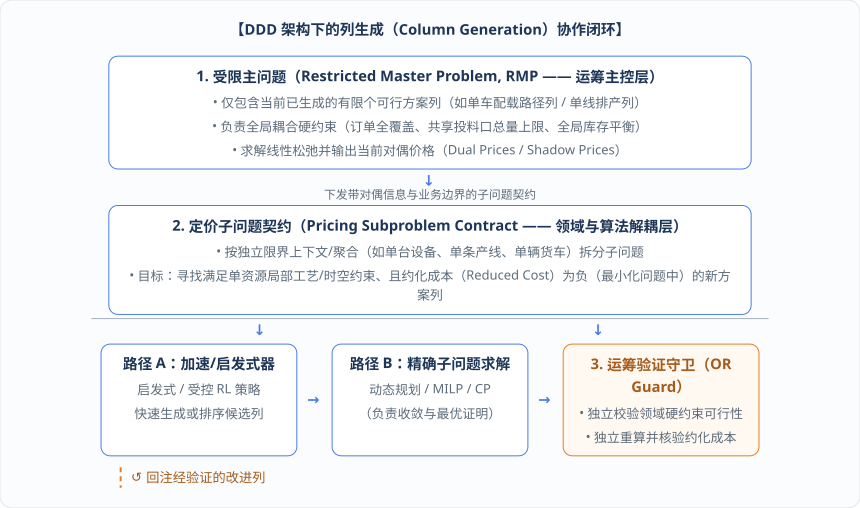
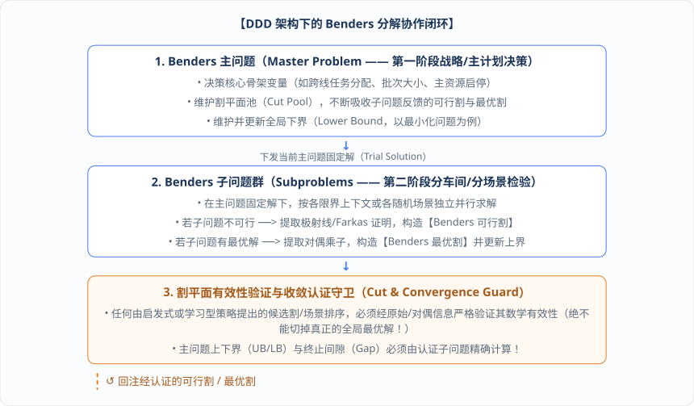

# 第 11 章 · 用领域驱动设计（DDD）白盒编排运筹算法与大规模分解求解

在第 10 章的数字孪生闭环中，我们看到系统需要在“局部数值推演”、“轻量级仿真试算”与“全局滚动重排（乃至列生成、Benders 分解等大规模数学规划）”之间自如切换。

要实现这种丝滑的协同，传统的“业务系统通过粗糙 HTTP 接口调用外挂黑盒算法服务”的架构必须被彻底淘汰。本章将完整呈现平台架构的 **15 点依赖关系推演**，阐明为什么运筹算法必须作为可被应用层白盒编排的库/模块融入领域驱动设计（DDD），并直接基于 `ospf-kotlin` 的原生模型与符号基础设施，给出局部/全局排产触发守卫、DDD 列生成（Column Generation）与 Benders 分解算法的完整工程实现代码。

***

## 11.1 15 点架构依赖推演：为什么算法必须优先作为可被应用层白盒编排的库与模块？

为什么我们如此坚定地主张采用“领域驱动设计（DDD）+ 函数式编程（FP）+ 形式化领域模型 + 白盒可编排算法库”的架构路线？因为这不是出于某种主观的技术审美偏好，而是由工业软件的 15 个核心诉求通过严格的逻辑依赖**一步步“逼”出来的唯一解**。

让我们先列出构建现代化智能 APS / DOP 平台所必需的 **15 个关键架构点位**：

| 点位编号      | 核心架构与业务能力内容                         | 点位编号       | 核心架构与业务能力内容                                  |
| --------- | ----------------------------------- | ---------- | -------------------------------------------- |
| **第 1 点** | 业务逻辑内聚到领域模型                         | **第 9 点**  | 纯计算可测试性（脱离框架与数据库单测）                          |
| **第 2 点** | 领域层与持久化、外部接口、运行时框架分离                | **第 10 点** | 轻量高频可仿真性（不污染真实业务状态）                          |
| **第 3 点** | 仓储（Repository）是领域接口，基础设施层只是实现       | **第 11 点** | 迭代数据与版本快照（含计划、预计、实际三层状态）                     |
| **第 4 点** | 算法可被应用层白盒编排，避免不透明黑盒接口               | **第 12 点** | 可计算的数字孪生动态推演                                 |
| **第 5 点** | 算法与系统业务口径严格一致                       | **第 13 点** | 滚动排产与跨节点可组合流程编排                              |
| **第 6 点** | 支持运行时结构化动态约束注入                      | **第 14 点** | 智能体基于结构化领域元数据动态适配                            |
| **第 7 点** | 业务中间值透明、具名、可解释、可查询                  | **第 15 点** | 智能体基于数字孪生和领域上下文做业务推理                         |
| **第 8 点** | **各运行侧（系统/OR/ML/Agent）共享同一形式化领域模型** | —          | _（注：ML 原生、基础框架与 LLM as Runtime 作为跨切面能力叠加其上）_ |

当我们把这 15 个点位的支撑与制约关系绘制成完整的架构依赖拓扑图时，整座大厦的力学结构便一目了然：


在第 5 章中我们已经拆解了第一层依赖（第 8 点形式化领域模型是一切的根基），现在让我们重点审视**第二层至第六层依赖**是如何严密咬合的：

### 1. 为什么第 4 点（算法白盒可编排）是第 6 点（动态约束）、第 7 点（中间值透明）与第 10 点（可仿真性）的实现前提？

如果运筹算法只对外暴露一个不透明的黑盒 RPC/HTTP 接口（传入固定 DTO，返回排程摘要），那么决策变量、中间值表达式、约束构造管线和求解过程就全被锁死在服务内部：

* **第 4 点 → 第 6 点（动态约束注入）**：动态约束要求在运行时把新规则（如 `actualFeedingInWindow + plannedFeedingRemaining[A] + plannedFeedingRemaining[B] <= feedingLimit`）注入算法模型。只有当算法以可被应用层编排的库/模块形式存在（或者在远程部署时显式暴露与领域模型对齐的结构化变量目录与约束契约），应用层才能直接基于同一批领域对象追加结构化约束，而不是退化为传不可解析的黑盒字符串。
* **第 4 点 → 第 7 点（中间值透明）**：如果黑盒服务只返回 `output summary`，系统就拿不到投料量、资源占用、换产耗时等具名中间值。算法作为白盒模块时，可以直接复用领域计算对象（如 `ospf` 的 `LinearExpressionSymbol`），显式输出带名称、来源表达式、物理单位、生命周期和版本信息的中间值结果。
* **第 4 点 → 第 10 点（轻量可仿真性）**：仿真试算（`What-if`）要求高频、轻量、低延迟地执行“改参数/加约束 → 重算 → 对比结果”。算法作为模块库由应用层直接在内存级编排调用时，省去了繁重的跨网拼装、序列化与服务调度开销；即便针对超大规模问题采用远端算力部署，也必须通过统一的领域快照契约、批量请求或就地缓存来治理延迟。

### 2. 第三层至第六层依赖的连锁传导

* **第 1、2、3 点 → 第 9 点（可测试性）**：可测试性不是靠加几个测试工具解决的，它取决于架构本身。只有当业务逻辑内聚在领域模型中（第 1 点）、领域层保持纯函数计算且不依赖持久化与框架（第 2 点）、仓储全部抽象为接口（第 3 点）时，研发团队才能做到\*\*“不启动 Spring 容器、不连接数据库、不调用远程算法服务，直接在毫秒级单元测试中验证所有领域规则、计算公式与约束管线”\*\*。
* **第 11 点（三层状态与版本快照） → 第 10、12、13 点**：没有计划/预计/实际三层时间与版本快照 diff 机制，仿真就无法结构化对比方案优劣（第 10 点），数字孪生就无法推演未来预计状态（第 12 点），滚动排产也就不知道哪些任务已完工、哪些正在执行、哪些预计会偏移（第 13 点）。
* **第 12 点（数字孪生）反向强化第 1 点与第 8 点**：正因为数字孪生要求不依赖完整排产就能实时重算预计时间，换产时间、生产时长与日历推算就必须从算法黑盒中抽出来，内聚沉淀到共享的形式化领域模型中。
* **第 15 点（智能体业务推理） → 第 14 点（智能体动态适配）**：两者的顺序永远是\*\*“先结合领域上下文与数字孪生做影响推理（第 15 点），再基于结构化元数据生成可校验的动态约束或流程编排方案，并交由仿真验证后执行（第 14 点）”\*\*。

通过下表，我们可以清晰地看到这套架构中的每一个设计决策是如何被业务目标一步步“倒逼”出来的：

| 架构点位                   | 是否被其它点约束？   | 直接约束来源              | 架构倒逼逻辑说明                              |
| ---------------------- | ----------- | ------------------- | ------------------------------------- |
| **第 8 点（形式化领域模型）**     | **否，是总根基**  | —                   | 核心架构基石，直接决定了第 5、6、7、12、13、14、15 点的解法。 |
| **第 1、3 点（领域内聚/仓储接口）** | **否，是基础选择** | —                   | 领域驱动设计分层的基础，否则所有能力只能靠过程式接口堆叠。         |
| **第 2 点（领域与框架分离）**     | 被第 3 点支撑    | 第 3 点               | 仓储接口化后，领域层才能彻底摆脱数据库与框架实现绑定。           |
| **第 4 点（算法白盒可编排）**     | 部分受约束       | 第 8 点               | 若领域概念未形式化，算法即便做成库也无法与系统共享领域对象。        |
| **第 5 点（算法系统口径一致）**    | 受严格约束       | 第 8 点               | 唯有共享同一份领域定义并隔离状态角色，口径一致才有根本保障。        |
| **第 6、7 点（动态约束/中间值）**  | 受双重约束       | 第 8 点、第 4 点         | 要求变量与中间值是具名领域符号，且算法模型支持运行时白盒注入与解析。    |
| **第 9 点（可测试性）**        | 受三重约束       | 第 1、2、3 点           | 依赖业务逻辑内聚、纯计算无副作用与持久化接口隔离。             |
| **第 11 点（三层状态与快照）**    | 相对独立的数据基石   | —                   | 为仿真对比、数字孪生推演与滚动排产提供版本化数据基础。           |
| **第 10 点（可仿真性）**       | 受四重约束       | 第 4、6、7、11 点        | 仿真要求轻量求解调用、动态约束注入、中间值查询与版本快照对比。       |
| **第 12 点（数字孪生推演）**     | 受约束且反向强化    | 第 8、11 点（强化第 1 点）   | 要求可独立计算的领域模型与计划/预计/实际三层数据。            |
| **第 13 点（滚动排产与编排）**    | 受三重约束       | 第 8、11、12 点         | 依赖统一节点领域契约、版本快照数据与动态预计状态推演。           |
| **第 15 点（智能体业务推理）**    | 受六重约束       | 第 7、8、10、11、12、13 点 | 依赖形式化词典、透明中间值、历史快照、数字孪生状态、仿真与流程上下文。   |
| **第 14 点（智能体动态适配）**    | 受五重约束       | 第 6、8、10、13、15 点    | 依赖结构化元数据、推理结论、可注入约束、安全仿真验证与可组合流程节点。   |

***

## 11.2 局部推演 vs. 全局滚动排产：如何划定局部时间传播与触发完整重排的策略边界？

当运筹算法与领域计算模型都能被应用层自由编排后，我们在处理第 10 章“前序任务 `T1` 延误”这类日常现场扰动时，就不再只有“要么不管、要么全盘重排”这两个极端选项，而是可以建立起\*\*“系统侧局部推演（Local Propagation）”与“运筹侧全局滚动排产（Global Rolling Rescheduling）”的分级响应机制\*\*。

为什么要严格划定“局部推演”与“完整重排”的边界？

* **如果任何微小偏差都触发完整重排**：不仅算力开销大、响应慢，而且频繁改变全厂工单顺序会引发严重的“计划神经质（Schedule Nervousness）”——车间工人刚领完料准备开工，系统又把工单顺序全改了，现场根本无法执行；
* **反之，如果只做局部推演而不设全局冲突警戒线**：局部的顺延修正可能会掩盖跨产线的全局资源冲突（例如 `T2` 顺延后与产线 B 的 `T3` 在同一时间桶争抢共享投料口容量或公用模具），导致推演出来的预计计划实际上是不可行的。

因此，应用层通过确定性策略将处理流程划分为三个清晰梯度：



1. **第一级（系统侧纯数值局部推演）**：由应用层直接调用领域层的换产时间、生产时长与物料消耗计算模型，更新受影响工序链的预计时间。只要更新后的预计时间未突破订单交期红线、偏差在允许阈值内，且经约束求值器检查未违反任何跨资源硬约束，系统就只需更新数字孪生预计状态，无需惊动运筹求解器改动基准排产顺序。
2. **第二级（运筹侧受限局部窗口重排）**：当偏差超出局部缓冲，但影响范围被领域图谱严格限定在某几个关联工单或单一车间内时，算法层仅锁定受影响对象集合（如 `{T2, T3, 产线 A, 产线 B}`），将其余已稳定工单冻结为边界常数，执行秒级轻量重排。
3. **第三级（全局滚动排产与流程编排）**：当扰动波及全局瓶颈资源、引发多级物料齐套缺口，或智能体与计划员注入了跨产线的新动态约束时，应用层触发完整的滚动排产工作流（如 `排产求解 → 替代料分配 → 重算物料消耗预计 → MRP 缺口核算 → 仿真对比 → 审批下发`）。每一轮滚动都强制冻结并记录输入快照、规则版本、触发原因与结果版本，确保全链路 100% 可复盘。

### 工程实现：基于 OSPF 原生单位与三层时间模型的数字孪生局部推演与滚动重排触发守卫

下面给出直接复用第 7 章 `TaskDurationSharedCore`、`FeedingSharedCore` 以及 `ospf-kotlin` 原生单位（`Hour`、`Minute`、`Kilogram`）实现的**数字孪生预计状态级联推演器与重排触发决策守卫代码**：

```kotlin
package org.adaptive.dop.application.twin

import java.time.Duration
import java.time.Instant
import fuookami.ospf.kotlin.utils.math.*
import fuookami.ospf.kotlin.utils.physics.unit.*
import fuookami.ospf.kotlin.utils.physics.quantity.*
import fuookami.ospf.kotlin.utils.error.*
import fuookami.ospf.kotlin.utils.functional.*
import org.adaptive.dop.domain.core.*
import org.adaptive.dop.infrastructure.ospf.OspfBoundaryAdapter

// 1. 工单任务的三层时间状态模型（计划时间、预计时间、实际时间严格分离，持久化统一使用 UTC Instant）
data class TaskThreeTierScheduleState(
    val taskId: String,
    val lineId: String,
    val plannedStart: Instant,
    val plannedEnd: Instant,
    val estimatedStart: Instant,
    val estimatedEnd: Instant,
    val actualStart: Instant? = null,
    val actualEnd: Instant? = null,
    val orderDeliveryDeadline: Instant,
    val plannedOutputMass: Quantity<Flt64>,
    val durationSpec: TaskDurationSpec,
    val feedingSpec: FeedingRuleSpec
)

// 2. 应用层重排分级响应决策结果
sealed interface PropagationDecision {
    /** 第一级：仅更新数字孪生预计状态，不改动基准排产顺序 */
    data class KeepBaselineUpdateTwinOnly(
        val updatedTasks: List<TaskThreeTierScheduleState>
    ) : PropagationDecision

    /** 第二/三级：触发受限局部窗口重排或全局滚动排产（携带触发原因、受影响对象与冻结快照要求） */
    data class TriggerRollingReschedule(
        val reason: String,
        val affectedTaskIds: Set<String>,
        val affectedLineIds: Set<String>,
        val updatedPreviewTasks: List<TaskThreeTierScheduleState>
    ) : PropagationDecision
}

/**
 * 数字孪生局部推演与滚动重排触发守卫：
 * 当收到前序任务 T1 实际完工反馈时，在系统侧用 OSPF 纯函数数值入口秒级推演后序预计时间，
 * 并检查是否越过交期偏差阈值或触发跨产线共享投料口容量冲突。
 */
class DigitalTwinPropagationGuard(
    private val maxAllowedDelayThreshold: Quantity<Flt64> = Quantity(Flt64(15.0), Minute) // 局部容忍偏差阈值: 15 分钟
) {
    fun propagateAndEvaluate(
        completedPredecessor: TaskThreeTierScheduleState,
        successorChainOnSameLine: List<TaskThreeTierScheduleState>,
        parallelTasksOnOtherLines: List<TaskThreeTierScheduleState>,
        actualFeedingAlreadyOccurred: Quantity<Flt64>, // 当日已实际发生的投料事实 (如 450 kg)
        sharedFeedingLimit: Quantity<Flt64>            // 当日共享投料口容量上限 (如 1000 kg)
    ): Ret<PropagationDecision> {
        val predActualEnd = completedPredecessor.actualEnd
            ?: return Failed(Err(ErrorCode.IllegalArgument, "前序任务 [${completedPredecessor.taskId}] 尚未产生实际结束时间"))

        val updatedSuccessors = mutableListOf<TaskThreeTierScheduleState>()
        var cursorEndInstant: Instant = predActualEnd
        var delayThresholdBreached = false
        var deadlineBreached = false

        // 1. 沿同产线前后置工序链，调用第 7 章共享业务核心的【数值入口】级联重算预计开始与预计结束时间
        for (succ in successorChainOnSameLine) {
            // 1.1 计算换产时间 + 日历可用时间调整，推算后序任务预计开始时间
            val changeoverHoursQty = when (
                val r = OspfBoundaryAdapter.addQuantitiesSafely(
                    lhs = succ.durationSpec.changeoverDuration,
                    rhs = succ.durationSpec.calendarBreakDuration,
                    targetUnit = Hour
                )
            ) {
                is Ok -> r.value
                is Failed -> return r
            }
            val changeoverSeconds = (changeoverHoursQty.value * Flt64(3600.0)).toDouble().toLong()
            val newEstimatedStart = cursorEndInstant.plusSeconds(changeoverSeconds)

            // 1.2 调用共享业务核心计算含换产与加工的总耗时，推算后序任务预计结束时间
            val totalDurationHours = when (
                val r = TaskDurationSharedCore.evaluateNumericalTotalDuration(succ.durationSpec, succ.plannedOutputMass)
            ) {
                is Ok -> r.value
                is Failed -> return r
            }
            val totalElapsedSeconds = (totalDurationHours.value * Flt64(3600.0)).toDouble().toLong()
            val newEstimatedEnd = cursorEndInstant.plusSeconds(totalElapsedSeconds)

            // 1.3 检查预计结束时间与原计划结束时间的偏差是否超过阈值，或是否突破订单交付窗口
            val delayMinutes = Duration.between(succ.plannedEnd, newEstimatedEnd).toMinutes().coerceAtLeast(0)
            val delayQty = Quantity(Flt64(delayMinutes.toDouble()), Minute)
            val thresholdInMin = (OspfBoundaryAdapter.convertQuantitySafely(maxAllowedDelayThreshold, Minute) as Ok).value

            if (delayQty.value gr thresholdInMin.value) {
                delayThresholdBreached = true
            }
            if (newEstimatedEnd.isAfter(succ.orderDeliveryDeadline)) {
                deadlineBreached = true
            }

            val updatedTask = succ.copy(
                estimatedStart = newEstimatedStart,
                estimatedEnd = newEstimatedEnd
            )
            updatedSuccessors.add(updatedTask)
            cursorEndInstant = newEstimatedEnd
        }

        // 2. 全局冲突守卫检查：即使单线顺延未超交期，也必须检查顺延后的时间窗口是否与并行产线 (如产线 B 的 T3)
        //    发生时间窗重叠，并校验当日共享投料口累计投料量是否超限！
        val allPendingTasks = updatedSuccessors + parallelTasksOnOtherLines
        var totalEstimatedRemainingFeedingKg = Flt64.zero
        for (task in allPendingTasks) {
            val taskFeeding = when (val r = FeedingSharedCore.evaluateNumericalFeeding(task.feedingSpec, task.plannedOutputMass)) {
                is Ok -> r.value
                is Failed -> return r
            }
            val taskFeedingKg = when (val r = OspfBoundaryAdapter.convertQuantitySafely(taskFeeding, Kilogram)) {
                is Ok -> r.value.value
                is Failed -> return r
            }
            totalEstimatedRemainingFeedingKg += taskFeedingKg
        }

        val actualKg = when (val r = OspfBoundaryAdapter.convertQuantitySafely(actualFeedingAlreadyOccurred, Kilogram)) {
            is Ok -> r.value.value
            is Failed -> return r
        }
        val limitKg = when (val r = OspfBoundaryAdapter.convertQuantitySafely(sharedFeedingLimit, Kilogram)) {
            is Ok -> r.value.value
            is Failed -> return r
        }
        val projectedTotalFeedingKg = actualKg + totalEstimatedRemainingFeedingKg
        val sharedResourceConflict = projectedTotalFeedingKg gr limitKg

        // 3. 根据确定性守卫判定返回第一级（仅更新孪生）还是第二/三级（触发滚动重排与仿真比选）
        return if (!delayThresholdBreached && !deadlineBreached && !sharedResourceConflict) {
            Ok(PropagationDecision.KeepBaselineUpdateTwinOnly(updatedSuccessors))
        } else {
            val reasons = buildList {
                if (delayThresholdBreached) add("后序任务预计延误超出局部缓冲阈值 (${maxAllowedDelayThreshold.value} ${maxAllowedDelayThreshold.unit.symbol})")
                if (deadlineBreached) add("后序任务预计完工时间突破订单交付红线")
                if (sharedResourceConflict) add("跨产线共享投料口预计累计投料 ($projectedTotalFeedingKg kg) 超出当日上限 ($limitKg kg)")
            }.joinToString("；")

            val affectedTasks = allPendingTasks.map { it.taskId }.toSet()
            val affectedLines = allPendingTasks.map { it.lineId }.toSet() + completedPredecessor.lineId
            Ok(
                PropagationDecision.TriggerRollingReschedule(
                    reason = reasons,
                    affectedTaskIds = affectedTasks,
                    affectedLineIds = affectedLines,
                    updatedPreviewTasks = updatedSuccessors
                )
            )
        }
    }
}
```

***

## 11.3 用 DDD 架构驾驭列生成（Column Generation）：受限主问题、定价子问题契约与约化成本验证

当企业规模进一步扩大——例如面对跨多个工厂、上万张工单的排产，或者数字化运营平台（DOP）中运输管理系统（TMS）的**大规模车辆路径与配载问题（VRP）**、下料切割问题（Cutting Stock）与人员班次调度问题时，如果试图把所有组合方案一次性建成一个巨大的单一混合整数线性规划（MILP）模型，变量数量会呈指数级爆炸（多达数百万乃至上亿列），任何商业求解器都会直接内存溢出或超时卡死。

为了攻克这类超大规模优化难题，运筹学界最强大的武器之一是**列生成（Column Generation）与分支定价（Branch-and-Price）算法**。然而在传统算法脚本中，列生成的主问题与子问题往往写成一团高度耦合的面条代码，极难维护与扩展。

在 `ospf` 与本书的领域驱动设计（DDD）架构下，我们将列生成算法拆解为职责极其清晰的领域与算法协作组件，并为后续引入机器学习/强化学习加速预留了严格的安全验证边界：



用 DDD 架构组织列生成的核心工程精髓在于以下三点：

1. **按领域聚合边界自然解耦主问题与定价子问题**：
   * \*\*受限主问题（RMP）\*\*只关心跨资源的全局协调契约（如“每个订单必须被执行”、“产线 A 与 B 今日共享投料总和不超过 `1000 kg`”），它甚至不需要知道单条产线内部复杂的换产细节；
   * \*\*定价子问题（Pricing Subproblem）\*\*则完全内聚在单个领域聚合（如单条产线或单辆运输车）内部，利用领域层定义的换产时间、生产时长、班次日历与局部工艺规则，结合主问题传下来的对偶价格（Dual Prices），独立寻找最有价值的候选方案列。
2. **严格的候选列验证守卫（Candidate Column Verification）**：无论是通过确定性启发式算法、还是通过第 13 章将介绍的强化学习（RL）加速器生成的候选列，在回注主问题之前，都**必须经过运筹优化验证守卫的独立检验**——验证该列是否 100% 满足单产线/单车的领域硬约束，并用主问题对偶值独立重算其\*\*约化成本（Reduced Cost）\*\*是否真正具有改进价值；任何不可行列或非改进列都会被当场拒绝。
3. **精确定价兜底与最优性认证（Exact Pricing Fallback & Certification）**：在迭代初期，系统可以使用快速启发式或学习型策略批量产出优质列以加速收敛；但当启发式/加速器找不到改进列、或者算法接近收敛需要给出严格的**数学上下界（Bounds）与全局最优性证明**时，系统**必须强制切换并运行可认证的精确定价子问题**，严格证明在当前分支约束下确实已不存在任何可改进列，绝不允许用未经认证的近似策略输出宣告全局收敛！

### 工程实现：基于 OSPF 的 DDD 列生成（Column Generation）主子问题编排与验证守卫代码

下面给出直接基于 `ospf-kotlin` 的 `Flt64`、`Quantity`（`Kilogram` / `Hour`）、`LinearMetaModel` 与 `Ret` 实现的 DDD 列生成编排核心代码：

```kotlin
package org.adaptive.dop.algorithm.cg

import fuookami.ospf.kotlin.utils.math.*
import fuookami.ospf.kotlin.utils.physics.unit.*
import fuookami.ospf.kotlin.utils.physics.quantity.*
import fuookami.ospf.kotlin.utils.error.*
import fuookami.ospf.kotlin.utils.functional.*
import fuookami.ospf.kotlin.core.frontend.variable.*
import fuookami.ospf.kotlin.core.frontend.expression.monomial.*
import fuookami.ospf.kotlin.core.frontend.expression.polynomial.*
import fuookami.ospf.kotlin.core.frontend.inequality.*
import fuookami.ospf.kotlin.core.frontend.model.mechanism.*
import org.adaptive.dop.infrastructure.ospf.OspfBoundaryAdapter

// 1. 单条产线/单辆货车的排产/配载候选方案列（领域值对象）
enum class ColumnSource { INITIAL_BASIS, HEURISTIC_ACCELERATOR, CONSTRAINED_RL_POLICY, EXACT_PRICING_MIP }

data class LineScheduleColumn(
    val columnId: String,
    val lineId: String,
    val coveredTaskIds: Set<String>,         // 该列执行的工单任务集合
    val totalScheduleCost: Flt64,            // 该列的直接执行成本（换产+能耗+延误惩罚）
    val totalFeedingMass: Quantity<Flt64>,   // 该列在共享投料口消耗的投料量 (OSPF Quantity，如 Kilogram)
    val totalElapsedShiftTime: Quantity<Flt64>, // 该列占用的产线班次总时长 (OSPF Quantity，如 Hour)
    val source: ColumnSource
)

// 2. 受限主问题 (RMP) 求解线性松弛后下发的对偶价格（影子价格）快照契约
data class RmpDualPriceSnapshot(
    val iteration: Int,
    val taskCoverageDuals: Map<String, Flt64>, // 每个任务覆盖约束的对偶乘子 \pi_i
    val lineConvexityDuals: Map<String, Flt64>,// 每条产线凸组合约束 (\sum \lambda_k <= 1) 的对偶乘子 \mu_l
    val sharedFeedingDual: Flt64               // 共享投料口上限约束的对偶乘子 \sigma (每 kg 投料的影子价格)
)

// 3. 单产线领域聚合硬约束校验器（由领域层提供，独立校验候选列在单条产线上是否物理可行）
interface SingleLineDomainValidator {
    val lineId: String
    val maxShiftAvailableTime: Quantity<Flt64>
    fun verifySequenceAndTimeWindows(column: LineScheduleColumn): Ret<Unit>
}

// 4. 运筹候选列验证守卫 (Candidate Column Verification Guard)
// 任何由启发式或强化学习 (RL) 生成的候选列，必须通过此守卫的【领域硬约束验证 + 约化成本独立重算】才能进入主问题！
class OspfCandidateColumnGuard(
    private val improvementTolerance: Flt64 = Flt64(-1e-6)
) {
    fun verifyAndComputeReducedCost(
        column: LineScheduleColumn,
        duals: RmpDualPriceSnapshot,
        lineValidator: SingleLineDomainValidator
    ): Ret<Flt64> {
        // 守卫 1：校验候选列占用的班次时长是否超出单产线日历可用上限（使用 OSPF Quantity 对齐为 Hour）
        val elapsedHours = when (val r = OspfBoundaryAdapter.convertQuantitySafely(column.totalElapsedShiftTime, Hour)) {
            is Ok -> r.value.value
            is Failed -> return r
        }
        val maxHours = when (val r = OspfBoundaryAdapter.convertQuantitySafely(lineValidator.maxShiftAvailableTime, Hour)) {
            is Ok -> r.value.value
            is Failed -> return r
        }
        if (elapsedHours gr maxHours) {
            return Failed(
                Err(ErrorCode.ApplicationError, "候选列 [${column.columnId}] 违反产线班次时长硬约束: $elapsedHours h > $maxHours h")
            )
        }

        // 守卫 2：调用单产线领域聚合校验工序先后序、换产与交期硬约束
        when (val domainCheck = lineValidator.verifySequenceAndTimeWindows(column)) {
            is Ok -> {}
            is Failed -> return Failed(domainCheck.error)
        }

        // 守卫 3：将候选列的投料量对齐为 OSPF 原生 Kilogram，并独立重算约化成本 (Reduced Cost)
        // Reduced Cost \bar{c}_k = c_k - \sum_{i \in Tasks} \pi_i - \sharedFeedingDual * feedingKg_k - \mu_{line}
        val feedingKg = when (val r = OspfBoundaryAdapter.convertQuantitySafely(column.totalFeedingMass, Kilogram)) {
            is Ok -> r.value.value
            is Failed -> return r
        }

        var taskDualSum = Flt64.zero
        for (taskId in column.coveredTaskIds) {
            taskDualSum += (duals.taskCoverageDuals[taskId] ?: Flt64.zero)
        }
        val resourceDualCost = duals.sharedFeedingDual * feedingKg
        val convexityDual = duals.lineConvexityDuals[column.lineId] ?: Flt64.zero

        val reducedCost = column.totalScheduleCost - taskDualSum - resourceDualCost - convexityDual
        return Ok(reducedCost)
    }

    fun isImprovingColumn(reducedCost: Flt64): Boolean = reducedCost ls improvementTolerance
}

// 5. 定价子问题求解器契约：严格分离【RL/启发式快速通道】与【可认证的精确定价兜底通道】
interface LinePricingSubproblemPort {
    val lineId: String
    /** 快速通道：可由启发式或受约束强化学习 (RL) 实现，允许超时或返回空列表 */
    fun proposeFastCandidateColumns(duals: RmpDualPriceSnapshot): List<LineScheduleColumn>
    /** 精确认证通道：基于 OSPF LinearMetaModel / 动态规划求解，用于提供对偶下界与全局收敛证明 */
    fun solveExactPricingColumn(duals: RmpDualPriceSnapshot): Ret<List<LineScheduleColumn>>
}

// 6. DDD 列生成主控编排器：构建 OSPF 受限主问题 (RMP) 并管理“RL加速 -> 运筹守卫 -> 精确认证兜底”闭环
class OspfColumnGenerationCoordinator(
    private val guard: OspfCandidateColumnGuard = OspfCandidateColumnGuard()
) {
    /**
     * 基于当前列池构建 OSPF 受限主问题 (Restricted Master Problem, RMP)
     */
    fun buildRestrictedMasterModel(
        allTaskIds: Set<String>,
        allLineIds: Set<String>,
        columnPool: List<LineScheduleColumn>,
        remainingSharedFeedingLimit: Quantity<Flt64> // 扣除已发生实际投料后的剩余共享投料上限
    ): Ret<Pair<LinearMetaModel, Map<String, URealVar>>> {
        val rmpModel = LinearMetaModel("DOP_RMP_Master")
        val lambdaVars = mutableMapOf<String, URealVar>()

        val limitKg = when (val r = OspfBoundaryAdapter.convertQuantitySafely(remainingSharedFeedingLimit, Kilogram)) {
            is Ok -> r.value.value
            is Failed -> return r
        }

        // 1) 为列池中的每一列注册主问题权重变量 \lambda_k \in [0, 1]
        for (col in columnPool) {
            val v = URealVar("lambda_${col.columnId}")
            v.range.leq(Flt64.one)
            rmpModel.add(v)
            lambdaVars[col.columnId] = v
        }

        // 2) 全局任务覆盖约束：\sum_{k: i \in col_k} \lambda_k >= 1
        for (taskId in allTaskIds) {
            val coverPoly = MutableLinearPolynomial()
            for (col in columnPool) {
                if (taskId in col.coveredTaskIds) {
                    coverPoly += Flt64.one * lambdaVars.getValue(col.columnId)
                }
            }
            when (val res = rmpModel.addConstraint(LinearPolynomial(coverPoly) geq Flt64.one, name = "rmp_cover_$taskId")) {
                is Ok -> {}
                is Failed -> return Failed(res.error)
            }
        }

        // 3) 每条产线凸组合约束：\sum_{k \in Line_l} \lambda_k <= 1
        for (lineId in allLineIds) {
            val convPoly = MutableLinearPolynomial()
            for (col in columnPool.filter { it.lineId == lineId }) {
                convPoly += Flt64.one * lambdaVars.getValue(col.columnId)
            }
            when (val res = rmpModel.addConstraint(LinearPolynomial(convPoly) leq Flt64.one, name = "rmp_conv_$lineId")) {
                is Ok -> {}
                is Failed -> return Failed(res.error)
            }
        }

        // 4) 跨产线共享投料口耦合容量约束：\sum_{k} feedingKg_k * \lambda_k <= limitKg
        val sharedFeedingPoly = MutableLinearPolynomial()
        for (col in columnPool) {
            val colKg = when (val r = OspfBoundaryAdapter.convertQuantitySafely(col.totalFeedingMass, Kilogram)) {
                is Ok -> r.value.value
                is Failed -> return r
            }
            sharedFeedingPoly += colKg * lambdaVars.getValue(col.columnId)
        }
        when (val res = rmpModel.addConstraint(LinearPolynomial(sharedFeedingPoly) leq limitKg, name = "rmp_shared_feeding")) {
            is Ok -> {}
            is Failed -> return Failed(res.error)
        }

        // 5) 主问题目标函数：Minimize \sum_k c_k * \lambda_k
        val totalCostPoly = MutableLinearPolynomial()
        for (col in columnPool) {
            totalCostPoly += col.totalScheduleCost * lambdaVars.getValue(col.columnId)
        }
        rmpModel.minimize(LinearPolynomial(totalCostPoly), name = "rmp_total_schedule_cost")

        return Ok(rmpModel to lambdaVars)
    }

    /**
     * 单轮子问题定价调度（严格落实第 13.3 节受约束强化学习边界）：
     * 先调用快速/RL 通道并经 OspfCandidateColumnGuard 验证；
     * 若未找到改进列或需要收敛认证，强制回退调用 solveExactPricingColumn 完成精确定价证明！
     */
    fun priceNewColumnsWithExactFallback(
        duals: RmpDualPriceSnapshot,
        pricingPort: LinePricingSubproblemPort,
        lineValidator: SingleLineDomainValidator,
        forceExactCertification: Boolean = false
    ): Ret<Pair<List<LineScheduleColumn>, Boolean>> { // 返回: (通过验证的改进列列表, 是否已经过精确定价认证)
        if (!forceExactCertification) {
            val fastProposals = runCatching { pricingPort.proposeFastCandidateColumns(duals) }.getOrDefault(emptyList())
            val verifiedFastCols = fastProposals.filter { candidate ->
                when (val rcRes = guard.verifyAndComputeReducedCost(candidate, duals, lineValidator)) {
                    is Ok -> guard.isImprovingColumn(rcRes.value)
                    is Failed -> false // 自动拦截并丢弃违反领域硬约束或约化成本不优的 RL 候选列
                }
            }
            if (verifiedFastCols.isNotEmpty()) {
                return Ok(verifiedFastCols to false)
            }
        }

        // 强制精确兜底：当 RL/启发式无改进列、超时或处于最终收敛认证阶段时，必须运行精确定价！
        val exactProposals = when (val exactRes = pricingPort.solveExactPricingColumn(duals)) {
            is Ok -> exactRes.value
            is Failed -> return Failed(exactRes.error)
        }
        val verifiedExactCols = exactProposals.filter { candidate ->
            when (val rcRes = guard.verifyAndComputeReducedCost(candidate, duals, lineValidator)) {
                is Ok -> guard.isImprovingColumn(rcRes.value)
                is Failed -> false
            }
        }
        return Ok(verifiedExactCols to true)
    }
}
```

***

## 11.4 用 DDD 架构驾驭 Benders 分解：主子问题解耦、可行割/最优割验证与收敛认证边界

与按“资源/方案列”纵向拆解的列生成相对应，运筹学中另一把处理多阶段、跨系统协同优化的利器是 **Benders 分解算法（Benders Decomposition）**。

在数字化运营平台（DOP）中，很多决策天然具有“先定宏观骨架、再验微观执行”或“确定性主计划 + 多场景随机扰动评估”的两阶段结构：

* 例如在主生产计划与详细排程协同中，\*\*第一阶段（主问题）\*\*决定跨工厂的订单分配、主产能开启与关键物料调拨；\*\*第二阶段（子问题）\*\*则在给定分配方案下，分别检验各车间的详细工序排程、共享投料口约束与 WMS/TMS 齐套配载是否可行及具体执行成本是多少。
* 又如在鲁棒优化与随机规划中，**主问题**决定基准排产方案，而**成百上千个子问题**则分别代表不同产能波动、耗时延误或需求变化场景（Scenarios）下的适应性检验。

在 DDD 与 `ospf` 架构下，Benders 分解同样被构建为一套高度模块化、带严格数学认证边界的协作管线：



在工程实现中，Benders 分解架构严格遵循三条铁律：

1. **主子问题通过领域快照与结构化割契约通信**：主问题无需感知子问题内部复杂的工序或物流细节；子问题求解完成后，向主问题返回的是绑定了稳定符号身份的**结构化割平面（Feasibility Cut / Optimality Cut）**，表达“为了避免车间排产不可行或成本过高，主问题的分配变量必须满足怎样的线性不等式约束”。
2. **可行割与最优割必须经过对偶数学认证**：即使在求解过程中引入了启发式策略或机器学习/强化学习来选择场景求解顺序、管理割池优先级（Cut Pool Priority）或直接预测提出候选割，每一个真正加入主问题的可行割或最优割，都**必须由运筹优化层根据经过认证的原始/对偶（Primal/Dual）信息验证其有效性**，绝不允许无效割污染主问题可行域。
3. **上下界与终止收敛标准不可篡改**：整个分解算法的全局上下界（Upper Bound / Lower Bound）与终止间隙（Optimality Gap），必须 100% 由经过精确验证的主子问题数学结果计算得出，任何外部估计模型均无权越权宣告算法收敛。

### 工程实现：基于 OSPF `LinearMetaModel` 与 `LinearInequality` 的 Benders 割平面验证与收敛认证守卫代码

```kotlin
package org.adaptive.dop.algorithm.benders

import fuookami.ospf.kotlin.utils.math.*
import fuookami.ospf.kotlin.utils.error.*
import fuookami.ospf.kotlin.utils.functional.*
import fuookami.ospf.kotlin.core.frontend.variable.*
import fuookami.ospf.kotlin.core.frontend.expression.monomial.*
import fuookami.ospf.kotlin.core.frontend.expression.polynomial.*
import fuookami.ospf.kotlin.core.frontend.inequality.*
import fuookami.ospf.kotlin.core.frontend.model.mechanism.*

// 1. Benders 割平面类型与基于 OSPF 线性多项式的结构化割契约
enum class BendersCutType { FEASIBILITY_CUT, OPTIMALITY_CUT }

data class CertifiedBendersCut(
    val cutId: String,
    val scenarioId: String,
    val cutType: BendersCutType,
    // 割平面右端关于主问题决策变量 x 的线性近似下界表达式：\alpha + \pi^T (b - T x)
    val masterRhsPolynomial: LinearPolynomial,
    // 在当前主问题固定解 x_bar 下，由子问题精确对偶证明算出的值（用于验证割是否有效切掉当前不可行/次优解）
    val evaluatedValueAtTrialPoint: Flt64,
    val isDualCertified: Boolean // 标记该割是否经过子问题精确原始/对偶信息验证
)

/**
 * Benders 割平面有效性守卫与主问题注入器：
 * 严禁未经对偶认证的启发式/RL 猜测割直接混入主问题切掉真实全局最优解！
 */
class OspfBendersCutGuard(
    private val cutViolationTolerance: Flt64 = Flt64(1e-6)
) {
    /**
     * 验证并向 OSPF Benders 主问题 (LinearMetaModel) 注入可行割或最优割：
     * - 对于可行割 (FEASIBILITY_CUT)：要求 masterRhsPolynomial <= 0，且在当前试验点处 evaluatedValue > tolerance（确实切掉了当前不可行点）
     * - 对于最优割 (OPTIMALITY_CUT)：要求子问题代价辅助变量 \theta >= masterRhsPolynomial，且 evaluatedValue > currentTheta + tolerance
     */
    fun verifyAndInjectCut(
        masterModel: LinearMetaModel,
        thetaVar: URealVar, // 主问题中代表第二阶段子问题代价下界的辅助变量 \theta_s
        currentTrialAssignment: Map<AbstractVariableItem<*, *>, Flt64>,
        candidateCut: CertifiedBendersCut
    ): Ret<LinearInequality> {
        // 守卫 1：必须经过子问题精确原始/对偶信息认证
        if (!candidateCut.isDualCertified) {
            return Failed(
                Err(ErrorCode.ApplicationError, "Benders 守卫拦截：割平面 [${candidateCut.cutId}] 未经子问题对偶数学认证，严禁注入主问题！")
            )
        }

        // 守卫 2：在当前主问题固定解处独立求值，验证多项式求值与对偶证明值一致
        val polyValAtTrial = candidateCut.masterRhsPolynomial.evaluate(currentTrialAssignment)
            ?: return Failed(Err(ErrorCode.SymbolNotFound, "割平面 [${candidateCut.cutId}] 包含未绑定的主问题变量"))

        if (polyValAtTrial neq candidateCut.evaluatedValueAtTrialPoint) {
            return Failed(
                Err(ErrorCode.ApplicationError, "割平面 [${candidateCut.cutId}] 表达式求值 ($polyValAtTrial) 与对偶证书值 (${candidateCut.evaluatedValueAtTrialPoint}) 不一致！")
            )
        }

        // 守卫 3：构造 OSPF LinearInequality 并注册进主问题 LinearMetaModel
        val inequality: LinearInequality = when (candidateCut.cutType) {
            BendersCutType.FEASIBILITY_CUT -> {
                if (polyValAtTrial leq cutViolationTolerance) {
                    return Failed(Err(ErrorCode.ApplicationError, "无效可行割 [${candidateCut.cutId}]：未切掉当前不可行试验点 ($polyValAtTrial <= 0)"))
                }
                candidateCut.masterRhsPolynomial leq Flt64.zero
            }
            BendersCutType.OPTIMALITY_CUT -> {
                val currentTheta = currentTrialAssignment[thetaVar] ?: Flt64.zero
                if ((polyValAtTrial - currentTheta) leq cutViolationTolerance) {
                    return Failed(Err(ErrorCode.ApplicationError, "非改进最优割 [${candidateCut.cutId}]：未提升当前下界 theta ($currentTheta)"))
                }
                // \theta >= masterRhsPolynomial  <==>  thetaVar - masterRhsPolynomial >= 0
                thetaVar geq candidateCut.masterRhsPolynomial
            }
        }

        return when (val addRes = masterModel.addConstraint(inequality, name = candidateCut.cutId)) {
            is Ok -> Ok(inequality)
            is Failed -> Failed(addRes.error)
        }
    }

    /**
     * 独立收敛认证守卫：
     * 全局上界 (UB) 与下界 (LB) 必须由经过精确认证的主子问题结果计算，严禁由 RL 估计替代！
     */
    fun certifyConvergence(
        certifiedLowerBound: Flt64,
        certifiedUpperBound: Flt64,
        allScenariosExactCertified: Boolean,
        relativeGapTolerance: Flt64 = Flt64(1e-4)
    ): Boolean {
        if (!allScenariosExactCertified) return false
        val denom = maxOf(abs(certifiedUpperBound), Flt64.one)
        val gap = (certifiedUpperBound - certifiedLowerBound) / denom
        return gap leq relativeGapTolerance
    }
}
```
