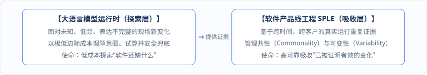
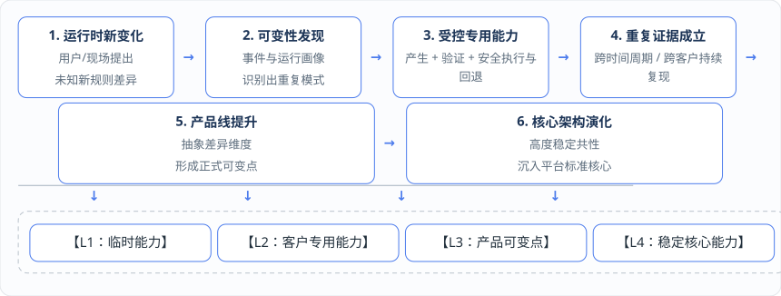

# 第 17 章 · 驯服复杂性：《人月神话》、软件产品线工程（SPLE）与四级能力晋升

通过第 16 章的语义即时编译（Semantic JIT），我们的软件已经能够在运行时自动把高频意图转化为高效的专用执行能力。

然而，站在企业软件全生命周期与产品工程的高度，一个更深层的危机正在浮现：**当大语言模型与产生式编译让“尝试和生成一种新能力”变得前所未有地容易时，如果任由成百上千家客户的现场人员每天不断生成各种动态规则、专用查询与私有流程，五年之后，这套系统究竟会进化成一个精密强大的标准产品，还是会退化成一个充斥着百万个动态特例、谁也理不清的“弗兰肯斯坦怪物”？**

本章将重温软件工程经典名著《人月神话》的核心洞见，引入**软件产品线工程（Software Product Line Engineering, SPLE）**，阐明为什么“运行时动态化”绝不是终点，并建立从“临时动态能力”通往“平台稳定核心”的四级产品资产晋升漏斗。

***

## 17.1 重温《人月神话》：当大模型让“生成新能力”的边际成本暴跌，如何守住系统的“概念完整性”？

半个世纪前，图灵奖得主 Fred Brooks 在《人月神话》（_The Mythical Man-Month_）中指出：软件工程的根本困难在于**本质复杂性（Essential Complexity）**，而维持大型软件系统不至于在演化中崩溃的灵魂，在于守住系统的**概念完整性（Conceptual Integrity）**。

进入 Software 3.0 时代，大语言模型与智能体带来了巨大的历史机遇，但同时也将违反“概念完整性”的工程风险成倍放大：

| 维度         | Software 3.0 与运行时生成带来的新机会           | 随之被急剧放大的复杂性风险                                                                                         |
| ---------- | ----------------------------------- | ----------------------------------------------------------------------------------------------------- |
| **需求准入速度** | 用户的现场业务意图可以跳过漫长排期，更快进入系统响应。         | **概念不一致（Conceptual Inconsistency）**：同一个业务语义（如“急单优先级”或“齐套率”）在不同车间或不同提示词下被定义出十几套相互冲突的口径。                |
| **长尾适配成本** | 临时规则与客户长尾需求可以先动态适配，不必每次都立刻开发专用接口代码。 | **产品碎片化（Product Fragmentation）**：大量“勉强能跑通”的一次性特例被永久留在系统里，成为无法升级、无法测试的永久技术债负担。                         |
| **候选生成效率** | 大模型与产生式工具可以极低边际成本批量生成候选查询、约束与流程。    | **协调成本飙升（Coordination Cost Explosion）**：多个预测模型、智能体、运筹算法与子系统各自按局部理解解释业务，系统结构熵（Structural Entropy）失控增长。 |

面对这一挑战，我们在架构上立下了一条醒目的座右铭：

> **概念完整性铁律：智能可以分布，但语义绝不能分裂（Intelligence can be distributed, but semantics must not be split）**！

我们必须清醒地认识到：**大语言模型降低的仅仅是“产生一次新变化”的边际成本；而软件工程依然必须承担起控制“这些变化长期存在并相互作用”的复杂度成本**。形式化领域模型（守住概念与量纲唯一性）、形式化验证机制（守住执行准入边界）以及接下来要讲的软件产品线工程（守住产品结构演化秩序），正是我们在 Software 3.0 时代驯服复杂性、捍卫概念完整性的三大核心武器。

***

## 17.2 为什么运行时动态化不是终点，而是发现未来稳定产品结构的探测机制？

在很多人的直觉里，既然有了强大的动态运行时，是不是意味着未来的软件应该“一切皆动态”——干脆不要固定的产品结构了，所有功能都在运行时按需生成？

本書对此给出明确否定的回答：**Software 3.0 绝不能无限动态化；运行时动态化不是软件演化的终点，而是低成本发现未来稳定产品结构的“探测机制”**！

为什么不能让所有能力永远停留在运行时动态态？

1. **维护与认知的规模经济学**：对于那些已经在全行业或绝大多数客户中被证明高度共性、长期稳定的核心业务逻辑，将其下沉固化为平台标准核心能力（Software 1.0 确定性模块或标准领域组件），其长期运行性能、测试确定性与维护收益，远高于让每个租户在运行时重复动态生成与单独治理的成本；
2. **抑制结构熵增长**：一个健康演化的软件产品，应当随着服务的客户越来越多，其对行业共性与差异维度的认知越来越清晰、产品结构越来越收敛和稳定，而不是让动态规则集合无限膨胀直至失控。

因此，在我们的顶层架构中，\*\*大语言模型运行时（LLM Runtime）**与**软件产品线工程（SPLE）\*\*构成了完美的“探索与吸收”双轮驱动：

简言之：**大语言模型负责低成本探索未知变化，软件产品线工程负责高可靠吸收已知变化**。只有经过真实运行证据积累、形式化验证和跨场景复用证明的变化，才有资格从动态候选一步步晋升进入长期产品结构。

***

## 17.3 软件产品线工程（SPLE）的四级能力晋升漏斗：临时能力 → 客户专用能力 → 产品可变点 → 平台稳定核心

正如我们在第 9 章所指出的，软件产品线工程（SPLE）并不作为“定义—描述—记忆—推演—产生—验证”链条里的第七个顺序步骤，而是位于整条能力形成闭环的上方，专门负责治理产品的**共性（Commonality）与可变性（Variability）**。

当一个新需求（例如我们在前文反复演练的“多产线共用投料口容量限制”或某类特定的“排产后替代料重算流程”）在运行现场诞生后，SPLE 依据其在时间维度与客户维度上的重复证据，将其纳入一套清晰的**四级能力晋升阶梯**进行全生命周期管理：

这四个能力层级的判定特征与产品工程处理方式严格界定如下：

| 能力演进层级                                                                 | 业务与运行证据判定特征                                                                                 | 产品工程与架构处理方式（SPLE 治理规则）                                                              | 以“共享投料口约束”为例的演进形态                                             |
| ---------------------------------------------------------------------- | ------------------------------------------------------------------------------------------- | ----------------------------------------------------------------------------------- | ------------------------------------------------------------- |
| 
<strong>第一级：临时能力</strong> （Temporary / Ad-hoc Capability）
    | 
• 一次性、高度特定场景化； • 跨周期重复证据尚不足。
                                                      | 留在运行时候选层或单次临时配置中，用完即归档进事件历史，**绝不急于写入长期产品结构或污染标准分支**。                                | 某车间因周二当天供料泵临时抢修，由智能体生成仅当日生效的一次性动态约束。                          |
| 
<strong>第二级：客户专用能力</strong> （Customer-Specific Capability）
   | 
• 在单一客户或单一组织/工厂内跨多个生产周期反复出现； • 业务语义与收益已稳定。
                                        | 经影子验证后**版本化为该租户的受控客户变体（Customer Variant）**，写入注册表，明确适用范围、权限、回滚路径与失效边界。               | 该客户因车间物理布局限制，每周二、四固定共用投料口，沉淀为该租户专用的参数化约束模板。                   |
| 
<strong>第三级：产品可变点 / 可配置能力</strong> （Product Variation Point）
 | 
• <strong>跨多个不同客户或不同行业工厂重复出现</strong>； • 客户间的差异维度（如聚合口径按日还是按班次、按重量还是按体积）已可被形式化表达。
 | **正式晋升进入软件产品线的可变性模型（Variability Model）与产品能力目录**，以标准化配置项、领域语言（DSL）模板或流程插件供新客户开箱受控选择。 | 化工与食品行业十余家客户均出现“多产线共享前处理投料/缓冲罐容量限制”，提炼为标准产品可配置约束组件。           |
| 
<strong>第四级：稳定核心能力</strong> （Stable Platform Core）
           | 
• 成为绝大多数客户的普遍共性、长期稳定； • 统一维护收益显著高于运行时动态生成成本。
                                      | **下沉提升为平台标准核心能力（Platform Standard Core）**，直接内建于标准领域模型与基础算法管线中，减少运行时动态性与重复生成开销。      | “多级资源共享与耦合容量约束”直接成为 DOP/APS 平台标准领域模型与 `ospf` 内置标准算子，所有客户默认享有。 |

通过这套四级晋升机制，软件产品真正形成了一种良性的\*\*“经验复利”\*\*：每一个新客户现场的特殊需求，都不再是拖累研发团队的定制泥潭，而是帮助平台探测未知领域可变点的雷达；一旦某项探索被跨周期、跨客户的运行证据证明为共性，它就会沿着 `临时能力 → 客户专用能力 → 产品可变点 → 稳定核心能力` 的阶梯稳步内化为平台的标准资产，让产品越用越标准、越用越清晰！

***

## 17.4 五大核心平台资产沉淀：语义中间表示、语义编译器、能力注册表、自适应运行时与产品线可变性模型

当软件生产方式从“发布前写死代码”演进为“运行时持续专门化与产品线演进”后，衡量一家软件企业或技术团队核心竞争力的\*\*平台核心资产（Core Platform Assets）\*\*也发生了根本性扩展。

未来的核心资产不再仅仅是 Git 仓库里的业务源代码，而是由以下**五类技术平台资产**与**五类业务知识资产**共同构成的有机资产库：

| 核心平台资产类别                                                                          | 在架构中的核心职责                                             | 典型资产对象与工程载体                                                                          | 对应的业务层资产价值（管理视角）                                 |
| --------------------------------------------------------------------------------- | ----------------------------------------------------- | ------------------------------------------------------------------------------------ | ------------------------------------------------ |
| 
<strong>1. 语义中间表示资产</strong> （Semantic IR Assets）
                       | 精确表达形式化业务语义，彻底隔离自然语言的模糊性与底层执行引擎的实现差异。                 | 规范化查询形状（Query Shape）、查询中间表示（Query IR）、动态约束定义（Constraint IR）、流程中间表示（Flow IR）及领域元数据目录。 | **统一的业务知识资产**：产能、投料、换产与各状态角色的全域唯一权威定义。           |
| 
<strong>2. 语义编译器资产</strong> （Semantic Compiler Assets）
                  | 执行代数类型、物理量纲、字段目录、租户权限校验，并完成规范化优化与向各后端的降阶映射（Lowering）。 | 查询计划生成器、基于 `ospf` 的动态约束编译器、表达式编译求值器、多求解器适配插件与显式错误契约集。                                | **可复用的业务能力资产**：经过严格验证、可自由拼装的规则、约束、计算与优化算子库。      |
| 
<strong>3. 能力与计划注册表资产</strong> （Capability Registry Assets）
             | 集中管控所有动态与专用能力的不可变版本、生命周期状态、底层依赖哈希树、灰度发布与一键原子回滚。       | 计划注册表（Plan Registry）、约束与流程模板库、模型制品与有效覆盖层快照库、完整血缘定义历史。                                | **可追溯可审计的治理资产**：清楚知道每项能力从何而来、谁批准、适用何处、何时失效。      |
| 
<strong>4. 自适应运行时与世界模型资产</strong> （Adaptive Runtime &#x26; World Model）
 | 采集运行画像、保存事件记忆、驱动数字孪生推演、执行影子验证、判定能力晋升并处理依赖变更时的精确失效重建。  | 运行时画像指标库、不可变领域事件时间轴、三层时间数字孪生镜像、能力提升策略引擎、Schema/策略变更监听器。                              | **可回放的运行经验与安全试验场**：历史事实与决策轨迹 + 可随时安全试算假设的数字孪生镜像。 |
| 
<strong>5. 产品线与可变性模型资产</strong> （Product Line &#x26; Variability Model）
 | 系统化管理产品的共性核心、正式可变点、客户变体规则、适用边界，以及从动态能力向正式产品能力的晋升状态。   | 四级能力层级目录、客户变体定义库、产品可变点目录（Variation Point Catalog）、能力晋升与淘汰审计记录。                       | **产品共性与差异模型**：清晰界定全行业标准核心、行业可选包与单一客户特例的边界。       |
